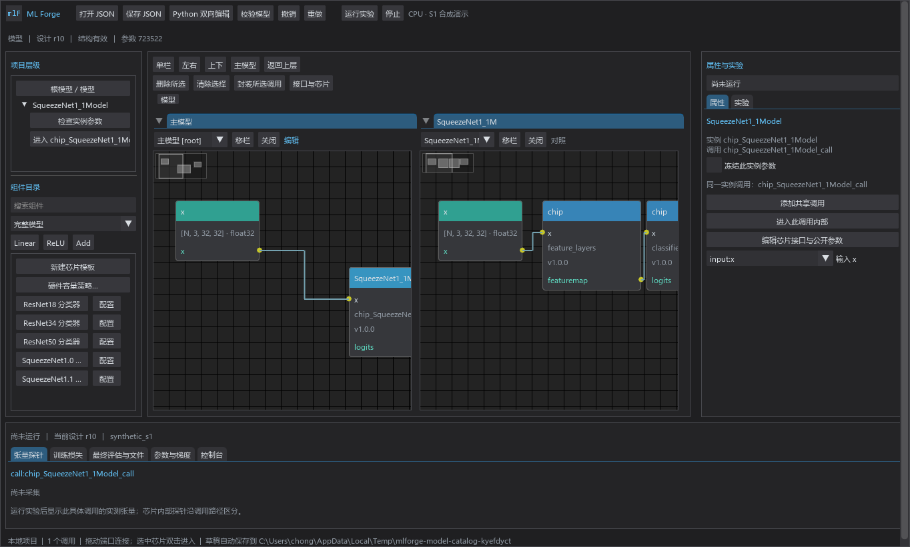
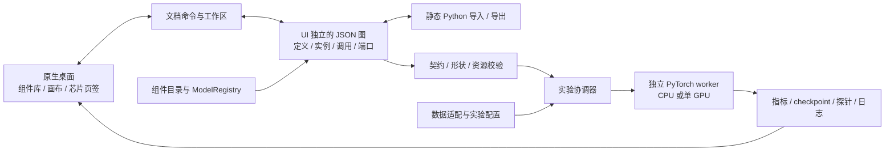

# ModelCircuit Studio · 模路

**像设计电路一样，构建与探索 AI。**

ModelCircuit Studio 是基于 [ML Forge](https://github.com/zaina-ml/ml_forge) 持续开发的原生可视化 AI 架构设计与实验工作台。它将算子、网络、融合模块与自定义模型组织成具有明确端口的组件，让研究者通过连接、展开、封装和测量来理解模型并开展实验。

**当前开发版本 `v0.7.0-alpha.1`。** S7 增加高位深灰度、DICOM、NIfTI 和视频分类输入，以及 FitNets 两阶段蒸馏。使用方法见 [S7 指南](studio/native/S7_RESEARCH_GUIDE.md)。S6 数值回归、SVM 与可视化编辑能力继续保留。

本仓库公开提供 ModelCircuit Studio 源码，欢迎通过 Issues 反馈、通过 fork 和 Pull Request 贡献。`main` 当前对应 S4 源码。S6 统一桌面版 `v0.6.0-alpha.2` 在[第 5 号 PR](https://github.com/ZZCHIHAO/modelcircuit/pull/5)及其依赖分支中接受审查。根目录 `pyproject.toml` 中的 `1.0.4` 是所保留的 ML Forge 上游包版本。

> **非商业用途声明**
>
> 本项目面向非商业科研、教学与个人学习。维护者倡议将本项目用于上述场景，避免用于商业产品、收费服务、付费部署或营利性生产。源码及第三方材料的使用权以各自许可证为准。[MIT License](LICENSE) 允许依其条款进行商业使用。详见[用途与许可说明](THIRD_PARTY_NOTICES.md#科研引用与使用范围)。



## 目录

- [产品定位](#产品定位)
- [当前能力与边界](#当前能力与边界)
- [组件与模型库](#组件与模型库)
- [从源码启动](#从源码启动)
- [完成一次分类实验](#完成一次分类实验)
- [芯片与 Python 扩展](#芯片与-python-扩展)
- [架构与源码导航](#架构与源码导航)
- [验证证据](#验证证据)
- [开发路线](#开发路线)
- [来源版权与协作](#来源版权与协作)

## 产品定位

面向需要理解、组合和修改模型结构的研究者、开发者及教学用户。平台借鉴电路设计工具的组件库、具名接口、层级封装和测量方式，把模型视作能够检查内部结构、追踪数据传递并复用的工程对象。

典型工作方式：

1. 从组件库拖出基础算子、成熟主干、分类器或融合芯片。
2. 通过具名输入输出连接组件，检查形状和接口契约。
3. 双击模块展开内部结构；把自己的结构封装成版本化芯片。
4. 配置数据、训练参数和设备，运行实验并查看真实测量。
5. 在受支持范围内导出独立 Python 模型，并重新导入继续编辑。

电路类比用于组织交互；自动求导、参数共享、训练阶段和任务评价仍按 AI 算法定义。长期方向见[项目计划书](docs/可视化AI架构设计与实验仿真平台项目计划书.md)，实际可用范围以本页和最新验收为准。

## 当前能力与边界

| 范围 | 当前已实现 | 主要边界 |
|---|---|---|
| 桌面设计 | 原生窗口、可搜索组件库、拖放、配置、具名端口、直角连线 | 当前主验证平台为 Windows；密集图布线与交互仍需持续优化 |
| 层级工作区 | 主图/芯片页签、单栏/左右/上下布局、层级定位、撤销/重做、v3 工作区恢复 | 不承诺精确恢复跨会话 pan/zoom；关闭页签不删除芯片 |
| 模型表达 | 多输入输出、分支/融合、嵌套芯片、独立实例、显式共享调用、参数冻结 | 只能使用已实现的算子、静态形状规则和执行语义；尚无任意动态图 |
| 真实数据实验 | 2D ImageFolder 单标签分类、CSV 数值 MLP 分类、2D 图片＋数值表格配对融合分类 | 不是分割、检测、回归、3D 或文本生成后端 |
| 训练与结果 | SGD / AdamW、训练/验证/测试、按验证损失选优、checkpoint、续训；checkpoint 可独立加载推理（代码接口） | 当前分类协议；尚无专门推理面板；CPU 续训有具体证据，不承诺所有设备位级复现 |
| 设备与容量 | CPU 或显式选择单张 `cuda:N`；执行前内存/显存检查 | float32；无多 GPU、AMP、量化或远程执行；预估不能保证避免 OOM |
| 探针 | 有限预算的张量/输出预览、梯度与参数变化摘要、来源和调用路径定位 | 不是交互式前向/反向/更新单步调试器；未采集数据明确标示 |
| 图与 Python | 支持限定语法的静态导入、独立模型代码导出、结构与共享关系往返 | 导出尚非完整实验工程；任意第三方 Python 不保证可导入或无损恢复 |
| 扩展 | 本地 JSON 芯片版本库、受信任的图工厂与可注入 ModelRegistry | 不自动执行任意 Python 插件；不附带预训练权重 |

**S5 已覆盖固定序列长度的 Encoder 和随机初始化的小型 ViT。** S7 支持三维体和视频分类。分割、检测、报告生成、LLM、RAG 和更多传统机器学习算法仍是后续工作。

### 源码与 EXE 的区别

S7 Windows 版使用同一个 EXE。双击 `studio/启动模路.cmd`，或打开 `studio/dist/s7/ModelCircuitStudio/ModelCircuitStudio.exe`。在「实验 → 设备」选择 `cpu` 或一张 `cuda:N`。工作区保存在 `%LOCALAPPDATA%\ModelCircuitStudio-S7`。移动时请保留整个应用目录。

## 组件与模型库

「全部库」按用途分组，也支持直接切换到某个库。入口支持点击添加、拖入画布和配置参数。

| 组件库 | 内置组件示例 |
| --- | --- |
| 基础组件库 | 全连接层（Linear）、二维卷积、激活层、归一化、池化、张量运算 |
| 深度学习模型库 | ResNet、VGG、SqueezeNet、Transformer Encoder、小型 ViT |
| 传统机器学习模型库 | 支持向量分类（SVC）、支持向量回归（SVR） |
| 网络结构与融合库 | 基础残差块、MLP 分类头、拼接投影、加权求和、门控融合 |
| 工程芯片与本地芯片 | 当前工程的定义，以及已存入本地库的组件 |

内置 SVC 和 SVR 对应数值 CSV 分类和回归，可在数据检查后创建已连线的起始图。传统机器学习实验使用 scikit-learn 在 CPU 上拟合一次。

| 模型族 | 可放置入口 | 说明 |
|---|---|---|
| ResNet18 / 34 / 50 | 每种主干＋标准分类器，共 6 项 | 可展开内部结构；主干输出分别为 512 / 512 / 2048 维 |
| VGG11 / 13 / 16 / 19 | 卷积特征＋GAP512 主干，共 4 项 | 标准非 BN 卷积特征，**不含原版大 FC 分类器**；可选特征图输出 |
| SqueezeNet1.0 / 1.1 | 每种主干＋标准分类器，共 4 项 | Fire 结构；分类头保留 Dropout、1×1 卷积、ReLU、GAP 和 Flatten |

这些入口采用图/芯片表达，支持内部查看与组合。当前全部默认随机初始化，不会自动下载或加载预训练权重。1 通道输入属于明确标识的结构变体。模型拓扑参考与对照范围见[第三方来源说明](THIRD_PARTY_NOTICES.md)。

`hardware-v5` 策略不设置固定参数量、单张量元素或累计执行元素天花板。静态编辑、校验和导出不要求本机能够装下模型；执行时才检查所选设备容量。批次契约与文件、节点、解析、递归预算仍需遵守，它们不等于模型参数上限。细节见[容量策略与模型指南](studio/native/S4_MODELS_WORKSPACE_GUIDE.md)。

## 从源码启动

### 环境要求

- Windows；当前历史验收使用 Python 3.12。
- 桌面依赖固定在 [requirements-desktop.txt](studio/requirements-desktop.txt)，PyTorch 为 `2.6.0`。
- CUDA 为可选项，需要兼容的 NVIDIA 显卡、驱动及 CUDA 版 PyTorch；CPU 版 PyTorch 无法使用 GPU。
- 原生桌面主入口不需要 Node.js、浏览器或本地 HTTP 服务。中文显示使用本机 Windows 字体，不随仓库分发系统字体。

在 PowerShell 中克隆公开仓库并进入 `modelcircuit`，再在项目根目录配置环境和运行源码。

```powershell
git clone https://github.com/ZZCHIHAO/modelcircuit.git
cd modelcircuit

py -3.12 -m venv studio/.venv
.\studio\.venv\Scripts\python.exe -m pip install --upgrade pip
.\studio\.venv\Scripts\python.exe -m pip install torch==2.6.0 --index-url https://download.pytorch.org/whl/cpu
.\studio\.venv\Scripts\python.exe -m pip install -r studio/requirements-desktop.txt
.\studio\.venv\Scripts\python.exe studio/desktop_entry.py --data-dir "$env:LOCALAPPDATA\MLForgeStudio-S4Preview-CPU"
```

依赖已准备好后，也可双击 `studio/启动S4源码预览.cmd`。脚本只使用已有环境，不会替新克隆的仓库安装依赖。

### 可选 CUDA 环境

将 CUDA 环境与 CPU 环境分开。下面按 [PyTorch 2.6.0 官方历史版本说明](https://pytorch.org/get-started/previous-versions/)提供 Windows CUDA 12.4 wheel 示例；执行前应确认驱动和硬件兼容性：

```powershell
py -3.12 -m venv studio/.venv-cuda
.\studio\.venv-cuda\Scripts\python.exe -m pip install --upgrade pip
.\studio\.venv-cuda\Scripts\python.exe -m pip install torch==2.6.0 --index-url https://download.pytorch.org/whl/cu124
.\studio\.venv-cuda\Scripts\python.exe -m pip install -r studio/requirements-desktop.txt
.\studio\.venv-cuda\Scripts\python.exe -c "import torch; print(torch.__version__); print(torch.cuda.is_available()); print(torch.cuda.device_count())"
.\studio\.venv-cuda\Scripts\python.exe studio/desktop_entry.py --data-dir "$env:LOCALAPPDATA\MLForgeStudio-S4Preview-CUDA"
```

也可使用 `studio/启动S4-CUDA源码预览.cmd`。在实验面板选择实际可用的 `cuda:0` 等设备；当前只能选择一张 GPU，不能设置并行使用几张 GPU。

**不要用根目录的 `pip install .` 或 `pip install zaina-ml-forge` 代替上述步骤。** 根目录 [pyproject.toml](pyproject.toml) 保留上游包及命令入口，只打包 `ml_forge/`，不安装当前 Studio。需要了解原项目时参阅[上游 README 归档](docs/upstream/README-ML-Forge-1.0.4.md)。

## 完成一次分类实验

1. **准备数据。** 选择 CSV 数值分类、2D ImageFolder，或图片＋表格配对分类，并在实验面板检查数据、类别、通道、尺寸和划分。具体格式见[桌面使用说明](studio/native/README.md)和[S3 配对输入协议](studio/S3_CONTRACT.md)。
2. **创建匹配的模型接口。** 可从检查过的数据创建起始模型；使用成熟模型时，保留数据输入和 `logits` 输出，替换中间网络调用。
3. **配置并连接模型。** 例如放置 ResNet18 分类器，使 `input_shape`、`num_classes` 与数据一致，连接“数据输入 → 分类器 x → logits”，然后校验。
4. **确认资源与设备。** 新放置的目录模型默认使用 `hardware-v5` 和批次上界 2；将实验 batch 显式设为 2，或在放置配置中先选择相应契约。遇到原工程策略不同的提示时，检查后确认采用。数据起始模型和旧工程可能保留历史策略；平台不会静默改变实验 batch。选择 CPU 或实际 CUDA 设备。
5. **运行并检查。** 观察训练/验证曲线、测试结果、checkpoint 和探针来源；错误信息可定位到已知调用或端口。32px / batch 1 等配置可能不满足 BatchNorm 的训练条件，应按模型与数据调整。
6. **保存实验。** 保存工作区 JSON，同时保留独立的运行产物。查看或导出 Python 模型后，可在支持范围内修改并重新导入。

默认启动的共享编码器示例用于理解编辑与执行；合成演示不能替代真实数据实验。模型能运行也不代表取得科研有效性或临床有效性。

数据路径、运行状态和本地芯片属于用户工作区。上述 CPU/CUDA 预览命令使用不同的 `%LOCALAPPDATA%` 子目录，避免混用旧便携版状态。默认入口的状态目录为 `%LOCALAPPDATA%\MLForgeStudio`；跨机器迁移数据路径后应重新检查数据，不能把历史摘要当作当前检查结果。

## 芯片与 Python 扩展

### 可复用的层级“芯片”

用已支持的算子或成熟模块搭建结构，声明具名输入输出、公开参数及内部绑定，再保存到版本化本地芯片库。芯片可嵌套、展开、复用，并在独立页签中编辑。

- 放置新芯片创建独立实例；“添加共享调用”才共享同一实例的参数。
- 修改定义影响引用该定义的实例；调用位置和权重实例分别管理。
- 本地 JSON 包保存架构闭包及策略，不携带权重，不执行相邻 Python 文件。
- 开发者可用返回 `ComponentBundle` 的纯图工厂与 `ModelSpec` 注册新组件，并向目录和 `NativeWorkbench` 注入扩展注册表。

该接口适合现有算子能表达的模型。增加注意力、3D 或新算法时，需要补齐配置、端口、形状、执行和代码转换规则，不能只注册一个名称。具体接口见[最新使用指南](studio/native/S4_MODELS_WORKSPACE_GUIDE.md)和[贡献指南](CONTRIBUTING.md)。

### 图与代码的三个层次

1. **平台生成代码往返：** 在支持的 profile 和语法内，恢复结构、接口及共享关系。
2. **约定结构内双向编辑：** 静态解析当前构造器和显式 `forward`，源码修改优先于旧 visual metadata；不通过旧图覆盖用户已改的代码。
3. **第三方任意 Python：** 不承诺导入，更不承诺无损还原动态控制流、外部调用和完整布局。当前导入器不执行待导入源码。

保留 metadata 可保留更多身份与布局信息；删除 metadata 后，支持的结构仍有往返验证，但不能恢复已经丢失的布局、版本和身份。导出的模型代码依赖 PyTorch，不依赖工作台；完整数据预处理、训练脚本、依赖锁定和实验工程打包尚待完成。

## 架构与源码导航



| 路径 | 用途 |
|---|---|
| `studio/native/` | 当前 Dear PyGui 桌面、层级画布、组件库、文档编辑与工作区 |
| `studio/backend/studio_core/` | 图契约、形状规则、算子执行、Python 桥、数据与分类实验 |
| `studio/backend/studio_core/model_registry.py` | 模型声明、工厂注册及扩展边界 |
| `studio/backend/studio_core/backbone_templates.py` | 成熟模型的可展开图工厂 |
| `studio/backend/server.py`、`worker.py` | 本地运行协调与独立执行进程；桌面不需启动 HTTP 服务 |
| `studio/backend/tests/`、`studio/native/tests/` | 核心回归、独立数值对照及桌面回调验证 |
| `studio/frontend/` | 保留的早期 React / Vite 网页实验版，覆盖与当前桌面不同 |
| `ml_forge/` | 保留的上游实现、资源和旧入口 |
| `docs/评审附件/` | 可携带的历史验收记录和来源哈希 |

原 `ml_forge/` 与 Studio 是不同入口，旧 `.mlf` 与 Studio 工作区 JSON 也不是相同格式；目前没有通用的一键迁移保证。上游保留不等于其所有代码都是当前执行链的一部分。

## 验证证据

S6 的完整测试、冻结 EXE 和独立指标核对见 [S6 验收记录](studio/native/S6_VERIFICATION.md)。

下列是 **2026-11-17 已记录的历史验收**，并非本次文档整理时重新训练或重跑后的结果：

| 项目 | 记录结果 |
|---|---|
| CPU backend 完整套件 | 319 项运行：318 通过、1 项因 Windows symlink 权限跳过 |
| CPU native 完整套件 | 253 项通过；合计 **571 通过、1 跳过** |
| CPU / 实际 `cuda:0` 微型对照 | 各 6 组，比较输出、输入/参数梯度、一步 SGD 和完整状态 |
| CPU ResNet18 短训练与续训 | 生成的 12 张 PNG；连续 2 轮与 1 轮后恢复的 122 项状态位级一致 |
| 协调器到独立 worker | CPU / `cuda:0` 各一次 ResNet50 两类短训练；23,512,130 参数，真实更新并保存产物 |

CUDA 微型对照固定初始化种子、关闭 TF32，并启用 cuDNN deterministic；这些验收设置不代表生产训练默认设置。上述证据不涵盖完整 CUDA 回归、GPU 位级续训复现、研究规模性能、临床有效性、多 GPU 或干净机器 EXE 验收。

可携带记录包含源码、截图及来源哈希；体积较大的本地原始日志与运行产物不随 Git 上传。历史记录中的 `output/` 和 `.superpowers/` 路径可能仅存在于原开发机器，不能把路径本身当作仓库内可直接打开的附件。

- [S4 模型与工作区验证说明](studio/native/S4_MODELS_WORKSPACE_VERIFICATION.md)
- [2026-11-17 可携带验收记录](docs/评审附件/2026-11-17-S4-多模型与硬件工作区验收记录.json)
- [S4 组件、端口与连线验证](studio/native/S4_COMPONENT_WORKBENCH_VERIFICATION.md)
- [历史 S3 验证说明](studio/native/S3_VERIFICATION.md)

本地回归命令及提交验证要求见 [CONTRIBUTING.md](CONTRIBUTING.md)。对功能改动应核对相应的结构、输出、梯度、共享和恢复行为，不能以截图或通过数量代替正确性判断。

2026-11-18 的[源码整理记录](docs/评审附件/2026-11-18-私库上传整理记录.json)保存了当时的许可证核对和源码哈希。

## 开发路线

以下是研发方向，**不是已经交付的功能或工期承诺**。各阶段需以可运行场景与代码/图一致性作为验收条件。

| 优先方向 | 待完成能力 | 代表性验收 |
|---|---|---|
| Transformer 模型扩展 | 预训练权重接入、更多模型族和序列任务 | 在保持 S5 固定长度计算图及代码往返兼容的前提下逐步扩展 |
| 仿真与测量 | 前向、反向、参数更新的交互单步；更完整的探针与性能采集 | 在同一快照定位梯度/更新，采集预算与来源明确，结果可复现 |
| 完整实验工程 | 数据、配置、训练/评估入口、自定义组件、依赖清单一并导出 | 在独立环境运行，并核对输出、共享关系与必要训练行为 |
| 任务后端 | 多标签、分割、检测、2D/3D 与更多传统 ML | 每种算法采用合适执行规则和指标，不强制套同一个 epoch 循环 |
| 医学领域适配 | 患者级划分、空间几何、联合变换、原始空间恢复与泄漏审计 | 数据、标注和预测空间一致；划分与评价协议可追溯 |
| 文本与多模态 | 报告生成、LLM 推理/微调、检索增强生成 | 任务适配、事实一致性、证据来源和生成评价协议齐备 |
| 执行与交付 | AMP / 多 GPU / 远程 worker、插件分发、干净机器验收 | 设备语义、失败恢复、资源边界和打包许可均有实际证据 |

主线是让模型组件、层级编辑、真实探针和图—代码转换形成可用闭环，再持续增加任务与后端。设计约束与历史决策可从[交接记录](studio/HANDOFF.md)和 [docs/superpowers/](docs/superpowers/) 继续追踪。

## 来源版权与协作

本项目直接基于 **[zaina-ml/ml_forge](https://github.com/zaina-ml/ml_forge)** 开发，感谢原作者提供可视化 PyTorch 编辑器、桌面实现、模板及配套资源。上游本地版本线索来自保留的 `pyproject.toml` 与 README，为 `1.0.4`。Studio 新增独立图核心、层级芯片、静态 Python 桥、真实数据实验协调与当前原生工作区；项目更名不改变来源和版权归属。

根目录 [LICENSE](LICENSE) 保留上游 MIT License 及原版权声明 **`Copyright (c) 2026 zaina-ml`**。项目新增及修改的源码和文档同样按 MIT 提供，另有明确许可的第三方内容适用其各自许可。复制或分发项目的全部或实质部分时，请保留原版权声明和 MIT 授权文本。

模型拓扑参考 PyTorch / Torchvision 官方实现。交互理念受到 **NI Multisim、Altium Designer、AMD Vivado** 的元件目录、层级设计和测量方式启发；这些商业产品不属于本仓库，不表示厂商授权或背书，其素材也不会因概念借鉴自动适用 MIT。完整来源、版本和依赖许可见 [THIRD_PARTY_NOTICES.md](THIRD_PARTY_NOTICES.md)。

贡献者通过 fork 提交 Pull Request，由仓库维护者审查和合并。科研成果请注明实际使用的版本或提交号。参见[贡献指南](CONTRIBUTING.md)和[软件引用](CITATION.cff)。

本仓库不附带研究数据、模型权重、运行 checkpoint、访问令牌或本地虚拟环境。医学影像是长期重点应用场景，当前软件不应作为临床诊断系统使用。
