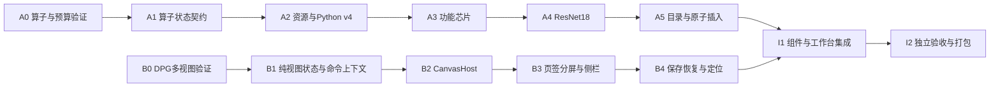

# S4 组件库与多页签层级工作台实施总计划

> **For agentic workers:** REQUIRED SUB-SKILL: Use superpowers:subagent-driven-development (recommended) or superpowers:executing-plans to implement this plan task-by-task. Steps use checkbox (`- [ ]`) syntax for tracking.

**Goal:** 在现有原生桌面版中，交付可检索的基础/功能/ResNet18组件库，以及共享工程的多页签、双分屏层级编辑。

**Architecture:** UI无关的算子与组件目录生成普通图及芯片定义；原生工作台用一个Document和多个独立CanvasView管理页签。新算子、BatchNorm状态、资源策略与受限Python往返一起验证；worker继续使用提交快照。

**Tech Stack:** 现有Python3.12、DearPyGui2.3.1、PyTorch2.6.0 CPU/cu124、标准库unittest与PyInstaller；不新增Web前端，不自动安装torchvision。

**Spec:** [S4设计规格](../specs/2026-11-15-s4-workbench-components-design.md)。先读规格，再执行子计划。

## Global Constraints

- 2026-11-15规划轮仅交付文档；2026-11-16用户已授权“推进下一步任务”，当前执行D0（A0+B0）及其回归/审查，不将整个S4标为已完成。D0不修改生产模型/UI核心、不安装依赖、不下载权重/数据、不启动独立科研训练、长训练或重打包；既有回归中的微型合成/CSV/PNG训练单独记录，不能证明S4新模型训练可用。
- 后续实施保持DearPyGui原生Windows EXE；原版 `ml_forge/` 业务源码保留；CPU/CUDA环境和便携包分离。
- 不使用Use Computer、OS或浏览器输入自动化；原生验收只用程序自己的DPG回调/framebuffer及CLI诊断。
- GitHub上传继续暂停；不创建远端、发布、添加协作者或自动化。
- 当前main无HEAD/identity，不能机械执行技能中的git commit/worktree步骤；实施前重新核实仓库状态，本轮不暂存、不提交。
- 每次模型命令原子提交；一个共享Document，统一语义undo；页签/分屏/选择不改模型身份。
- 新算子和模板均需校验、执行、受控Python及声明的恢复能力，目录按钮不构成验收。
- 精确pan/zoom恢复在公开API试验通过前不承诺。主模型/芯片页签、双分屏与稳定ID恢复为必交。
- 首批ResNet18为可展开随机初始化拓扑；ResNet34/50、预训练权重、3D/LLM/多GPU等不冒充本阶段能力。

## 1. 阅读与执行顺序

1. [设计规格](../specs/2026-11-15-s4-workbench-components-design.md)：需求、格式、语义、范围和调整门槛。
2. [S4-A组件库子计划](2026-11-15-s4a-component-library.md)：算子、预算/Python、融合芯片、ResNet18和目录命令。
3. [S4-B工作台子计划](2026-11-15-s4b-tabbed-workbench.md)：视图状态、CanvasHost、页签分屏、持久化和定位。
4. 本总计划：交叉集成、实际验收、交付与总路线。

两条子线能分别通过核心测试后再集成，不把整个大功能当作一次巨型修改。

2026-11-16执行结果：A0与B0的调查、定向测试及独立审查完成；B0限定双editor验证通过，A0发现“仅改batch上界”的候选计费在所声明ResNet18层级下仍超限，**D0的Go关口没有全部通过**。允许继续独立的A1算子/B1视图状态工作；A2新策略必须先处理预算口径，A4/正式主干接入仍受阻断。当前软件仍为S3，没有新EXE。证据入口：[D0验证与交接](../../../studio/native/S4_D0_VERIFICATION.md)。

同日第二次授权后：A1/B1限定源码交付完成，CPU完整backend运行219项（218通过、1权限跳过）、native108项通过；六新算子链在CPU/CUDA微型前向/梯度/一步更新/state_dict重放核对通过，独立交叉审查接受。见[基础核心验证](../../../studio/native/S4_FOUNDATION_VERIFICATION.md)。D1仍缺A2，D3仍缺B2，正式UI/EXE未更新。

2026-11-17授权推进后，A2与B2限定源码及各自独立修复复审通过，整体审查两P2已合并修复：最终CPU backend251项运行（250通过、1旧权限跳过）、native141项通过，退出0；CPU/cuda:0受控独立Python数值/梯度/更新/buffers/策略检查通过。D1核心契约和D3多视图核心已完成，整轮交叉复审及记录整理见[策略与画布验证](../../../studio/native/S4_POLICY_CANVAS_VERIFICATION.md)。下一未实施项A3与B3；没有交付ResNet18、完整目录/页签/持久化或S4 EXE。

同日继续推进A3/B3后，用户扩大本轮要求：基础元件库可像电路软件直接拖放、连接线平直转折、输入在左/输出在右且数量按实际接口。本轮提前交付A5/I1的17primitive+5功能芯片基础切片与当前工程芯片放置；工厂/目录核心/helper已通过限定独立审查，正式UI与连线整体验收进行中，见[组件工作台说明](../../../studio/native/S4_COMPONENT_WORKBENCH_VERIFICATION.md)。ResNet18、本地库自动索引、v3视图恢复及新EXE继续后续，不据目录条目推断全部S4完成。

## 2. 六个交付批次和工作依赖

| 批次 | 包含任务 | 可评审成果 | 退出关口 |
|---|---|---|---|
| D0 可行性 | A0、B0（调查已完成） | 预算算例、DPG公开能力/常驻上下文报告 | B0限定验证通过；A0候选计费未过，A2预算口径调整为必经关口；精确视口边界明确 |
| D1 核心契约 | A1、A2已完成 | 统一算子、BN状态、新资源及Python v4 | 数值/状态、旧黄金值、新策略/Python及范围复审通过 |
| D2 成熟组件 | A3已完成、A4待做 | 功能芯片及可展开ResNet18 | 五工厂参考/往返通过；生产ResNet18仍须A4完整独立验证 |
| D3 多视图核心 | B1、B2已完成 | WorkbenchState/ViewScope/CanvasHost | 纯状态、真实多画布、事件归属及范围复审通过；正式控件属D4 |
| D4 产品集成 | B3已完成；A5/I1基础切片已做；B4及完整目录待做 | 分类目录、页签、双分屏、保存恢复、跨页定位 | 17primitive+5工厂与工程芯片可拖放、页签/分屏通过；ResNet/本地索引/v3恢复仍是退出条件 |
| D5 交付验收 | I2 | 源码/CPU/CUDA EXE、指南、证据、便携包 | 真实小型任务及核心回归通过，包CRC/哈希/源码身份可核对 |



## 3. 文件归属和集成纪律

| 责任范围 | 独占新增文件 | 共享入口处理 |
|---|---|---|
| 核心/模型 | `operators.py`、`operator_rules.py`、`operator_runtime.py`、`component_catalog.py`、`module_templates.py`、`backbone_templates.py`及对应backend测试 | schema/runtime/python_io/experiment_spec由核心集成者修改，保持子计划接口一致 |
| 视图/交互 | `workbench_state.py`、`view_document.py`、`canvas_view.py`、`workbench_panel.py`及对应native测试 | document/workspace_state/ui/main必须按任务顺序集成；不能两人并改ui.py |
| 目录面板 | `catalog_panel.py`及native目录测试 | A5先交纯目录和Document.add_component；I1才接入焦点视图 |
| 独立审查/交付 | 新验收模块、指南、日志/包身份记录 | 不代替实现者验证数值，不从已有测试数推断新功能已通过 |

所有新路径是待创建文件。保留frontend作历史参考，不在本阶段改写或启动。既有S1/S2/S3归档不覆盖；未来新包另命名S4。

## 4. 集成任务 I1：从组件库到指定图页签

**Files:**
- Create: `studio/native/catalog_panel.py`、`studio/native/tests/test_catalog_panel.py`、`studio/native/tests/test_s4_integration.py`。
- Modify: `studio/native/ui.py`、`studio/native/chip_panel.py`、`studio/native/experiment_panel.py`。
- Consumes: `component_catalog`模块的函数接口、`Document.add_component`、`WorkbenchState`、`view_scope`、`CanvasHost`。
- Produces: `CatalogPanel.add_to_focused_view(component_id, config) -> str`；空工程到真实组件架构的原生操作路径。

- [ ] 写失败行为测试，约束焦点目标、错误回滚与目录可达性。测试核心如下，fixtures使用S4-A/B明确的初始化契约：

```python
def test_add_targets_focused_chip_not_last_rendered_root(self):
    import tempfile
    from native.document import Document
    from native.paths import resource_root
    from native.ui import NativeWorkbench
    with tempfile.TemporaryDirectory() as directory:
        ui = NativeWorkbench(Document(), None, directory, resource_root())
        try:
            ui.build()
            view_id = ui.workbench.open_definition('encoder_chip', ['encode_a'])
            ui.workbench.set_layout('columns')
            ui.workbench_panel.activate_view(view_id)
            before_root = len(ui.document.graph['calls'])
            ui.catalog_panel.add_to_focused_view('primitive.Add', {})
            definition = next(d for d in ui.document.graph['definitions'] if d['id'] == 'encoder_chip')
            self.assertEqual(len(ui.document.graph['calls']), before_root)
            self.assertEqual(definition['graph']['instances'][-1]['kind'], 'Add')
        finally:
            ui.shutdown()
```

- [ ] 运行定向测试确认因新接口不存在而失败；不能把无关导入/环境错误当作有效红灯。
- [ ] 将目录面板与项目树分成独立区域。搜索框固定；分类和结果独立滚动；组件配置弹窗只接受schema允许的字段，不执行输入表达式。若未获得有效图焦点，明确提示先选择目标页签。
- [ ] 添加“ResNet18主干/分类器”和功能芯片配置对话框；显示输入形状、特征/类别数、随机初始化、所需vision-v4及batch上界。需要改变工程策略时先展示具体变化，由用户明确应用；取消不改图。实验批次超过bound时明确提示用户修改，不暗中改变batch。无预训练占位开关。
- [ ] 组件添加命令通过view_scope进入目标scope；返回call_ref后仅更新该视图选择，其余视图同步结构而不夺取焦点。当前工程芯片与本地库均可通过目录添加，版本/冲突处理沿用库语义。
- [ ] 在原生回调测试中构造长项目树，分别搜索“相加”“融合”“ResNet18”和大小写英文，检查匹配项、添加回调、搜索区实际可见矩形；不能仅检查字符串存在。
- [ ] 运行backend/native所需回归，独立审查事件归属、参数身份和库导入原子性。记录通过证据，再更新D4状态。

命令（未来实施时运行，不代表本轮已执行）：

```powershell
$env:PYTHONPATH=(Resolve-Path '.\studio').Path+';'+(Resolve-Path '.\studio\backend').Path
& '.\studio\.venv\Scripts\python.exe' -m unittest discover -s studio/native/tests -p test_catalog_panel.py -v
& '.\studio\.venv\Scripts\python.exe' -m unittest discover -s studio/native/tests -p test_s4_integration.py -v
```

## 5. 集成任务 I2：数值、原生与冻结交付验收

**Files:**
- Create: `studio/native/s4_acceptance.py`、`studio/native/s4_render_acceptance.py`、相应 `test_s4_acceptance.py/test_s4_render.py`。
- Modify: `studio/native/main.py`、`studio/build-desktop.ps1`（仅需要的资源收集）、`studio/native/MLForgeStudio.spec`（仅新包资源）、指南及HANDOFF。
- Produces: `--s4-check REPORT`、`--s4-render-check REPORT`，接受已有 `--data-dir` 与 `--check-device cpu|cuda:N`。

- [ ] 写验收断言：报告必须包含status、device、frozen、fixture_notice、workers_stopped、组件/页签/共享/BN/budget/Python/checkpoint证据；退出码和报告缺一不能通过。
- [ ] 跑三组最少代表场景：
  1. 双输入特征→WeightedSum/GatedFusion→MLPHead；对照独立公式，改变alpha与gate参数确实影响输出/梯度。
  2. 标准ResNet18，224/batch2前向+有界训练单步，与独立手写网络装载同权重/buffers对照；小32输入再跑短训练/恢复。记录运行用时和内存为实测，不预置“快”或固定百分比。
  3. 小型配对CSV/PNG：ResNet18主干输出与数值支路经融合头接分类器；打开root/stage/block/融合芯片并分屏；train/val/test、保存重开、Python去metadata往返、检查调用探针归属。
- [ ] 检查旧S1/S2/S3 checkpoint和模型黄金值、线程/worker清理、取消、路径/分组/内容隔离、自动保存错误保护；本阶段新增不会减少既有检查。
- [ ] 由独立审查者确认“不同block未误共享权重”“同定义不同实例BN状态独立”“同实例多次调用buffers按实际次数变化”。
- [ ] 后续实施时分别运行CPU/CUDA backend与native完整测试。实际数目从输出记录，不写死预期测试总数；跳过项单列。两环境不共享同时会写同一路径的fixture。
- [ ] 构建两版EXE，再使用实际EXE运行s4运行/原生诊断；CUDA版另显式选择CPU。全部worker退出后才生成归档；保留旧归档。
- [ ] 生成S4运行/渲染报告、对照截图、源码哈希、EXE/ZIP身份及CRC；源码包排除环境、output和临时文件，逐项匹配当前源码。不在源码包内自包含自己的ZIP哈希。
- [ ] 更新能力表和使用指南，明确精确视口恢复实际等级、随机初始化、未采集探针、资源上限及后续能力；GitHub仍不上传。只有此时勾选D5。

未来命令示例：

```powershell
$env:PYTHONPATH=(Resolve-Path '.\studio').Path+';'+(Resolve-Path '.\studio\backend').Path
& '.\studio\.venv\Scripts\python.exe' -m unittest discover -s studio/backend/tests -v
& '.\studio\.venv\Scripts\python.exe' -m unittest discover -s studio/native/tests -v
& '.\studio\.venv-cuda\Scripts\python.exe' -m unittest discover -s studio/backend/tests -v
& '.\studio\.venv-cuda\Scripts\python.exe' -m unittest discover -s studio/native/tests -v
& '.\studio\build-desktop.ps1' -Runtime CPU
& '.\studio\build-desktop.ps1' -Runtime CUDA
```

窗口EXE诊断必须等待进程退出再检查报告，不能把PowerShell启动返回当作运行完成。自动化诊断使用程序内部回调/framebuffer，符合用户禁用电脑控制的要求。

## 6. 总体剩余路线和完成定义

此前7个大阶段遗漏了工作台和组件库的独立交付。修订为8个剩余里程碑，S4内部又有上述6批；它们不是8次对话或固定天数。

| 顺序 | 里程碑 | 完成标准 |
|---|---|---|
| 1 | S4 组件库＋多页签层级工作台 | 本规格D0–D5全部退出关口通过 |
| 2 | 可配置训练关系图 | 多loss/参数组与更新关系有统一语义，手写参考核对；同时建立任务/执行事件接口 |
| 3 | 仿真与单步探针 | 前向/反向/更新暂停继续，同一执行器，状态和采集开销可验证 |
| 4 | 完整实验工程导出与受控代码编辑 | 数据/划分/预处理/训练/环境/恢复可复现，离开平台运行；不承诺任意Python无损 |
| 5 | 任务与后端插件首版 | 传统ML拟合、非epoch任务及另一数据任务不改核心，接口由真实第二任务检验 |
| 6 | 医学2D/3D与分割/检测 | 患者划分、几何/标签变换、原空间恢复及任务评估真实验收 |
| 7 | 文本、多模态、报告与大模型 | 生成/检索证据、评价、模型推理/微调协议和声明资源下实训分别验收 |
| 8 | 规模化与发行完善 | 多GPU/远程、参数扫描/实验比较、跨机器安装与恢复通过；发行可靠性贯穿前面阶段 |

阶段6/7在插件契约稳定后可分别推进。组件目录继续逐批扩展，不把“支持插件”当作所有音视频/时序/算法已经实现。当前S3可用与长期平台完成是两个不同判断。

## 7. 本计划完成检查

- [x] 已重新核对当前源码接缝及历史边界。
- [x] 已给出统一规格、两个独立子计划、交叉接口、文件归属和迁移策略。
- [x] 已将ResNet预算、BN buffers、精确视口公开API缺口列为前置关口。
- [x] 已给出行为/数值/原生/冻结验收和失败调整条件。
- [x] 已完成核心/工作台只读复核并修订BN条件状态、旧档batch兼容、调用事件失效、选择恢复及v3异常保存等边界。
- [x] D0限定调查、诊断代码、回归及审查完成（2026-11-16），预算Go仍未通过，见执行追记。
- [x] A1算子核心与B1纯状态/上下文完成源码、测试和交叉审查（2026-11-16）。
- [x] A2新资源/Python及B2常驻画布完成源码、完整回归与范围复审（2026-11-17）。
- [x] A3五工厂及B3页签/独立侧栏完成限定源实现、回归与各线审查；用户追加基础目录/拖放/直角线切片已接入（2026-11-17），整轮交叉结论见最新验证记录。
- [x] 后续A4扩展为14模型/H1硬件策略，A5/I1本地与原生注册接线、B4工作区v3完成源码和分任务审查，详见2026-11-17补充计划及新SDD账本；完整回归319/253通过。
- [ ] I2新EXE/便携包仍未执行；本轮源码已通过整轮交叉审查并关闭，不从旧EXE或源码接受推断完整S4发行完成。

原实施顺序为D0后并行A/B线，再依次修改共享入口。2026-11-17已完成D0、A1/A2/A3、B1/B2/B3及基础目录/拖放/直角线切片；后续直接从A4和B4、剩余A5/I1集成恢复，不重做已完成任务。整轮是否关闭及最终证据以最新验证和SDD账本为准。

本轮文档检查与业务源码未变化记录：[S4规划核查记录](../../评审附件/2026-11-15-S4规划核查记录.json)。此记录只证明规划交付及边界核对，不证明S4软件已通过测试。
