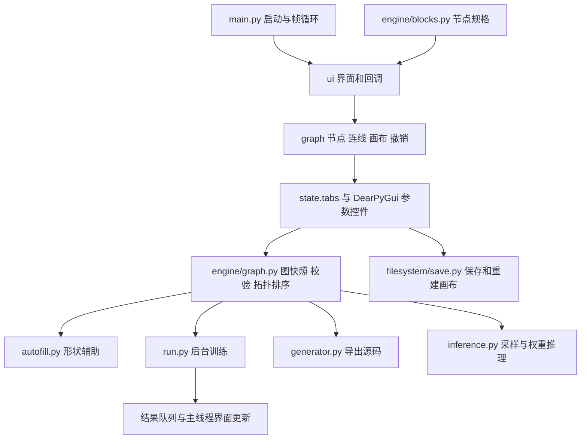

# ML Forge 使用与二次开发指南

核查日期：2026-11-13。适用范围：当前文件夹中的 **ML Forge 1.0.4 源码快照**，不代表上游最新版本。

本文根据 README、打包配置、33 个 Python 文件和两个内置模板整理。区分了源码已实现的行为、静态发现的问题及建议开发的功能。安装命令、界面训练和新增节点示例尚未在完整依赖环境中实测；具体核查结果见第 13 节。

## 1. 项目是什么，适合拿来做什么

ML Forge 是一个使用 **DearPyGui + PyTorch** 的桌面图像分类流水线编辑器。用户在三个画布中配置数据、模型、损失函数与优化器，然后在界面中训练，或者导出 Python 训练脚本。

它适合用于理解 PyTorch 流程、搭建简单 MLP/CNN、做小型图像分类原型，以及作为自建可视化训练工具的起点。

| 能力 | 当前实际范围 |
|---|---|
| 可视化编辑 | 三个角色画布、节点参数、连线、撤销/重做、搜索节点 |
| 数据 | MNIST、FashionMNIST、CIFAR10、CIFAR100、ImageFolder |
| 模型 | Linear、卷积、激活、归一化、池化等组成的顺序模型 |
| 训练 | 后台线程、CUDA/MPS/CPU、CUDA AMP、loss/验证准确率、权重保存 |
| 推理 | 从当前配置的数据集抽一张样本，显示分类 Top-k |
| 项目文件 | `.mlf` JSON，保存画布、节点、参数和连线 |
| 导出 | 独立 PyTorch `.py` 脚本，但与 GUI 的设置和权重格式存在差异 |
| 复杂网络 | 暂无真正的分支、残差、Concat、多输入执行语义 |
| 其他任务 | 没有完整的检测、分割、文本、表格、回归、多标签工作流 |
| 实验管理 | 暂无完整配置持久化、实验历史、断点恢复、独立测试报告 |

**判断：适合作为可视化教学与原型工具，也值得二次开发；正式科研实验应先补齐配置、评估与可复现性。** 界面有 MSE/BCE 等 loss 节点，并不代表对应任务已经端到端支持：验证仍按分类 `argmax` 统计，推理仍按 softmax/Top-k 显示。

源码依据：`ml_forge/main.py:90`、`ml_forge/engine/blocks.py:8`、`ml_forge/engine/run.py:37`、`ml_forge/engine/run.py:466`、`ml_forge/engine/inference.py:332`。

## 2. 安装与启动：Windows 源码开发方式

### 2.1 环境要求

- **Python 3.11 或以上**。README 写 3.10+，但 `pyproject.toml` 实际声明 `>=3.11`，安装时以它为准。可先用 Python 3.11 建立独立环境。
- 界面依赖：`dearpygui>=1.11.0`、`Pillow>=9.0.0`。
- 训练依赖：PyTorch 和 torchvision。普通安装不自动安装它们；`training` extras 才包含它们。
- 需要可以显示桌面窗口的环境。程序通过 DearPyGui 创建窗口，没有 Web 服务启动入口。

本次检查中，当前 PowerShell 找不到 `python`，`py --list-paths` 也未列出已注册的 Python。以下命令需要先安装开发用 Python；本次没有修改系统 Python 或安装项目依赖。

### 2.2 推荐先用 CPU 跑通

在 PowerShell 中逐行执行。这里直接调用虚拟环境解释器，无须激活脚本。

```powershell
Set-Location '.'

py -3.11 -m venv .venv
.\.venv\Scripts\python.exe -m pip install --upgrade pip

# 首次跑通使用 CPU 版 PyTorch
.\.venv\Scripts\python.exe -m pip install torch torchvision --index-url https://download.pytorch.org/whl/cpu

# editable 安装：修改此目录的源码后，重启程序即可使用改动
.\.venv\Scripts\python.exe -m pip install -e .

# 启动桌面应用
.\.venv\Scripts\python.exe -m ml_forge
```

如果 `py -3.11` 找不到解释器，先安装 Python 3.11，或把该行替换为机器上已安装的合适 Python 版本。

### 2.3 NVIDIA GPU 方式

先在 PyTorch 官方安装选择器中选择 Windows、Pip 和适合机器的计算平台，用其生成的命令替换上面的 CPU 安装行。随后执行 editable 安装及启动命令。

官方安装入口：`https://pytorch.org/get-started/locally/`。本文不固定 CUDA wheel 版本，也不把本地项目版本称为 PyTorch 的最新兼容组合。

安装后检查解释器与设备：

```powershell
.\.venv\Scripts\python.exe -c "import sys, torch, torchvision, dearpygui.dearpygui; print(sys.executable); print('torch:', torch.__version__); print('torchvision:', torchvision.__version__); print('CUDA:', torch.cuda.is_available())"
```

训练设备选 `auto` 时，源码依次尝试 **CUDA → MPS → CPU**。手动选 `cuda` 不会替你修复缺失的 CUDA 环境。AMP 在本项目中只对 CUDA 生效。

### 2.4 其他安装方式

如果不需要指定 CPU/CUDA wheel，可使用配置声明的训练 extras：

```powershell
.\.venv\Scripts\python.exe -m pip install -e '.[training]'
```

仅使用已发布包时，README 的入口是：

```powershell
python -m pip install zaina-ml-forge
ml-forge
```

上面未指定版本的发布包不一定与本地 1.0.4 相同；二次开发优先使用源码 editable 安装。默认包仍需另装 torch/torchvision。

源码依据：`pyproject.toml:5`、`pyproject.toml:22`、`pyproject.toml:36`、`ml_forge/__main__.py:1`、`ml_forge/engine/run.py:24`。

## 3. 第一次使用：先跑 MNIST 模板

### 3.1 认识界面

- 左侧 **Blocks**：搜索并点击节点按钮，把节点加入当前画布。
- 中间：**Data Prep / Model / Training** 三个画布。
- 右侧：**Training Config**、模型摘要、loss/accuracy 曲线。
- 底部：**Console**，查看校验、下载、训练与报错日志。
- 顶部：**RUN / PAUSE / STOP / METRICS** 及菜单。

刚启动时曲线中有演示数据，不能据此认为已经运行过训练。运行后再结合 Console、epoch 和实际输出文件判断。

### 3.2 加载并保存模板

1. 选择 **File → Templates → MNIST Classifier**。
2. 选择 **File → Save As...**，保存为自己的文件，例如 `experiments/mnist/run01.mlf`。保存位置的父目录需已存在。
3. **必须先保存，再训练。** 模板加载会清空当前保存路径，直接点 RUN 会提示先保存。

加载模板或 Open 会替换当前画布内容，切换前先保存当前工作。

### 3.3 检查三个画布

Data Prep 模板已经有两条链：

```text
MNIST(train=True, root=./data, download=True)
  → ToTensor → DataLoader (train)

MNIST(train=False, root=./data, download=True)
  → ToTensor → DataLoader (val)
```

两条链的 batch size 都是 64。**Windows 第一次运行建议把两个 DataLoader 的 `num_workers` 从模板的 `2` 改为 `0`**，先减少多进程加载的排查变量；跑通后再按需要调大。

Model 模板为：

```text
Input(shape=1, 28, 28)
  → Flatten
  → Linear(in_features=784, out_features=256)
  → ReLU
  → Linear(in_features=256, out_features=10)
  → Output(shape=10)
```

Training 模板已有四个节点及四条配置连线：

```text
DataLoaderBlock.images → ModelBlock.images
ModelBlock.predictions → CrossEntropyLoss.pred
DataLoaderBlock.labels → CrossEntropyLoss.target
CrossEntropyLoss.loss  → Adam.params
```

这里最后一条线表达训练配置关系。实际训练仍是把 `model.parameters()` 交给 Adam，然后计算 loss、反向传播、更新参数。

### 3.4 配置并运行

第一次可用以下设置验证流程，数值是上手建议，不是性能保证：

| 位置 | 建议设置 |
|---|---|
| 右侧 Epochs | `1`，跑通后再调到 3～5 或更长 |
| Device | `cpu` 或 `auto` |
| AMP | 关闭 |
| Early Stopping → Enable | 保持关闭，当前实现有逻辑问题，见第 12 节 |
| Save Dir | `./checkpoints_run01`，为各实验分开目录 |
| Save Best Only | 开启 |
| Monitor | `val_loss` |
| Adam 节点 lr | `0.001` |

按 `Ctrl+S` 保存节点修改，然后点 **RUN**。首次运行内置数据集可能需要下载。

观察 Console 是否出现设备、数据加载器、epoch 和 checkpoint 信息。红色校验错误会阻止训练；黄色警告允许继续，但仍应检查。

训练正常结束后，到保存 `.mlf` 的目录下找 `checkpoints_run01/best.pth` 和 `final.pth`。点击 **METRICS** 查看本次汇总。

**PAUSE** 在 epoch 边界生效，不保证立即冻结当前 batch；暂停后点 RUN 可以继续当前进程中的训练。**STOP 不保证保存一份最终权重**。程序没有从 `.pth` 恢复中断训练的入口。

源码依据：`ml_forge/ui/menubar.py:24`、`ml_forge/ui/menubar.py:95`、`ml_forge/ui/training.py:149`、`ml_forge/templates/mnist_classifier.mlf:8`、`ml_forge/ui/layout.py:26`、`ml_forge/engine/run.py:421`。

## 4. 不用模板时，三个画布分别怎么搭

### 4.1 Data Prep：定义输入和标签来源

基本顺序是：**Dataset → 图像操作 → ToTensor → Normalize → DataLoader**。

- Dataset 的 `root` 是数据路径，`train`/`download` 填 `True` 或 `False`。
- Resize/Crop 等先统一图像大小；ToTensor 把图像转换为训练需要的 tensor。
- Normalize、RandomErasing 放在 ToTensor 后。
- 有其他 transform 时，训练器不会自动替你插入 ToTensor；显式加入最清楚。
- `batch_size` 调整每批样本数；初次调试 `num_workers=0`。
- MNIST/FashionMNIST 是单通道；若加 Normalize，明确填 `mean=[0.5]`、`std=[0.5]`。裸 `0.5` 在当前 GUI 实现中会扩展成三通道值。
- RGB 图像的 Normalize 可先使用三个元素的列表，例如 `mean=[0.5, 0.5, 0.5]`、`std=[0.5, 0.5, 0.5]`；正式任务再根据数据确定预处理。

### 4.2 Model：定义顺序网络

- Input 的 shape 写不含 batch 的维度，例如 `3, 224, 224`。
- Conv2D 的输入通道应与上游输出通道一致。
- 从卷积特征接 Linear 前，一般先 Flatten；自动填充只是辅助，修改尺寸后仍需核对。
- 最后一个 Linear 的 `out_features` 必须等于类别数 K。
- Output 的 `shape=K` 是图中的标记，不会自动替你创建分类层。
- 当前分类训练可沿用模板的“最后 Linear → Output + CrossEntropyLoss”组合。

保持一条明确的串行链。模型图中的所有非 Input/Output 层会按拓扑顺序进入 `nn.Sequential`；不要留下不使用的游离层，也不要把画出的分支当成已经支持残差网络。

### 4.3 Training：连接训练要素

需要 DataLoaderBlock、ModelBlock、一个 loss、一个 optimizer。连线按第 3 节。

常规多分类先使用模板的 CrossEntropyLoss + Adam。虽然可以放多个 loss/optimizer，当前执行代码只选择首个匹配节点，不支持多损失联合优化。

训练/验证链共用当前 Model，不需要在 Training 再复制一套具体卷积层。

源码依据：`ml_forge/engine/run.py:142`、`ml_forge/engine/run.py:164`、`ml_forge/engine/run.py:314`、`ml_forge/engine/generator.py:22`、`ml_forge/engine/graph.py:306`。

### 4.4 画布操作与快捷键

先选目标画布，再点击左侧节点按钮；从输出引脚拖到输入引脚连接。工具栏提示支持鼠标中键平移、拖动框选、Ctrl+Click 连线删除；鼠标交互本次未做 GUI 实测。

| 快捷键 | 功能 |
|---|---|
| `Del` / `Ctrl+Backspace` | 删除选中节点 |
| `Ctrl+S` | 保存项目 |
| `Ctrl+Z` | 撤销 |
| `Ctrl+Y` | 重做 |

源码只检测左侧 Ctrl，没有实现 Cmd 映射。初学时保留三个默认角色画布即可；使用 Graph → New Tab 新建画布时，还需通过 Assign Role 指定用途。同一角色有多个画布时，引擎取首个。

源码依据：`ml_forge/shortcuts.py:9`、`ml_forge/ui/toolbar.py:36`、`ml_forge/engine/graph.py:99`。

## 5. 使用自己的图片：ImageFolder 示例

### 5.1 目录组织

下面以两类图片为例。类别名可换成自己的名称，但 train/val 应保留相同的类别目录集合与含义。

```text
my_dataset/
├── train/
│   ├── class_a/
│   │   ├── a001.jpg
│   │   └── a002.jpg
│   └── class_b/
│       └── b001.jpg
└── val/
    ├── class_a/
    │   └── a101.jpg
    └── class_b/
        └── b101.jpg
```

两条 ImageFolder 分别指向 **train** 和 **val**，不要都指向 `my_dataset`，也不要都指向同一目录。程序不会帮你判断样本重叠或标签映射是否一致。

建议路径填写 `D:/datasets/my_dataset/train` 这样的绝对路径；使用 `/` 也能减少导出成 Python 字符串时的反斜杠问题。

### 5.2 两条数据链

```text
ImageFolder(root=D:/datasets/my_dataset/train)
  → Resize(size=256) → CenterCrop(size=224)
  → ToTensor
  → Normalize(mean=[0.5,0.5,0.5], std=[0.5,0.5,0.5])
  → DataLoader (train)

ImageFolder(root=D:/datasets/my_dataset/val)
  → Resize(size=256) → CenterCrop(size=224)
  → ToTensor
  → Normalize(mean=[0.5,0.5,0.5], std=[0.5,0.5,0.5])
  → DataLoader (val)
```

先使用确定性的预处理把流程跑通，再只在训练链增加合适的随机增强。上面的参数是示例，不是针对具体数据集调优后的配置。

**ImageFolder 不会因为界面显示默认 shape=3×224×224 就自动把图片变为该大小。** 本例通过 Resize + CenterCrop 明确统一尺寸。当前自动填充也不会完整追踪 Data Prep 中的尺寸/通道变化；Model 的 Input 需手动确认。

### 5.3 一个可作为起点的小型分类模型

```text
Input(shape=3, 224, 224)
  → Conv2D(in_channels=3, out_channels=16, kernel_size=3, stride=1, padding=1)
  → ReLU
  → MaxPool2D(kernel_size=2, stride=2, padding=0)
  → Conv2D(in_channels=16, out_channels=32, kernel_size=3, stride=1, padding=1)
  → ReLU
  → AdaptiveAvgPool2D(output_size=1)
  → Flatten
  → Linear(in_features=32, out_features=2)
  → Output(shape=2)
```

有 K 类时，将最后的 `2` 都换成 K。ImageFolder 的类别数不会在当前固定数据集形状表中被可靠地自动推断，须手动设置。

使用第 3 节的 Training 配置，两个 loader 可先设 `batch_size=16`、`num_workers=0`。训练前另存一个新 `.mlf`，并设置独立 checkpoint 目录。

源码依据：`ml_forge/engine/run.py:195`、`ml_forge/engine/run.py:239`、`ml_forge/engine/autofill.py:19`、`ml_forge/engine/autofill.py:209`。

## 6. 数据划分、路径和实验解释

### 6.1 单链与双链行为不同

| 配置 | GUI 的实际行为 |
|---|---|
| 只有 DataLoader (train)，Val Split > 0 | 用 `random_split` 分成训练/验证子集 |
| 只有 DataLoader (train)，Val Split = 0 | 不创建验证集 |
| 同时有 DataLoader (train)/(val) | 分别读取两条祖先链，忽略右侧 Val Split |

单链随机划分的两个 Subset 共用同一 dataset/transform。因此，若链里有随机增强，验证时也会用到。需要独立验证预处理时，使用双链更明确。

MNIST/CIFAR10 内置模板把 `train=False` 的官方测试划分用作界面验证集。这适合演示；正式实验应另外定义训练、调参验证、最终测试数据，不能把已经参与模型选择的验证结果再当独立测试结果。

若用于医学图像，还需按患者/检查等独立单位划分，不能依靠当前逐图片 random_split 保证无泄漏。这属于任务数据划分需要额外实现的规则。

### 6.2 两类相对路径使用不同基准

| 参数 | 相对路径基准 |
|---|---|
| Dataset.root=`./data` | 启动 Python 时的当前工作目录 |
| Checkpoint Save Dir=`./checkpoints` | 已保存 `.mlf` 所在目录 |
| 导出脚本的 `model.pth` | 运行该脚本时的当前工作目录 |

例如从项目根目录启动，项目保存为 `D:/experiments/run01/model.mlf`：数据 `./data` 仍在源码根目录下，而 GUI 权重默认写到 `D:/experiments/run01/checkpoints/`。

### 6.3 Seed 和 Shuffle 的现有限制

右侧 Seed 当前仅用于随机切分，不会完整设置模型初始化、数据增强及采样等随机状态，不能只凭 Seed=42 声称实验完全可复现。

GUI 实际从右侧配置读训练 Shuffle，忽略 DataLoader 节点的 shuffle 字段；但存在 val loader 时右侧 Shuffle 又被禁用。初次模板运行通常沿用默认 True。导出脚本却读取节点 shuffle，两种运行方式可能不同。

源码依据：`ml_forge/engine/run.py:263`、`ml_forge/engine/run.py:278`、`ml_forge/ui/training.py:122`、`ml_forge/ui/training.py:285`、`ml_forge/engine/generator.py:290`。

## 7. 保存的文件分别是什么

| 文件 | 内容 | 没有包含的内容 |
|---|---|---|
| `.mlf` | JSON；画布角色、节点类型/参数/位置、连线 | 数据、权重、训练曲线、右侧训练配置 |
| GUI 的 `best.pth` | 最优监控值对应的模型 `state_dict` | 模型定义、optimizer、epoch、随机状态 |
| GUI 的 `epoch_0005.pth` 等 | 指定间隔的模型 `state_dict` | 同上 |
| GUI 的 `final.pth` | 正常完成或 early stop 后的最后权重 | 不保证是最佳权重；STOP 时不保证生成 |
| 导出的 `.py` | 可编辑的模型、数据、训练源码 | 数据本体、已训练权重 |
| 导出脚本的 `model.pth` | 导出 Model 类训练后的 `state_dict` | 与 GUI 数字键权重不直接兼容 |

Save Best Only 开启时，改善则保存/覆盖 `best.pth`，Save Every 不生效；关闭时，按 Save Every 写 `epoch_*.pth`，不写 best。正常结束仍另存 final。

**右侧 Epochs、Device、Seed、AMP、checkpoint 和 early stopping 配置不写入 `.mlf`。** 新开程序后即使加载了项目，也要重新核对。节点参数，例如 Adam 的 lr、DataLoader 的 batch size，则会保存在项目中。

同一个 checkpoint 目录反复训练会覆盖同名文件。建议每次实验使用独立目录，并另记环境、数据划分和右侧配置。

源码依据：`ml_forge/filesystem/save.py:17`、`ml_forge/filesystem/save.py:52`、`ml_forge/engine/run.py:482`、`ml_forge/engine/run.py:527`。

## 8. 推理与导出怎么用

### 8.1 GUI 推理

1. 打开与权重相匹配的 `.mlf`，保持 Model 结构/顺序及预处理一致。
2. 选择顶层菜单 **Run → Inference...**。
3. Browse 选择 GUI 训练保存的 `best.pth` 或 `final.pth`。
4. 抽样并运行推理，查看类别索引、Top-k 概率及该样本是否预测正确。

当前推理是**从已配置的数据集抽样**，没有任意图片文件导入界面，也没有整套测试集评估入口。优先使用 val 链；无 val 链时，内置数据集改用 `train=False`，不是训练时 random_split 得到的那个验证 Subset。ImageFolder 则仍按配置 root 读取。

推理只重建部分预处理：保留 ToTensor、Resize、CenterCrop、Normalize、Grayscale，将 RandomCrop 换成 CenterCrop；其余变换（包括 GaussianBlur）会被忽略。使用特殊预处理时，需要核对并扩展推理实现，不能假定其完整复用了训练链。

推理会用当前图重新构造 `nn.Sequential` 再加载权重。如果训练后修改网络，旧权重可能加载失败。推理设备总是 auto，不读取右侧训练 Device。

### 8.2 导出 Python

选择 **File → Export → Python → PyTorch**，保存为 `train.py`。导出后用编辑器打开，检查设置，再运行：

```powershell
.\.venv\Scripts\python.exe -m py_compile 'D:/experiments/run01/train.py'
.\.venv\Scripts\python.exe 'D:/experiments/run01/train.py'
```

第一行只检查语法；第二行才真正训练。导出脚本不依赖 ML Forge，但仍需要 torch、torchvision 及数据。

| 项目 | GUI 训练 | 导出脚本 |
|---|---|---|
| Epochs | 右侧配置 | 固定 `EPOCHS = 20`，需手改 |
| 设备 | auto/cuda/cpu/mps | 自动 CUDA 或 CPU |
| 单链验证划分 | 使用右侧 Val Split/Seed | 常规单链导出不生成这个划分 |
| AMP/早停/最佳权重 | 有对应运行逻辑，早停有已知问题 | 没有这些对应逻辑 |
| 保存 | `.mlf` 附近的配置目录 | 当前工作目录 `model.pth` |
| 模型键名 | Sequential 数字键 | Model 的具名属性键 |

因此，**导出是可继续修改的代码起点，不是 GUI 运行的完整复现**。导出训练得到的 `model.pth` 不能直接拿回 GUI 推理加载；应在导出 Model 类中使用，或专门转换键名。

目前还要检查 Grayscale 导出缺失、GaussianBlur sigma 元组和 Windows 路径转义，详见第 12 节。

源码依据：`ml_forge/engine/inference.py:142`、`ml_forge/engine/inference.py:303`、`ml_forge/engine/generator.py:413`、`ml_forge/engine/generator.py:454`、`ml_forge/engine/generator.py:551`。

## 9. 源码架构：从哪里开始读



| 文件/目录 | 作用 | 二次开发常见入口 |
|---|---|---|
| `main.py` / `__main__.py` | 创建窗口、初始化画布、运行帧循环 | 启动流程、定时刷新 |
| `state.py` | 模块级共享状态 | 当前文件、训练状态、画布数据 |
| `constants.py` | 布局、颜色、日志、撤销长度 | 界面尺寸和外观 |
| `ui/` | 面板、菜单、配置、曲线与训练按钮 | 增加配置或交互 |
| `graph/` | 节点、边、画布、角色、undo/redo | 图编辑行为 |
| `engine/blocks.py` | `SECTIONS` 节点主注册表 | 新增节点、参数、端口 |
| `engine/graph.py` | 读取 GUI 参数为 GraphNode，校验和拓扑排序 | 图结构约束 |
| `engine/autofill.py` | 形状模拟、输入维度和参数辅助填充 | 新层形状推导 |
| `engine/generator.py` | 模块映射和 Python 代码生成 | 导出、层/loss/optimizer 的构造映射 |
| `engine/run.py` | 构造模型和数据、训练线程、checkpoint | 训练能力和正确性 |
| `engine/inference.py` | 推理采样、变换、加载权重、Top-k | 文件推理或整集评估 |
| `engine/metrics.py` | 读取内存曲线和汇总 | 评估报告 |
| `engine/training_setup.py` | 建立 Training 中的桥接节点 | ModelBlock/DataLoaderBlock |
| `filesystem/save.py` | `.mlf` 序列化和恢复 | 保存训练配置、版本迁移 |
| `templates/` | 两个 `.mlf` 内置模板 | 预置教学/业务场景 |
| `docs/ml_forge/` | 静态介绍页面 | 宣传/文档页面，不是 Python 桌面程序实现 |

当前 GraphNode 是从实时 DearPyGui 控件读取的快照，还不是与界面彻底解耦的领域模型。模型运行复用 generator 的层映射，但 dataset/transform 在训练、推理、导出中有多份实现，这是扩展时最容易遗漏的位置。

推荐阅读顺序：`blocks.py → graph/nodes.py → engine/graph.py → generator.py → run.py → filesystem/save.py`。

## 10. 二次开发：先做一个最小的 SiLU 节点

这是改动说明，**本文没有把这些功能修改应用到源码**。GELU 和 LeakyReLU 已经存在，SiLU 才是当前未注册的示例。

### 10.1 注册节点

在 `ml_forge/engine/blocks.py` 的 `SECTIONS["Model Creation"]["Activations"]` 列表中追加：

```python
{
    "label": "SiLU",
    "color": (255, 180, 80),
    "params": [],
    "inputs": ["x"],
    "outputs": ["out"],
    "defaults": {},
    "tooltip": "PyTorch SiLU activation",
    "when_to_use": "Use as a shape-preserving activation layer.",
},
```

`params` 会生成文本输入框，参数值保存为字符串；`inputs`/`outputs` 是端口名称。palette 自动读取 SECTIONS，不需另写按钮。

### 10.2 补构造/导出映射

在 `ml_forge/engine/generator.py` 的 `_LAYER_MAP` 中追加：

```python
"SiLU": ("nn.SiLU", ""),
```

第二项为空字符串，表示构造 `nn.SiLU()`。运行模型直接复用这张表，GUI 推理又复用运行模型构造器，因此这个普通 PyTorch 激活不需单独改训练或推理代码。

### 10.3 明确形状语义

建议把 `"SiLU"` 加入 `autofill.py` 中 ReLU/GELU 等“输入输出形状相同”的名单。当前未知层也默认透传上游 shape，所以这步是显式维护语义，不是该无参数激活能够运行的硬性条件。

### 10.4 验证这个扩展

1. 重启 editable 安装的应用，确认左侧出现 SiLU。
2. 用 MNIST 模板，把 ReLU 替换为 SiLU，核对连线，另存项目。
3. CPU、1 epoch、num_workers=0 跑通；确认输出权重能在同一项目结构中推理。
4. 保存并重新打开 `.mlf`，确认 SiLU 保留。
5. 导出源码，确认出现 `nn.SiLU()`；做语法检查并运行一个短训练。

这条路径适用于多数普通 `torch.nn` 单输入顺序层。对有形状变换、可训练参数或特殊 forward 返回值的层，还须补形状推导、参数映射、摘要及调用协议。

源码依据：`ml_forge/engine/blocks.py:8`、`ml_forge/ui/palette.py:25`、`ml_forge/engine/generator.py:22`、`ml_forge/engine/run.py:43`、`ml_forge/engine/autofill.py:137`、`ml_forge/engine/inference.py:332`。

## 11. 其他扩展如何落地

### 11.1 按功能找修改点

| 目标 | 必改位置 | 还需考虑 |
|---|---|---|
| 新模型层 | blocks 的 Model Creation；generator 的 `_LAYER_MAP` | autofill 的 shape/字段、summary 的参数统计、特殊 forward |
| 新 Dataset | blocks 的 Datasets；run 的数据工厂；generator 的 `_DATASET_MAP` | inference 的数据工厂、autofill、导出脚本 imports |
| 新 Transform | blocks 的 Augmentation；run 的 transform 构造；generator 的 `_AUGMENTATION_MAP` | inference 是否保留该变换、尺寸/通道变化 |
| 新 loss | blocks 的 Loss Functions；generator 的 `_LOSS_MAP` | target dtype/shape、任务指标、多个 loss 的执行逻辑 |
| 新 optimizer | blocks 的 Optimizers；generator 的 `_OPTIM_MAP` | 特殊 step 协议；例如 closure 不能靠注册表自动解决 |
| 学习率调度器 | 增加规格、配置、构造和 scheduler.step | 保存恢复状态、GUI/导出同步 |
| 保存训练设置 | save.py 的 payload/加载；ui/training.py 和 layout.py | 文件版本、旧 `.mlf` 的默认值与迁移 |
| 任意图片推理 | inference.py | 与训练一致的预处理、类别映射、权重元信息 |
| CSV/表格/文本 | Dataset、输入输出和任务协议 | 不能只新增一个 Dataset 菜单项 |
| 分割/检测/多标签/回归 | 数据、模型、loss、训练/评估、推理显示 | 当前 argmax/softmax/Top-k 逻辑需改 |
| 残差、多输入、Add/Concat | 图执行器、按边路由、模型导出、图校验 | 每节点张量缓存、形状合并、存储兼容 |

如果只是使用自己的分类图片，先用现有 ImageFolder；只有标签来自 CSV、读取多模态/医学格式或任务结构不同，才需要新 Dataset。

### 11.2 节点扩展容易漏掉的硬编码

- `generator.py`：`_LAYER_MAP`、`_LOSS_MAP`、`_OPTIM_MAP`、`_DATASET_MAP`、`_AUGMENTATION_MAP` 和 `_PARAM_DEFAULTS`。
- `autofill.py`：固定数据集 shape/类别数、in/out 字段名、卷积/池化公式。
- `graph.py`：全局可选参数名单及各画布的校验。
- `ui/summary.py`：少数层的参数量估算；当前数值不是完整训练显存统计。
- `run.py` 与 `inference.py`：独立的数据和 transform 分支。

参数当前经过字符串模板填充，并在运行构造中使用 `eval`。二次开发时建议改为带类型、范围和默认值的参数 schema，并直接调用注册的构造函数；路径和字符串导出使用可靠的字面量编码。

### 11.3 推荐实施顺序

**第一阶段：统一现有行为。** 修复 early stopping；让所有可见参数生效；统一 GUI/导出的设备、验证划分、Shuffle、权重命名；补 Grayscale 和 sigma 导出。先让同一项目在两种入口得到一致配置。

**第二阶段：补齐实验保存。** `.mlf` 保存训练配置；每次运行产生独立目录，保存配置、数据划分、类别映射、环境信息、指标 CSV/JSON 和权重。完整 checkpoint 增加 optimizer、epoch、随机状态，区分“暂停”和“恢复训练”。

**第三阶段：把训练核心从 GUI 拆出来。** 定义带类型的 ProjectConfig/GraphIR；主线程先生成不可变配置快照；训练、导出、推理共用 dataset/transform/model 注册表。再提供命令行或服务器运行入口，GUI 负责编辑与展示。

**第四阶段：按目标扩展任务。** 先选清楚是分类研究工具、教学编辑器还是多任务平台。需要残差和多输入时，再实现按边传递张量的 DAG forward；只增加 Add 节点无法让当前 Sequential 执行残差。

当前快照没有 `.git`，本次也未创建版本历史。若准备维护 fork，先取得有 Git 历史的上游副本，再迁移自己的修改。许可证文件为 MIT，分发时按 LICENSE 保留相应版权和许可声明。

## 12. 已知限制与常见问题

以下实现问题来自源码审查；本次没有在真实训练环境中复现全部问题。表中的处理方式用于当前版本排查与开发规划。

| 现象/需求 | 原因或现状 | 处理方式 |
|---|---|---|
| `python` 找不到或 `py -3.11` 失败 | 开发解释器未安装/未注册 | 安装合适 Python，再建立 `.venv` |
| `No module named torch/dearpygui` | 安装环境与启动环境不同，或依赖缺失 | 全程调用同一个 `.venv/Scripts/python.exe` |
| 模板加载后 RUN 没启动 | 未保存项目 | File → Save As，再 RUN |
| 找不到数据或重复下载 | root 相对启动 cwd | 使用数据绝对路径，核对 root 和 download |
| 图片 batch 无法堆叠 | 图像尺寸不同 | 明确 Resize + Crop 的统一输出尺寸 |
| 矩阵维度/通道数不匹配 | Input/Conv/Flatten/Linear 与实际数据不一致 | 检查预处理和每层形状；不要只信自动填充 |
| MNIST Normalize 报通道错误 | 裸 `0.5` 被扩为三通道 | mean/std 填 `[0.5]` |
| 大约 Patience 轮就早停 | 先更新 best_metric，再比较改善，默认非负 Min Delta 下会错误累计 | 首次使用关闭早停；开发时先计算 improvement，再更新 best |
| 修改节点参数却没效果 | 多个 UI 参数没有进入构造模板 | 检查 `_LAYER_MAP/_LOSS_MAP/_OPTIM_MAP` |
| 改 DataLoader.shuffle 没效果 | GUI 实际读取右侧 Shuffle | 修复配置来源；双链时注意右侧控件被禁用 |
| 重新打开后 epochs 等变了 | 右侧设置不持久化 | 每次重新核对，或扩展保存格式 |
| 载入导出脚本的权重报 missing/unexpected keys | GUI Sequential 与导出 Model 键名不同 | 在对应模型类中加载，或实现显式转换 |
| Grayscale 导出后消失 | augmentation map 缺失映射 | 补映射并核对通道/预处理 |
| GaussianBlur 导出语法报错 | 默认 sigma 文本为 `0.1, 2.0`，被直接插入参数 | GUI 保留 `0.1, 2.0`；导出后把脚本改为 `sigma=(0.1, 2.0)`，再检查语法；开发时修复元组编码 |
| Windows 路径导出后异常 | 路径直接放入 Python 单引号字面量 | 先用 `D:/...`；开发时修复转义 |
| 训练准确率曲线看起来与验证一致 | 当前 train accuracy 直接复制 val accuracy，没有独立计算 | 正式使用前补真实训练指标 |
| 不做验证时却出现 val 曲线值 | 结果处理用 train loss/0 作占位 | 以配置和真实验证流程为准，修复缺失值显示 |
| 以为能从 final.pth 继续训练 | 仅保存纯 state_dict，没有恢复入口 | 新增完整 checkpoint/恢复流程 |
| 放了 LBFGS 节点但 step 失败 | 训练循环未提供其需要的 closure 协议 | 先用模板 Adam，或实现专用 step |

另有参数不生效的明确例子：Flatten 的 start_dim/end_dim、ConvTranspose2D 的 padding、Adam 的 betas/eps/weight_decay；当前映射没有传入这些可见参数。不要据界面字段推断已经全部实现。

METRICS 的拟合诊断是简单规则提示；Model Summary 也是手写估算。当前没有完整混淆矩阵、F1/AUC、独立测试集报告或指标历史持久化。这些功能可以作为二次开发内容。

问题定位源码：`ml_forge/engine/run.py:491`、`ml_forge/engine/run.py:510`、`ml_forge/engine/run.py:669`、`ml_forge/engine/generator.py:22`、`ml_forge/engine/generator.py:56`、`ml_forge/engine/generator.py:74`、`ml_forge/ui/summary.py:17`。

## 13. 本次核查证据与阅读索引

### 已执行的核查

- 读取本地文档、打包配置、GUI/图编辑/训练/推理/导出/持久化相关源码。
- 使用应用附带的 Python **3.12.14** 对 33 个 Python 文件做 AST 语法解析，全部通过。
- 解析两个 `.mlf` 模板，核对节点、参数、连线及三个画布角色。
- 用内存中的最小 DearPyGui 参数读取替身调用实际图校验、拓扑排序和代码生成器；没有创建 GUI。
- MNIST/CIFAR10 两个模板均为 **0 校验错误、0 校验警告**。
- 两个实际生成脚本分别为 113/131 行，均能做 AST 语法解析，没有 Ellipsis 未填参数占位。
- 核实节点注册表共 53 个类型，Grayscale 缺导出映射，SiLU 尚未注册。

### 尚未验证的内容

- 没有启动 DearPyGui 窗口或进行人工界面验收。
- 没有安装 torch、torchvision、dearpygui；核查用的附带 Python 环境缺少这三个包。
- 没有下载数据、训练、测量精度/速度、验证 GPU/AMP 或真实权重推理。
- 没有执行本文的安装步骤及 SiLU 新增示例，也没有修改业务源码。
- 模板静态校验通过不等于训练数值和运行环境已验证；GUI 参数替身只覆盖了读参数接口。

### 主要源码定位

| 要理解的内容 | 首读位置 |
|---|---|
| 版本、Python 和依赖 | `pyproject.toml:5` |
| 启动与帧循环 | `ml_forge/main.py:90` |
| 节点定义 | `ml_forge/engine/blocks.py:8` |
| 节点生成 | `ml_forge/graph/nodes.py:34` |
| 图数据与拓扑排序 | `ml_forge/engine/graph.py:48`、`:178` |
| 图校验 | `ml_forge/engine/graph.py:438` |
| 形状模拟 | `ml_forge/engine/autofill.py:85` |
| 运行模型与数据 | `ml_forge/engine/run.py:37`、`:105` |
| 训练与 checkpoint | `ml_forge/engine/run.py:366` |
| GUI 训练配置读取 | `ml_forge/ui/training.py:122` |
| 导出映射与脚本 | `ml_forge/engine/generator.py:22`、`:485` |
| 推理 | `ml_forge/engine/inference.py:142`、`:303` |
| 项目保存格式 | `ml_forge/filesystem/save.py:17`、`:52` |
| 贡献约定 | `CONTRIBUTING.md:37` |
| 许可 | `LICENSE:1` |

官方参考入口（供后续自行选择环境与查 API；未作为“当前最新版兼容性已验证”的依据）：

```text
PyTorch 安装：https://pytorch.org/get-started/locally/
torchvision ImageFolder：https://docs.pytorch.org/vision/stable/generated/torchvision.datasets.ImageFolder.html
DearPyGui 文档：https://dearpygui.readthedocs.io/
```
