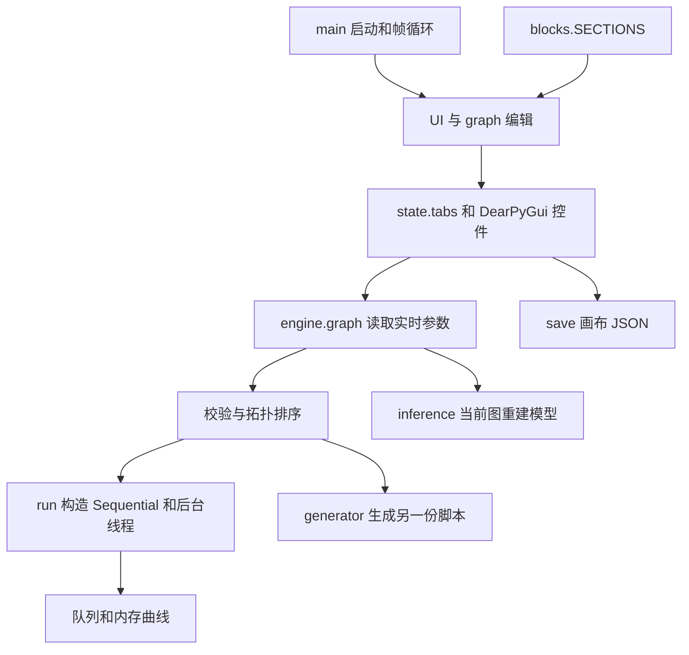
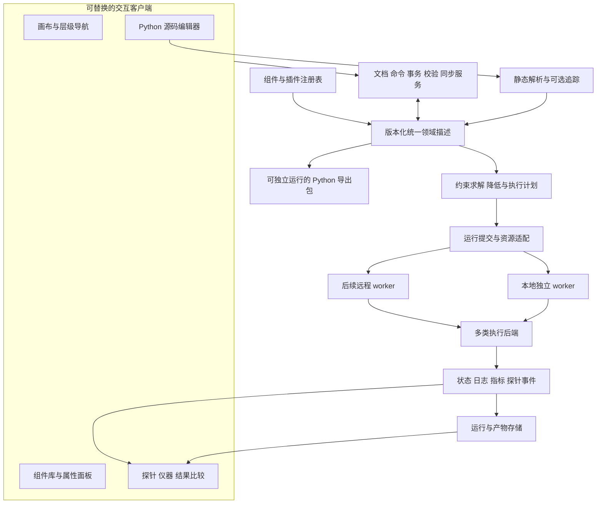
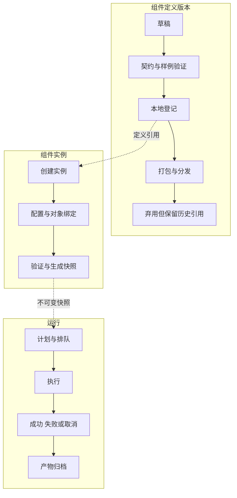
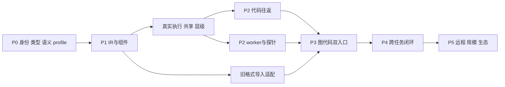

# 可视化 AI 架构设计与实验仿真平台项目计划书

**版本：评审草案 v0.1｜核查日期：2026-11-14｜时区：Asia/Shanghai**

**本地审查根目录：** `.`

**文档状态：**用于立项、架构评审和后续实施方案细化，尚未批准实施。本文中的目标接口、目录、测试和阶段均为规划。本轮没有修改业务代码，没有安装依赖、下载模型或数据、启动 GUI、训练、部署或发布。新增内容仅为本计划书和核查记录。

**配套证据：**`docs/评审附件/2026-11-14-源码核查记录.json`。包含核查环境、45 个基底文件的 SHA-256、33 个 Python 文件的函数行号索引、模板轻量校验、生成脚本语法检查与验证边界。文中源码路径相对于上述根目录，行号对应本轮文件快照。

## 1. 执行摘要与核心结论

### 1.1 项目定位

建设一个借鉴 Multisim 交互方式的可视化 AI 架构设计与实验平台。用户通过组件、具名端口、连接、层级子图和测量仪器构建可执行系统；高级用户能够编辑内部结构或 Python；新结构可封装为可分发的自定义“芯片”。图与 Python 是同一设计的两种编辑入口。

平台长期覆盖传统机器学习、深度学习、多模态、生成模型与知识检索。医学影像是重点领域插件和验证场景，领域规则不进入通用核心。实验管理为模型设计、执行、观察与比较提供支撑。

### 1.2 核心决策建议

1. **建议有条件地以 ML Forge 为交互原型和迁移来源。** 保留组件目录知识、模板和部分桌面操作资产；核心语义应由新的独立领域模型承担。不能把当前执行器作为全面科研平台的长期核心。[S01–S23]
2. **推荐路线二：桌面适配器＋独立核心＋独立 worker。** 先通过核心和无界面用例证明真实图执行、共享参数、芯片封装、代码往返、探针，再评估是否迁移 Web 交互。桌面保留是降低早期前端变化的选择，不是永久技术约束。
3. **先统一语义，再扩充组件数量。** 必须分离 Definition、Instance、CallSite、Parameter 和 WeightSnapshot；使用 UI 无关的版本化中间表示，分别建模模型、数据、训练关系和科研工作流。
4. **图—代码往返分三级承诺。** 平台生成代码可靠往返；受支持代码子集允许双向编辑；任意第三方程序尽力解析并允许保留代码黑盒。当前代码为导入事实来源，旧图元数据不能覆盖源码改动。
5. **探针和仿真模式是首批核心验证对象。** 功能验收必须观察真实数据、梯度和更新，确认探针对结果和开销的影响；界面出现仪器图标不构成能力验收。
6. **立项采用能力关口而非先承诺日期。** 目前缺团队配置、硬件、样本、支持矩阵和交互规模要求，不能可靠给出总工期、成本、完成度或复用百分比。

### 1.3 事实与证据等级

| 标记 | 含义 | 本文使用规则 |
|---|---|---|
| D：文档声明 | README、注释或元数据声称支持 | 不自动升级为已实现或已运行 |
| S：源码事实 | 已重新读取实现与调用路径 | 静态推导的影响另标“待复现” |
| L：轻量验证 | 实际执行语法解析、纯函数或内存替身检查 | 明确替身和覆盖范围 |
| E：端到端验证 | 真实依赖、界面/worker、数据和产物闭环 | 本轮没有 E 级证据 |
| 设计建议 | 目标对象、协议、技术路线和验收要求 | 不代表当前能力 |
| 待验证假设 | 影响技术选择、范围或投入的未决条件 | 用验证关口消除，不伪装成事实 |

**重要结论：**本地版本文件声明为 1.0.4，不代表已确认上游提交、发布包版本或最新状态。本目录没有 `.git`，无法确认分支、提交和相对上游差异。[S01，L01]

## 2. 项目目标、需求与能力边界

### 2.1 用户及价值

| 用户 | 主要工作 | 平台价值与边界 |
|---|---|---|
| 学习者、初级实验者 | 连接组件、选择数据和预设、运行、查看信号 | 通过默认方案减少配置负担，同时显示有效配置和真实运行状态 |
| 模型研究者 | 改主干、融合、损失、共享结构、训练策略 | 图、代码和自定义芯片共同表达新方法；允许代码黑盒 |
| 医学等领域研究者 | 管理队列、划分、预处理、任务评估 | 领域适配器保证样本单位、几何和评估契约，不能自动替代研究设计 |
| 组件开发者 | 定义、验证、发布、维护新芯片 | 稳定 API、契约测试、版本和依赖声明 |
| 课题组平台维护者 | 环境、worker、资源、结果归档 | 运行可追踪、失败可诊断，后续可接远程计算 |

基础操作路径：选预设/组件 → 连接数据与模型 → 系统检查 → 选择运行模式 → 接入探针 → 观察和保存结果。

高级路径：打开组件属性/内部子图/Python → 修改结构或实现 → 查看受影响端口与约束 → 样例验证 → 封装版本 → 在其他设计中调用。展开、收起和移动节点不得改变算法语义。

### 2.2 功能地图

| 能力域 | 目标能力 | 首批需证明的核心 | 后续内置与插件扩展 |
|---|---|---|---|
| 设计 | 基础算子、成熟模型、层级芯片、共享、多输入输出 | 分支/融合/残差、共享调用、嵌套封装与公开参数映射 | 动态 region、更多成熟模型和领域组件 |
| 编辑 | 画布、属性、源码、命令事务、撤销重做 | 图与代码引用同一文档，失败编辑可恢复 | 多窗口、协作、丰富源码工具 |
| 执行 | 检查、前向、训练、推理、评估、扫描 | 明确 step、真实独立 worker、确认式暂停/取消 | 远程、多 GPU、外部 API、分布式 |
| 观察 | 数据、梯度、权重、更新、性能和任务输出 | 具备可核对的真实探针与采集预算 | 3D 切片、生成轨迹、检索链、多次实验差异 |
| 代码 | 可独立运行导出与三级导入 | 平台代码往返、受支持改动回写、opaque 保留 | 更大可解析子集及后端适配 |
| 实验 | 配置快照、数据划分、环境、指标、产物 | run 隔离、样本级结果、恢复粒度声明 | 多种子、搜索、基线/消融/外部测试 |
| 扩展 | 模型、任务、数据、执行、指标、仪器插件 | 图实现与 Python 实现采用同一对外契约 | 视觉、文本、表格、音视频、时序、知识流程 |

“全面支持”指新能力有稳定接入路径。每个版本必须公布实际支持的任务、端口类型、模式、导出/导入等级、恢复与探针能力；注册一个名字不等于完成支持。

### 2.3 四类图及其关系

| 图 | 语义 | 典型内容 | 与其他图的关系 |
|---|---|---|---|
| 模型计算图 | 一次调用如何产生结果 | 算子、子模型、值、分支、共享调用 | 被训练、推理、生成任务引用 |
| 数据处理图 | 样本如何读取、对应、变换和组成批次 | 数据清单、划分、变换、采样、collate | 向模型提供具名输入、目标和元信息 |
| 训练关系图 | 如何构造目标并更新哪些状态 | loss、参数集合、冻结、优化器、更新频率 | 引用模型参数，不把 loss 当模型参数值传递 |
| 科研工作流图 | 多个任务与产物怎样组织 | 训练、检索、生成、评估、扫描、报告 | 调度模型/数据/训练定义及外部系统 |

四类图共享身份、类型、版本、引用和产物协议，但保留不同执行语义。普通数据环不是合法反馈；显式状态、时间步或循环 region 才能定义迭代。自动微分梯度视图是运行关系的派生展示，不要求初级用户绘制反向连线。[E04]

### 2.4 Multisim 借鉴与 AI 重定义

NI 官方资料说明了层级块/子电路、符号/引脚/模型、自定义元件、探针与多类分析机制。[E01–E03] 本平台借鉴交互和层级思想，不声称实现了电路求解器，也不复制其产品资产。

| 可借鉴机制 | 平台设计 | AI 特有的重定义 |
|---|---|---|
| 元件库与参数面板 | 基础/成熟/自定义组件，参数 schema 生成属性面板 | 区分结构超参数、可训练参数、buffer、缓存和权重快照 |
| 子电路与封装 | 框选封装、具名端口、公开参数、嵌套与展开 | 捕获共享实例、参数、状态和副作用；封装不能意外复制参数 |
| 导线与引脚 | 类型化端口和不同关系的连线 | 支持 tensor、文本、文档、数据集、模型句柄等，不能全伪装成 tensor |
| 激励与测试台 | 数据输入、运行模式、训练目标、评估协议 | 输出依赖数据、随机性、模型状态；连接正确不证明泛化或临床有效 |
| 仪器与参数扫描 | 探针、统计视图、性能测量和实验扫描 | 明确采集开销、梯度阶段和调用身份；多 seed 与患者抽样不确定性分开 |
| 模型与网表 | 独立 IR、源码映射、执行计划 | 支持代码黑盒、条件/循环及不同学习协议 |

### 2.5 代表性场景

场景 A：双输入共享编码器 → 特征融合 → 分类/回归；检查复制和共享区别、冻结、分支及梯度。

场景 B：2D/3D 分割 → patch/整图推理 → 原空间输出；检查空间元信息和领域评估。

场景 C：表格预处理 → 特征选择 → 分类器 → 分组交叉验证；检查 fit/transform 边界。

场景 D：影像或文档 → 编码/检索 → 语言模型 → 报告 → 评价；检查变长输入、生成、证据和 opaque 组件。

同一平台可以运行 2D 和 3D 实验；一个模型同时处理两者，需要显式双输入、对应规则和融合设计，不能由“兼容”隐含推出。

## 3. 开源基底尽调

### 3.1 范围、环境与轻量验证

本轮重新读取打包和文档、UI/图编辑/持久化、图与形状、运行/导出/推理/指标以及两个模板。未把此前指南当源码证据。

| 项目 | 事实或结果 | 等级 |
|---|---|---|
| 包及版本 | `zaina-ml-forge`，`1.0.4`，Python `>=3.11`；README 写 `>=3.10` | S，[S01–S02] |
| 依赖 | DearPyGui、Pillow 为默认依赖；torch/torchvision 为 training extras；无完整锁定组合 | S，[S01] |
| 入口 | `ml-forge → ml_forge.main:main`；`python -m ml_forge` | S，[S01，S03] |
| 许可证 | LICENSE 为 MIT 文本，含原版权与许可保留条件；未做上游权属链和第三方模型许可证审查 | S，[S24] |
| 本地形态 | 无 `.git`；不是可确认提交的 checkout | L，附件 |
| 核查解释器 | 使用应用已附带 Python 3.12.14；当前 shell 的 python 不可用，py 未列出注册解释器 | L，附件 |
| 依赖探测 | 附带环境缺 torch/torchvision/dearpygui，PIL 可发现；未安装 | L，附件 |
| 源码语法 | 33 个 Python 文件 AST 解析通过 | L，附件 |
| 模板图 | 内存替身提供 DearPyGui 参数读取；实际调用图构建/拓扑/校验：两模板均 0 error、0 warning | L，非 GUI 集成测试 |
| 生成脚本 | CIFAR10 131 行、MNIST 113 行，AST 通过，无 Ellipsis 占位；仅在内存中生成 | L，未实例化/训练 |
| 参数边界 | `_parse_sigma` 裸范围得到 tuple，带括号文本回退 1.0；未加括号的生成片段语法失败 | L，附件 |
| E2E | 未启动 GUI、训练、推理、打包安装、GPU/AMP、远程任务 | 无 E 级证据 |

模板检查不覆盖任意图、损坏文件、保存加载、共享、动态控制流或浮点行为；0 error 只说明当前校验器接受两个模板。正式验证必须使用独立规格与预期结果。

### 3.2 当前结构与真实执行链



推导：图的参数事实存在于控件，状态和 UI tag 混在字典里；运行、导出和推理分别组装数据/配置；模型实际顺序执行。它提供可用设计原型，不具备目标平台的独立网表、真正按边执行和统一实验快照。[S03–S22]

### 3.3 关键发现与影响

| 编号 | 已核实实现 / 静态推导 | 影响及验证要求 |
|---|---|---|
| F01 | `run._build_torch_model` 最终构造 Sequential；`generator._gen_model` 逐层覆盖 x。[S16，S18] | 画出的分支不是分支执行；需真正多值图和调用语义 |
| F02 | GraphNode 是字符串参数、端口名与连接存在集合；参数由 DPG 读取。[S10] | 不是 UI 无关 typed IR；后台仍依赖实时控件 |
| F03 | 连线直接建立；拓扑排序排除自环；训练校验主要看端口是否连上。[S07，S10] | 不能把可连线、可排序等同契约正确；补非法边与自环用例 |
| F04 | 同角色页签：引擎取首个，阶段栏取最后一个。[S08，S10] | 同一画布显示与执行可能不一致；新文档明确图引用 |
| F05 | `.mlf` 仅 version+tabs，不含右侧设置、历史、环境或权重。[S14] | 当前保存不是完整实验保存 |
| F06 | 保存直接覆盖；加载在完整 schema 校验前清空当前图。旧 tid 未存而边保留旧 tag。[S14] | 非连续画布 ID 可能丢边/误连，属于静态风险待 GUI 复现；新导入必须事务化 |
| F07 | 未映射层可跳过；loss/optimizer 构造异常可替换为默认算法；排序失败导出可退回插入顺序。[S16，S18] | 不允许新平台静默改变研究方法；必须结构化失败 |
| F08 | 多个字段未进映射：Flatten start/end、ConvTranspose padding、Adam 多个参数等。[S09，S18] | 有控件不证明参数生效；字段到实际对象逐项验证 |
| F09 | 先更新 best_metric 再算 early-stop improvement。[S16] | 正常有限指标、非负 min_delta、有验证时会错误累计；轻量指标序列应独立验证，未训练复现 |
| F10 | STOP 立即令 UI idle；线程未 join；新 RUN 清全局停止事件；队列无 run_id。[S13，S16] | Stop→立即 Run 存在任务串扰风险，未并发复现；目标使用确认式状态机 |
| F11 | train accuracy 曲线复制 val accuracy；无验证时 val loss 用 train loss 占位。[S16–S17] | 现有图表不能直接用于论文指标；缺失值与指标来源需重写 |
| F12 | 单链两个 Subset 共用 transform；Seed 只用于切分；双链不查重叠。[S16] | 不能保证无泄漏/独立验证增强/可复现 |
| F13 | GUI Shuffle 读右侧，导出读节点；双链时右侧又禁用。[S13，S16，S18] | 同图存在有效配置差异 |
| F14 | checkpoint 仅 state_dict；Resume 仅解除同一线程暂停。[S13，S16] | 不具备中断后的完整训练恢复 |
| F15 | 导出固定 20 epochs、CUDA/CPU、model.pth，未同步右侧配置；具名键与 GUI 数字键不同。[S18] | 不能承诺当前 GUI/导出等价或权重互换 |
| F16 | Grayscale 未进导出表；sigma 裸范围直接拼接；GUI 括号 tuple 又回退。[S09，S16，S18–S19，L01] | 参数必须类型化，统一后端构造与源码字面量编码 |
| F17 | 推理重建当前图，部分重建 transform，固定 softmax/Top-k；不是实验独立重放。[S19] | 可保留分类 viewer，模型/数据语义须由快照提供 |
| F18 | `ensure_pipeline_inputs` 无调用；标题更新固定 9901/9902，而模板实际用其他 ID；lock 函数仅设主题。[S20–S21] | 注释/函数名不等于功能接通，须查调用链；静态推导未 GUI 复现 |
| F19 | 未训练曲线有演示值；summary 是少数公式估算；日志仅内存、最多300行。[S05，S12] | 不属于真实测量、资源仿真或审计日志 |
| F20 | 未发现测试套件/锁文件；CI 仅 release 构建发布；包资源覆盖未构建验证。[S22–S23] | 建立新验证体系，不能继承“CI 通过”的假设 |

### 3.4 逐模块复用矩阵

分类含义：直接复用=边界内基本保留；封装复用=隔离后接新接口；重构后复用=保留意图或规则、改主要实现；替换=不承接其核心实现；不再使用=目标路径中淘汰。该分类不是代码量百分比。

| 模块 → 当前能力 | 源码证据 | 对目标差距 | 处理 | 原因 | 具体改造点 | 验证方式 | 风险 |
|---|---|---|---|---|---|---|---|
| main/入口 → 桌面生命周期 | [S01，S03] | 核心启动依赖 GUI | 封装复用 | 可保留入口体验 | 注入文档/命令/运行服务；GUI 退出策略 | headless 核心与窗口独立验收 | worker 随窗口退出 |
| constants → 布局配色 | [S04] | 固定像素与新仪器不匹配 | 局部直接复用 | 小型独立展示资产 | 主题和布局配置化 | DPI/尺寸视觉检查 | 长期复制硬编码 |
| state → 全局字典 | [S04] | 文档/视图/运行混杂 | 替换 | 阻止多文档与任务隔离 | ProjectDoc、ViewState、RunState | 并行项目和快照隔离 | 隐式依赖残留 |
| layout/resize → 工作台 | [S05] | 缺层级、代码、探针视图 | 封装＋重构 | 初期减少整套 UI 重做 | 停靠/面板、空状态、最小尺寸 | 可用性与大图试验 | DPG 长期适配上限待测 |
| palette/menubar/toolbar/statusbar | [S06] | label 身份、回调直改状态 | 封装复用 | 有完整操作路径 | registry 与命令路由、dirty 提示 | 菜单/快捷键一致、插件注册 | UI 成为第二份规则 |
| shortcuts → 删除/撤销/保存 | [S06] | 焦点/平台不完整 | 重构后复用 | 操作语义可保留 | 焦点路由、左右 Ctrl/Cmd | 文本/画布焦点测试 | 文本编辑误删图 |
| graph.nodes → 参数/端口绘制 | [S07] | 无类型和稳定领域身份 | 重构后复用 | 能改为渲染适配器 | callsite ID、schema 控件、core 命令 | 非法参数和端口契约 | 控件仍是真源 |
| graph.links → 建边/断边 | [S07] | 无完整合法性检查 | 重构后复用 | 保留鼠标交互 | 先 core 验证再显示 | 类型、基数、重复边、环 | 可画不可跑 |
| graph.tabs → 页签/角色/minimap | [S08] | 无层级/跨图稳定引用 | 重构后复用 | 可用作多视图容器 | 文档 ID 与视图 ID 分离 | 重排/关闭/重命名/层级导航 | tag 污染领域 |
| graph.undo → 快照撤销 | [S08] | 参数/移动无完整事务 | 替换内核，保留交互 | 目标需跨图命令 | 文档事务、命令日志、布局撤销 | 封装/展开/源码编辑撤销 | 大图快照成本 |
| graph.pipeline → ready 栏 | [S08] | 非空判定、角色歧义 | 不再使用其判定；复用展示 | 应统一 ValidationReport | 分级状态和运行前检查 | UI/headless 报告一致 | 绿色误导为正确 |
| blocks → 53类元数据 | [S09，L01] | 无命名空间/版本/typed schema | 迁移后封装复用 | 组件目录和说明实际可减少录入 | ComponentDefinition、参数核对 | 逐字段运行/导出契约 | 旧映射遗漏被继承 |
| engine.graph → 图/排序/验证 | [S10] | UI 耦合、无真实多值边 | 替换核心 | Kahn 思想通用，结构不适合作长期 IR | TypedIR、约束、region | 图不变量和错误位置 | 把旧算法当完整语义 |
| autofill → 2D公式与填值 | [S11] | 单上游、未知透传 | 规则选择迁移 | 仅明确前提公式可留 | 符号约束、unknown、样例检查 | 多输入/轴/动态维度 | 错误 shape 看似已证明 |
| summary → 参数估计 | [S12] | 漏项、不等于显存 | 替换统计；复用 viewer | 需区分估计与测量 | 参数去重、状态与激活测量 | 与已知模型对照 | 错误资源承诺 |
| console → 内存日志 | [S12] | 无 run 归属、无持久化 | 重构后复用 | 颜色/展示可留 | 事件总线、文件、限流 | 事件完整性/重放/背压 | 高频导致 UI 卡顿 |
| ui.training → 控件/按钮 | [S13] | 状态先行、实时 GUI 配置 | 重构后复用 | 输入/展示可保留 | 提交不可变 RunSpec，worker 确认状态 | 取消竞态/迟到事件 | 假暂停、重跑串扰 |
| save → .mlf | [S14] | 全配置/稳定ID/事务缺失 | 替换写入；保留旧导入适配 | 兼容教学资产但不锁死核心 | 纯解析、重映射、原子保存、迁移报告 | 损坏/空洞ID/旧黄金文件 | 错恢复比拒绝更危险 |
| run → 分类线程 | [S16] | Sequential、固定任务、全局线程 | 替换主路径 | 可作为行为参考，不能长期包装扩展 | 多后端 runner、独立 worker | 分支/共享/字典输入/状态 | 包装后保留隐藏耦合 |
| generator → PyTorch源码 | [S18] | 串行/字符串/配置分叉 | 替换生成器；迁移映射知识 | 缺失可逆语义和源码身份 | canonical lowering、CST/AST | 结构/行为/训练往返 | 语法过关但意义改变 |
| inference/metrics → 分类界面 | [S17，S19] | 当前图重建/固定指标 | viewer 封装，任务内核替换 | 一个领域 viewer 可用 | RunSnapshot/TaskAdapter | 同权重同输入对照 | 指标伪占位 |
| training_setup → 桥接视觉 | [S20] | 未接通/固定ID | 不再使用固定ID实现 | 训练语义归 core | viewer 按事件和 callsite 绑定 | 任意 ID 正确更新 | 保留死路径 |
| templates → 两套分类图 | [S21] | 旧格式/无完整配置 | 迁移复用 | 教学与旧项目回归资产 | 添加新格式基准和明确 test 角色 | 导入/导出/保存黄金用例 | 不能用其覆盖全面任务 |
| packaging/CI/docs/license | [S01–S02，S22–S24] | 无测试、环境和资源验证 | 文档/许可保留，工程体系补建 | 分发骨架价值有限但可用 | 安装 smoke、兼容矩阵、资源和许可证清单 | 隔离构建/安装/文档验证 | 文件声明被当运行保证 |

### 3.5 两种完成度分别评价

**项目自身功能完成度：**界面、图编辑、保存、分类训练、推理和导出的实现均存在；轻量检查支持默认模板的语法与现有校验路径。参数不生效、配置分叉、指标和停止语义等问题削弱其正确性。本轮无法给出 E2E 完成度，也不提供百分比。

**相对目标的能力覆盖度：**已有交互原型与基础目录；typed IR、层级芯片、共享调用、真正分支执行、双向代码、真实探针、独立 worker 和多任务后端没有完整实现证据。它们属于新平台核心研发，不能由“已有节点图”推导为接近完成。

### 3.6 旧格式兼容与从零建设比较

建议新核心采用新版本格式，提供 `.mlf v1` **单向导入适配器**，初期不承诺把任意新图写回 v1。迁移先纯解析和验证，再创建新文档；以旧端点映射到局部稳定节点/端口 ID，歧义必须报告。原文件保持原样。

可迁移：组件类型、参数、位置、基本边和三个流程角色。不能凭空恢复：未保存的训练设置、数据划分、环境、权重归属。导入报告将其标为未知或未配置，要求用户明确采用新默认值后才能运行。tid 歧义无法自动修复时拒绝猜测。

| 工作 | 复用 ML Forge 的影响 | 从零的影响 |
|---|---|---|
| 早期桌面交互与教学样例 | 可减少基础画布、菜单和目录录入；仍需核心适配 | 初期需重做这些交互 |
| 通用核心/代码往返/探针 | 主要仍为新增；旧耦合可能增加拆分成本 | 可直接围绕统一协议设计 |
| 兼容和回归 | 增加旧格式与既有习惯的迁移测试 | 不兼容旧文件则没有这部分成本 |
| 前端长期自由度 | 必须限定 DPG 在适配层，否则增加迁移负担 | 前期选择自由，但同样需用实际需求验证 |
| 维护 | 边界清晰且停止双份语义后，复用才有净收益 | 无遗留耦合，但不自动减少新核心复杂度 |

**判断依据：**真实节省集中在交互、元数据和例子；最昂贵的新能力集中在语义、代码和运行正确性。两者要分开估算。

## 4. 路线比较与推荐

### 4.1 三条路线

| 维度 | 路线一：现有 DPG 内直接扩展 | 路线二：桌面＋独立核心/worker | 路线三：新前端＋服务层 |
|---|---|---|---|
| 初期投入 | 小型补丁最低；通用化会累计拆分 | 新核心投入较高，减少同时重做前端 | 核心与前后端同时投入较高 |
| 可扩展性 | 若继续依赖控件/全局字典则受限 | 后端和插件可独立，前端可替换 | 可围绕浏览器和多人需求设计 |
| 维护成本 | 同类逻辑多份，长期风险高 | 接口成本显式，测试可分层 | 加服务协议、部署和前端版本协同 |
| 迁移风险 | 用户体验变化小，语义债务大 | 适配和旧导入风险可分批控制 | 用户交互/文件/执行同时迁移 |
| 科研表达 | 增节点容易，任意结构难保正确 | 按 IR 和 runner 能力扩展 | 取决于相同核心；Web 本身不增加算法语义 |
| 长期演进 | 适合教学分类工具的有限改良 | 适合本项目先证核心能力 | 适合多人、集中资源、浏览器访问成为刚需 |

### 4.2 推荐与成立条件

**推荐路线二。** 新核心不得 import DearPyGui，不读取 UI tag；现有 UI 只作客户端。新主路径不同时维护“旧训练器”和“新训练器”的同一功能；迁移完成的能力只经新核心运行。旧模式若临时保留，应独立标注并设退役关口。

成立条件：近期以单用户/本地工作台为主要交互，团队具备 Python 图系统/编译与运行工程能力，愿意建设回归与契约测试，而不是只追加节点。

需要调整路线的条件：

- 浏览器、多用户、协同、统一服务器权限为已确认首要需求：提前转路线三，核心协议保持。
- DPG 的源编辑器、复杂层级、仪器面板或目标规模经试验无法达到预定交互预算：替换前端，保留核心。
- 团队只需简单分类教学且资源有限：路线一可以成立，但应明确缩小产品承诺。

待验证的前端试验：在合成小/中/大图、嵌套、多个探针和并发事件下测编辑延迟、首屏时间与内存；先确认目标机器和可接受阈值，再做选型。当前没有规模或性能实测，不宣称 DPG 一定满足或一定不能满足。

## 5. 目标架构与关键机制

本章全部为**设计建议**。外部框架文档证明候选能力存在，不代表已完成本平台集成或兼容验证。

### 5.1 系统分层



边界要求：核心文档、解析器和编译器可无 GUI 测试；worker 不回读设计态控件；领域适配器不改变核心对象语义；UI 的每次编辑通过核心命令提交，不能绕过验证私自改图。

### 5.2 工作台交互

工作台由画布、层级树、组件库、属性面板、源码编辑器、问题列表和仪器台组成。模型、数据、训练和工作流是同一项目的关联视图，不强制永远保持三个固定页签。基础视图主要显示数据流；共享、训练、时序和控制关系按需展开。

双击组件依次可见参数、公开接口、内部子图/源码、权重与状态、兼容能力。节点上的“已检查”必须区分 schema 合法、静态契约通过、样例通过和实际运行成功。无法证明的 shape 显示 unknown，不显示虚假确定值。

画布操作、源码变更、封装、展开与升级为原子命令；撤销作用于领域文档，布局可独立撤销。长时间验证异步执行，返回结果带文档 revision；过期报告不得覆盖当前状态。

### 5.3 主要领域对象

| 对象 | 必要内容 | 不变量 |
|---|---|---|
| ProjectDocument | schema_version、project_id、revision、图/组件/配置引用 | 与 UI 控件和运行进程解耦 |
| ComponentDefinition | namespace、稳定ID、版本、参数/端口schema、实现/子图、依赖、能力表 | 发布版本不可原地改语义 |
| ComponentInstance | instance_id、definition_ref、解析后配置、状态归属 | 复制默认生成独立实例与状态 |
| CallSite | call_id、instance_ref、具名绑定、输出值、所属region | 一次调用；多个 CallSite 可引用同一 Instance |
| Value / PortContract | 类型、dtype、shape、轴语义、可选性、结构、约束 | 变量与显示标签不是对象身份 |
| Edge | source value/port、target binding、关系类型、基数 | 真实端点可解析，不能只记“连过” |
| ParameterObject | parameter_id、owner、shape/dtype、trainability、共享/alias集合 | 统计按对象去重；同一优化器参数组/更新阶段防止意外重复，显式多阶段更新另行定义 |
| StateObject | buffers、缓存、随机或时序状态、更新规则 | 区别于可训练参数；规定读写和生命周期 |
| WeightSnapshot | 参数/buffer映射、内容hash、来源、兼容manifest | 相同权重文件不等于共享参数 |
| GraphRegion | 层级子图、局部符号、捕获对象、边界与控制语义 | 收起/展开不复制对象、不改变执行 |
| TrainingSpec | losses、参数组、冻结、优化器/调度器、频率、精度、停止条件 | 目标与参数归属可验证，无隐式算法替换 |
| RunSpec / RunSnapshot | 文档revision/hash、有效配置、数据/代码/环境/资源引用、seed | 提交后不可变；运行产物可追溯到它 |
| ExecutionPlan | backend、步骤/region、对象绑定、依赖、检查义务、探针点 | 来自特定快照和编译器版本 |
| ProbeSpec | 目标ID、采集阶段/粒度/预算、统计/切片规则 | 明确不可用阶段，不能默默造值 |
| SourceMap / ViewMetadata | 语义ID与文件/符号/范围/布局映射、base revision | 辅助关联，不能覆盖代码事实 |
| Artifact / Event | 类型、hash、URI/路径、run/node/step、序号、来源 | 事件与产物均有运行归属 |

显示名可改；稳定ID不能依赖显示名、控件tag或画布序号。组件库元件、画布实例、调用位置、权重和完整checkpoint分别管理。两个独立实例加载同一快照后，后续更新仍应独立。

### 5.4 端口、类型与形状系统

端口契约支持：Tensor、Table、Text、Tokens、DocumentSet、DatasetRef、ModelHandle、ParameterSet、MetricRecord、ArtifactRef，以及受约束的 list/dict/record。每个类型有序列化/显示/执行边界，文本与文档不强转为 tensor。

Tensor 契约例：`features: float32[B, N, D]`，轴语义为 batch/token/feature；`image: float[B,C,H,W]` 或 `[B,C,D,H,W]`；mask/logits/probability 的语义标签不同。符号局部绑定，只有显式连接/约束才统一；不同分支中的同名 B 不能无条件视为相同。

连接检查分层：

1. 静态：端口存在、类型、基数、必需性、轴/语义、广播和符号约束、无效引用。
2. 元数据/样例：轻量执行或后端允许的抽象运行，记录输入和模式，不能自动升级为全输入证明。
3. 运行期：检查动态值并定位 callsite/port/约束；错误携带预期与实际。

转换通过显式 Adapter 组件表达，如 flatten、投影、tokenize、空间重采样和dtype转换；编辑器可建议插入，不能静默修改研究方法。未知自定义模块由作者声明契约，平台显示声明/推导/实测三种来源。

### 5.5 连接、共享与控制流

| 关系 | 表达与执行 | 图检查 |
|---|---|---|
| 数据流 | 具名 Value 从源绑定到目标 | 类型、shape、使用前定义、可达性 |
| 执行依赖 | 任务/副作用顺序 | 依赖环、资源和失败传播 |
| 实例/参数引用 | 引用对象身份 | 不等同数据边，别名集合可核对 |
| 训练关系 | loss与参数集合、优化组、更新阶段 | 可微路径、重复更新、冻结、目标有效性 |
| 状态/时序 | 显式 state 输入输出、delay/iteration | 初始化、步进、停止与状态保存 |
| 条件/循环 | 条件region、循环region或backend拥有的迭代 | 分支接口合流、循环携带状态、不变式 |

普通模型分支按真实边创建独立变量，Add/Concat 等有自己的约束。残差是前向分支合并。任意代数环先拒绝，直到某类明确支持的求解/迭代协议可处理。生成式解码、RNN 和工具调用循环分属不同协议，不因都画成环而共用相同执行规则。

组件能力表须声明纯调用、读状态、写状态和外部副作用。共享buffer、随机状态或工具副作用的两个调用，即使无数据边也可能不可交换；执行计划保留明确effect顺序或更新屏障。未能证明纯性的opaque调用保守按有副作用处理。跨图连接明确传递的是不可变值、对象句柄还是更新后的状态，不能仅凭DAG依赖任意重排。

训练关系应允许多个loss、参数组、交替优化、梯度累积、部分冻结和任务自定义步骤；首批可支持的具体组合在能力表声明，复杂训练策略可以整体封装为代码runner。不可微边界必须明确，不承诺把任意传统分类器连接后就能端到端反向传播。

参数去重按优化器及更新阶段定义，不禁止同一参数参与显式安排的多个优化器/阶段；各优化器状态独立，并声明更新顺序和频率。验证器应阻止未声明的重复更新，而不是否定合法的交替或多阶段算法。

### 5.6 自定义芯片及生命周期

封装步骤：选择子图 → 求边界输入输出 → 审计捕获实例/参数/buffer/资源 → 定义公开参数 → 映射内部参数 → 验证契约/样例 → 保存组件版本 → 注册或打包分发。

公开参数映射使用可校验的表达式/约束，例如一个 `fusion_dim` 绑定两个投影层输出与融合输入；避免任意隐藏代码改变内部配置。参数变更后重新求约束，接口变化需升级定义版本并展示受影响引用者。版本升级生成迁移预览；用户可固定旧定义继续重现。

捕获对象分三类：内部拥有的实例/状态；显式外部绑定槽位；按用户选择复制或冻结的快照。若芯片内外调用同一编码器，定义应暴露对象绑定槽位，实例化时绑定到共享对象；可分发Definition不得暗含原项目活对象ID。复制芯片是否同时复制内部对象、继续引用外部绑定，由声明和操作预览决定，不能靠封装时偶然的引用关系猜测。



本轮不进行生命周期中的注册、打包或发布。图实现和Python实现使用同一对外契约；opaque 允许内部不可展开，但必须声明可运行条件及已知/未知能力。插件进程隔离不等于安全沙箱，可信本地插件与未受信代码的执行策略应分别定义。

### 5.7 主要接口契约

以下为接口职责说明，不是代码脚手架或已实现 API。

| 接口 | 输入 → 输出 | 关键责任 |
|---|---|---|
| DocumentService.apply(command, base_revision) | 编辑命令 → 新revision/冲突/诊断 | 原子提交、撤销、dirty和引用一致性 |
| Registry.resolve(definition_ref) | ID+版本 → 定义、schema、实现 | 无GUI发现、依赖/能力检查；可借鉴Python entry points [E16] |
| Validator.check(document, profile) | 文档+目标模式 → 分级诊断与未知义务 | 编译和UI共用规则，不静默修正 |
| Compiler.lower(snapshot, backend) | 快照 → 执行计划、源码映射、探针点 | 正确实例化与共享，不在此读取数据/GUI |
| PythonExporter.export(snapshot, profile) | 快照 → 导出包与能力/依赖manifest | 明确支持子集，生成清晰程序 |
| PythonImporter.parse(source, base, policy) | 当前源码 → 候选IR、SourceMap、opaque区、冲突 | 默认静态，保留未知代码，事务化导入 |
| DataAdapter.prepare/split/batch | 清单+数据配置 → 具名样本/批次 | 对齐、fit边界、元信息、数据版本 |
| TaskAdapter.loss/postprocess/evaluate | 模型输出+目标 → 目标值/结果/指标 | 任务语义、聚合单位、NA约定 |
| BackendRunner.capabilities/initialize/step/run | 计划与资源 → 阶段事件/结果 | 自定step语义、状态、checkpoint和取消 |
| ProbeProvider.capture | ProbeSpec+运行上下文 → 有预算的测量事件 | callsite与对象身份、采集阶段、开销 |
| Worker.submit/control/status | RunSpec+控制请求 → 确认与事件 | 幂等ID、终态、失联与故障原因 |
| ArtifactStore.put/get/query | 内容和来源 → 内容标识与定位 | 可检索、可追踪，路径与内容身份分离 |

### 5.8 多执行后端与技术选择

| 后端 | 接入方式与原因 | 代价、边界与替代 |
|---|---|---|
| PyTorch | 自定义nn.Module、按边生成forward、任务/训练step；FX用于适用图的辅助追踪 [E05] | 需显式共享、动态region、特殊返回值；FX不是全平台IR，也不是任意源码逆向器 |
| scikit-learn | Pipeline/ColumnTransformer/估计器适配fit/transform/predict及CV [E10–E11] | 数据拟合边界与神经梯度不同；不可强塞进epoch循环；不追求逐内部算法节点展开 |
| 大模型训练/生成 | 模型/provider适配，Tokenizer、生成配置、adapter权重独立记录；Trainer/PEFT是候选适配 [E13–E15] | 不是所有研究训练策略适合统一Trainer；保留直接Python runner，按版本验证恢复与探针能力 |
| 检索/生成流程 | Reader/Index/Query/Retrieve/Rerank/Prompt/Generate等类型化组件与任务协议 | 首期不强绑定某一编排库；外部API版本、重试、token和证据必须留存 |
| 自定义Python/程序 | 整段代码、模块或runner附契约和依赖 | 内部透明度/可逆性/单步由插件声明；不能假装全部可探测 |

核心配置建议采用版本化 JSON Schema 与Python强类型对象；是否选用额外验证库由原型比较决定。源码编辑优先评估 LibCST，原因是需保留注释/格式与精确修改；它保留语法细节，但增加解析/转换复杂度。[E07] 追踪、训练框架和图编辑库均放在适配边界。

实验追踪可后续接 MLflow，搜索可接 Optuna；它们提供记录/搜索候选能力，不负责本项目的模型网表、芯片或往返语义。[E18–E19] 不同时建立两份权威run状态；外部服务是投影或被明确指定的存储后端。

### 5.9 worker、资源、存储与可复现

本地先用独立进程和版本化消息协议，避免GUI生命周期和线程状态成为实验真相。远程复用同一RunSpec/事件/产物协议，再增加传输、鉴权、上传缓存及资源租约。前端不直接操纵远端GPU。

运行状态：`submitted → queued → preparing → running → succeeded/failed/cancelled`。暂停用 `pause_requested → paused`，取消用 `cancel_requested → cancelling → cancelled`；正常控制以worker确认生效。worker崩溃或被杀死时，由执行监管器依据进程退出、attempt归属和资源回收证据确认failed/cancelled并记录原因。心跳失联先为 `lost/unknown`，不能仅凭超时推定终态或写成功。每个事件有run_id、attempt_id、worker_id、node/call_id、phase、step、seq和时间；迟到事件按归属隔离。

资源声明包括CPU、内存、GPU数量/显存需求、精度、线程、网络/provider需求。先串行/明确分配运行；排队、抢占和分布式放在资源适配器。估计与实际资源测量分开记录，不能根据参数量保证显存。

每次运行保存：有效配置、IR/源码hash、组件与编译器版本、数据/拆分标识、预处理、环境/硬件、所有相关seed策略、训练/推理模式、日志、事件、预测、指标、权重和checkpoint manifest。数据内容无法hash时声明替代版本依据及局限；本地无Git时保存源码快照hash，不能填造commit。

checkpoint区分纯权重、可恢复训练状态和完整实验快照。PyTorch恢复状态根据承诺范围包括模型/buffer、optimizer、scheduler、AMP、进度、RNG、采样器；执行器声明恢复粒度。跨硬件/外部服务不承诺逐位相同。训练成功与评估成功分别记录，允许单独重评估。

### 5.10 仿真与探针体系

| 模式 | 运行对象与“单步” | 结果/局限 |
|---|---|---|
| 结构检查 | schema、端口、依赖、共享、约束 | 可证明声明契约内的合法性，不证明学习效果 |
| 样例前向 | 一个样例/批次；可在受支持callsite暂停 | 记录train/eval和输入；只覆盖本次路径 |
| 训练调试 | 取批次、前向、loss、backward、optimizer step各阶段 | 累积microstep、update_attempt、实际update_applied/skipped分别记录 |
| 完整训练 | 后端定义的epoch/step或自定义协议 | 汇总、checkpoint、停止；不统一成一个固定循环 |
| 推理/生成 | 模型调用；生成可按token/chunk步进 | 记录cache、采样与停止条件；API流不保证可看内部计算 |
| 传统ML | fit、transform、predict或一折CV | 内部迭代单步仅对明确支持的估计器暴露 |
| 检索/评估 | query/retrieve/rerank/score阶段或评估批次 | 保存证据、索引版本和聚合单位 |
| 参数扫描 | 一个trial及其子run | 每trial独立快照；对比同数据/预算/指标协议 |

探针类型与要求：

- **数据/特征**：shape、dtype、device、轴、分布、NaN/Inf、样本切片；3D提供选定切片/ROI，文本展示token/片段，结构化值用对应viewer。
- **梯度**：参数梯度、指定中间值梯度、范数和分布；区别累积、AMP缩放/反缩放、裁剪前后阶段；未采集、不适用与零梯度分开。hook是PyTorch候选基础，不保证任意插件都有内部梯度。[E17]
- **权重/更新**：更新前后差值、相对变化、冻结状态；共享参数只按对象计数，调用位置分别记录。
- **性能**：耗时、吞吐、内存、GPU统计；异步设备计时区分提交时间和同步测量，插入同步的额外开销明确标记。
- **结果**：分类、分割、生成、检索viewer；每个展示能追到输入、run、组件和评估器版本。

统计事件至少声明全量/抽样、统计轴/范围、总元素数/采样数、有效值及NaN/Inf计数、近似方法和精度；抽样统计、全量统计、不适用和未采集分别显示。AMP因非有限梯度跳过更新时，记录attempt、实际是否应用及原因；不能把跳步的零变化误诊为冻结或把尝试计为真实更新。

共享实例hook天然对应模块对象，不直接等于某个调用位置；运行器需传播callsite上下文。梯度checkpoint重计算等可能产生重复调用，采集事件带phase和invocation序号，不能误当多次独立更新。

默认采集统计而不是复制全量张量；设置采样频率、层/端口白名单、字节/时间预算、保留周期、压缩与异步写入。全量激活、注意力矩阵和完整梯度需显式开启。采集不长期持有autograd图引用；队列背压时优先丢弃可丢遥测并留计数，不能丢状态终态和错误事件。

必须对照关闭/开启探针的输出、梯度、更新及开销。允许的统计误差和时间/内存预算在目标硬件上预设；当前不编造开销百分比。估计、样例测量、完整运行测量在UI中有不同标记。

非扰动对照从相同输入、参数/buffer、optimizer及RNG快照重放，控制数据增强、Dropout等随机来源。探针抽样使用独立RNG，不推进算法RNG；否则两次结果差异不能归因于探针。包含受控非有限梯度用例，核对AMP跳过更新与真正冻结的区别。

设计态可持续编辑，运行只使用不可变快照。默认结构变更创建新revision与新run；有限热调参必须由后端声明支持，在指定边界生效，并写事件与新有效配置，不能无痕改变已运行实验。

探针能显示本次执行路径、数值和更新异常，不能单独证明因果机制、无数据泄漏、泛化、临床效果或完整数学正确性。解释图与注意力可视化同样不作为因果证明。

### 5.11 任务覆盖矩阵与领域适配

所有条目是目标覆盖。阶段标识：P1/P2为核心能力原型，P3为桌面接通，P4/P5为任务与规模扩展，详见第7节。插件接入能力与内置成熟模板分别验收。

| 领域/任务 | 数据/模型/执行适配 | 评价和产物 | 首批验证与后续边界 |
|---|---|---|---|
| 2D视觉 | 图像/标签，张量模型与task | 逐样本预测、分类/分割/检测协议 | P1/P2小型分支模型；后续成熟主干、检测器 |
| 3D视觉/医学分割 | 体数据、mask、几何、patch、滑窗 | 原空间输出、病例/类别指标 | P4合成几何用例；真实队列及更多格式后续验证 |
| 表格ML/回归 | 表、分组/时间、Pipeline/估计器 | 折级与样本级预测、拟合记录 | P4小型表格案例；复杂估计器/搜索插件 |
| 文本/报告生成 | 文本/token、tokenizer、模型/provider | 生成文本、采样配置、事实/领域评价 | P4确定性小组件或mock先测协议；真实模型另验收 |
| 多模态 | 具名输入、样本对应、缺失模态、融合 | 对齐证据、分模态/缺失模式评价 | P1共享/融合结构；具体影像+表格/文本模板分批 |
| LLM推理 | 模型/provider、变长token、KV/cache、stream | token/成本（可得时）、时延、生成轨迹 | mock/小模型协议后接真实权重；API内部探针不可假设 |
| LLM微调 | 全参/adapter、训练协议、权重与基座引用 | loss、任务评价、adapter manifest | 候选PEFT/Trainer适配；分布式与复杂策略后续 |
| RAG/知识流程 | 文档、chunk、索引、retriever/reranker、prompt | 检索ID/分数、引用片段、生成和证据 | P4小型受控语料；外部索引/provider后续 |
| 时间序列 | 时间/分组、窗口、目标时点 | 时间划分、预测范围与回归/分类指标 | 数据/task插件；防未来信息泄漏 |
| 音频/视频 | 波形/帧/时间轴、采样率、同步 | 序列/事件/生成评价 | 契约先预留，真实pipeline单独验收 |
| 自定义算法/多任务 | 任意结构化值、代码子图/runner、多目标 | 插件声明评估与恢复能力 | 能作为opaque接入不等于内部全可逆/全可探针 |

医学领域插件负责：患者/检查/序列/体数据/切片ID，先分组再生成patch；重复与跨集合检查；标签标准和缺失信息；原始affine/spacing/orientation及变换链；图像和标注一致的空间变换与适当插值；多模态配对、时间窗和配准状态。重采样不能被误记成配准。

3D推理适配需要整卷/滑窗与融合、边界覆盖及回原始网格；可评估MONAI的滑窗能力，具体版本/反变换接入待验证。[E12] 几何验收使用带非对称标记的合成体数据，检查物理坐标、方向、image/mask一致性和原空间输出。

分类/回归/分割指标、阈值、空真值/空预测、缺失类别、物理单位与聚合单位由Task/Evaluator规定。Dice/HD95等遇空集合必须有公开约定，报告NA/失败计数而非静默排除；若采用“两者均空Dice=1”的策略，应并报非空病例与空病例误检，避免均值误导。病例/患者级bootstrap与seed波动分开，独立测试不用于调参或阈值选择。

生成任务保存输入、prompt模板、模型/tokenizer/adapter版本、解码配置、原文输出、引用证据及评价器版本。通用文本相似度只覆盖部分质量；事实一致性、遗漏/幻觉、领域关键属性与人工评价协议需单独定义。LLM评审器需记录提示与重复性、偏差和人工核查范围，不当作真值。

RAG应分别评估检索、引用支持和最终回答；固定索引/文档版本与引用定位。报告生成场景记录影像与报告对应及时间窗；隐去可识别信息的展示/日志策略放在领域与数据配置中。没有真实外部队列或专家评价时，只能验证接口和流程，不能宣称领域效果已证明。

## 6. 图—Python 双向转换专项设计

### 6.1 范围与事实边界

**源码事实：**当前只有Python生成，没有发现Python→图的AST/CST/FX导入路径；当前导出也与GUI配置/权重键不等价。[S18–S19] 双向转换属于新核心能力。

**设计目标：**图与代码同等作为编辑入口，成功提交后形成同一语义revision。支持范围内保证结构、别名与共享关系往返；有可验证身份锚点时保持原ID，没有锚点时允许分配新ID并报告映射。不要求所有Python都能静态展开。Python AST可解析语法，unparse不保证与原始文本相同；CST适合保留注释格式；FX/export受其追踪/控制流范围约束。[E05–E08]

### 6.2 三层支持承诺

| 等级 | 支持范围 | 导入方式 | 必须输出的状态 |
|---|---|---|---|
| R1：平台生成代码 | 版本化导出profile内的组件构造、具名调用、分支/共享和支持的region | 静态解析当前代码重建IR，metadata辅助身份和布局 | 完整恢复/明确失败；不靠旧图代替解析 |
| R2：约定代码子集编辑 | 注册构造器、受控import、明确赋值/调用/返回、声明的控制结构 | AST/CST＋符号/别名分析，必要时用户指定接口 | 修改已反映、待补契约或opaque区；逐区域诊断 |
| R3：任意第三方Python | 任意模块/程序/框架代码 | 尽力静态识别；可选隔离环境样例追踪；可整体封装 | 代码保留、已知接口、追踪输入与覆盖范围，不承诺完整展开 |

R1与R2的profile由语言构造、后端、组件版本、支持操作组成公开清单。首次核心验证先选择明确的小子集；新profile经round-trip测试后扩展。R3的“可接入运行”和“内部可编辑可视化”分开显示。

### 6.3 正向生成

流程：文档冻结 → 校验 → 解析组件/共享/region → canonical IR → 后端降低 → 源码/CST → 语法与依赖检查 → 导出manifest。任何不支持操作返回定位错误或按明确profile导出代码组件，不静默跳过层或退回插入顺序。

代码组织建议提供两种profile：

```text
单文件模型：model.py
  组件类、明确的 __init__/forward、输入输出契约、必要自定义实现

完整实验包：
  components/       可分发的自定义组件源码
  model.py          层级结构与具名调用
  data.py           数据引用、变换与batch契约
  train.py          后端训练入口
  evaluate.py       独立评估入口
  config.json       有效配置与数据路径占位说明
  manifest.json     profile、依赖、组件、权重映射、源码hash
  requirements.txt  已验证组合或明确的待解析依赖约束
  visual.meta.json  可选身份/布局辅助，不是模型运行依赖
```

输出需有具名中间变量、清楚组件类边界、显式forward连接、公开配置与可定位错误；避免把全部模型隐藏在巨型字符串/eval中。数据、密钥和大权重默认以引用/manifest表达，不偷偷打包。

“独立运行”验收：在没有平台和DearPyGui的干净环境中，安装manifest声明依赖、提供数据/权重后，可实例化、前向并运行相应入口。必需helper源码和自定义组件随包提供且许可允许；不能依赖本机editable路径或私有编辑器模块。外部API/模型不可得时返回明确缺项，不伪造运行成功。

结构与权重分开保存；state_dict本身不是模型定义。[E09] 同一对象可有多个导出访问路径，manifest记录parameter/buffer ID与实际键的映射及alias约束，加载后检查共享身份；不能仅靠state_dict键名猜共享关系。

### 6.4 反向解析与当前代码优先

流程：读当前源码/依赖manifest → 计算hash与base revision差异 → CST/AST解析 → 名称、对象和调用/别名分析 → 构造候选IR → 类型/共享/region校验 → 冲突与opaque报告 → 事务提交 → 按有效metadata恢复视图。

静态解析区分“定义一个类”“创建两个实例”“同一实例调用两次”“部分参数绑定到同一Parameter”。图上的CallSite与模块树不一一对应，不能只遍历子模块树就声称已恢复计算图。

必要追踪是辅助视图：记录入口、样例、模式、shape约束和路径；不把一次执行未走到的分支判为不存在。FX可表示可追踪操作，动态控制流等有明确限制，无法可靠恢复时保留源码或使用显式region。[E05，E08] 静态导入默认不执行用户代码；需要运行的解析与“仅导入结构”分开标注。

**禁止的伪往返：**只打开旁边旧graph.json即宣布成功。metadata缺失时，R1仍应能从代码恢复结构；布局可以自动重排。metadata存在但代码hash不同，必须重新解析变更，并重新匹配身份或报告冲突。

没有有效身份锚点时，“恢复结构”按ID重命名后的图同构和alias关系比较，不保证找回原项目UUID。两个同构实例经重排/改名后无法唯一匹配时，不自动认定为原对象；建立新身份或请求消歧，并明确其对布局、历史和权重映射的影响。

### 6.5 身份、源码定位、布局与合并

语义ID采用稳定标识；源码映射记录文件、类/函数符号、节点关联、范围和基线hash；行号随编辑变化更新，不作为唯一身份。变量重命名可保持关系；恢复原ID仍须满足锚点有效或匹配无歧义的条件。布局包含位置、线形、折叠和颜色，独立于执行语义。

同一基线同时发生图和代码变更时，做三方差异：base IR、图编辑revision、当前源码候选IR。可交换改动自动合并；相同连接/参数/定义冲突由用户选择，不能“最后保存者静默覆盖”。解析失败保留源码及原文档，但界面明确不同步，禁止把旧图导出覆盖未解析源码。

对支持子集的修改用CST局部编辑尽量保留用户注释/格式；不保证所有重排逐字不变。不可解析代码区保存原始文本、依赖、边界契约与内容hash；图→代码再次导出不得抹去这些区域。代码组件可以整体打开编辑，不必强制节点化。

opaque还需保留词法作用域、自由变量/import/全局状态绑定及外部对象捕获契约。无法证明安全局部提取时，将边界扩大为完整函数或模块，并限制跨边界改名/移动。携带了源码文件不等于运行绑定完整，导出验收须覆盖这些依赖与作用域。

### 6.6 动态结构、状态与预训练还原

条件/循环以明确region表示，并保存分支合流契约与状态绑定；后端不支持时保留为代码组件。动态维度保留符号/约束，样例追踪只能补充观测。外部库调用由注册组件适配，未登记调用保留opaque；import别名解析与实际运行环境是不同检查。

预训练引用记录基座/版本、tokenizer/processor、adapter、参数配置、内容标识和加载策略。导入图不能自动下载或执行远端定义；缺权重仍可显示结构，但状态为不可运行/需配置。图构造参数、权重状态、训练checkpoint和运行cache分别恢复。

### 6.7 往返一致性标准

| 层次 | 必须比较 | 测试条件与通过含义 |
|---|---|---|
| 结构 | 定义层级、实例、callsite、具名边、region、参数映射 | 规范化图比较；无身份锚点时允许ID重命名，不允许共享/effect关系丢失；布局和临时变量名不参与语义同一性 |
| 接口 | 类型、shape/符号约束、轴与目标语义 | 合法/非法输入集，动态/unknown不伪装确定 |
| 身份 | 实例复用、Parameter/buffer共享与冻结 | 比较具体alias集合、按优化器/更新阶段防意外重复，复制与外部绑定按声明；原ID保持有条件 |
| 状态 | 权重映射、buffer、train/eval、必要cache | 指定相同快照；不是仅比较文件名或键数量 |
| 前向 | 具名输出结构与数值 | 固定环境/输入/状态；精度相关容差先声明 |
| 必要训练行为 | loss、梯度、一次/多次更新、冻结、optimizer状态 | 确定性小用例与恢复用例；不承诺跨硬件逐位一致 |
| 非神经后端 | 拆分ID、fit范围、变换、预测/检索/生成轨迹 | 生成受seed/provider条件约束；外部非确定结果区分结构与统计检查 |
| 编辑 | 改参数/连接/共享/新增子模块/改名 | 导回反映变化；不支持变更明确保留或失败 |
| 保真 | opaque源码、词法绑定与依赖、注释保护、有效布局 | 原始代码及作用域不丢失；metadata删去后仍恢复R1结构/共享，原UUID与布局不作无条件保证 |

首批往返黄金用例至少包括串行、分叉融合、残差、嵌套、共享实例、部分参数共享、冻结、两输出、源代码改线、opaque保留、metadata缺失和过期metadata。预期结构由独立规格提供，不用同一生成器输出再自我断言正确。

另包含芯片内外共享对象、复制芯片的外部绑定、共享有状态组件的调用顺序、两个同构实例重排/改名，以及opaque自由变量/import重定位用例；这些检查共享含义和effect，而非仅检查对象数量。

## 7. 二次开发与迁移计划

本节是后续工作分解，不在本轮执行。各阶段范围用于控制交付顺序，不限制长期架构和插件类型。

### 7.1 目标能力到现有资产的迁移映射

| 目标能力 | 可利用现有模块 | 新增/改造 | 依赖 | 迁移步骤 | 验收标准 |
|---|---|---|---|---|---|
| 独立文档与IR | state、engine.graph、save作字段线索 | core/document、ir、schema、command | 组件身份规格 | 纯文档→校验→UI只读投影→命令编辑 | headless构造/保存/撤销，无DPG import |
| typed组件库 | blocks、palette | registry、ComponentDefinition、参数控件适配 | IR类型 | 迁移已有映射并逐参数核对 | 每个支持字段改变真实对象/导出参数 |
| 按边分支执行 | graph拓扑思想、基础映射 | compiler、多值ExecutionPlan、PyTorch后端 | IR/registry | 串行→分支融合→多输出 | 与手写模型前向/梯度一致 |
| 共享参数与芯片 | 无完整实现；nodes/tabs作视图基础 | 对象/调用分离、层级region、参数映射 | IR与编译 | 显式共享→封装→嵌套→展开 | 收起/展开前后alias、结果和更新不变 |
| 双向代码 | generator映射知识、模板 | exporter、importer、CST、SourceMap、merge | canonical IR | R1→R2→R3 opaque | 第6.7节，含修改代码与删metadata |
| 探针仪器 | summary/metrics/console展示 | ProbeSpec、运行上下文、采集与viewer | callsite/事件/worker | tensor→梯度→更新→性能 | 真值核对、共享定位、预算可控 |
| 独立运行 | run线程为行为参考 | worker、control、resource、事件协议 | RunSnapshot/backend | headless worker→确认式控制→GUI | 取消/失联/迟到事件正确隔离 |
| 数据/任务适配 | run/inference中的分类样例 | Data/Task/Evaluator/Viewer插件 | typed batch/artifact | 先单任务→表格/3D/生成协议 | 不修改核心即可新增代表性任务 |
| 实验快照和恢复 | save/checkpoint思路 | 项目schema、RunStore、恢复manifest | 核心对象/worker | 全配置→产物→恢复→重评估 | 配置不丢；恢复粒度与证据明确 |
| 旧项目导入 | save和两个.mlf | legacy_reader、迁移报告/黄金样例 | 新schema/组件映射 | 纯解析→ID映射→歧义报告→新文档 | 不改旧文件；空洞ID/未知字段可诊断 |
| 桌面接通 | main、UI和graph交互 | application services/DPG adapter | 核心命令/事件 | 新旧边界隔离→逐视图迁移 | 同一快照GUI/CLI行为一致 |
| 远程与大模型资源 | CUDA状态栏仅作展示参考 | remote executor/provider/资源租约 | 稳定worker与artifact协议 | 本地可靠→远程受控→规模化 | 断连/重复提交/资源释放与费用记录 |

### 7.2 分阶段工作分解与交付

| 阶段 | 工作包与交付物 | 退出关口 | 本阶段不冒充完成的能力 |
|---|---|---|---|
| P0：规格和验证基线 | 固定源快照；能力矩阵；IR/组件/profile草案；人工参考模型与fixture规格；环境/硬件清单；关键技术试验结果 | 共享/层级/错误边/profile定义可评审；未知项有验证方法 | 文档写完不等于核心已实现 |
| P1：可执行核心与芯片 | headless文档/命令/registry；按边执行；多输入输出/共享/封装；纯检查；小模型前向与更新；基础事件 | S1场景与独立参考匹配；参数身份、冻结、封装不变性通过 | 任意动态Python、全部训练协议 |
| P2：可逆代码与真实探针 | R1导出导入；R2初始子集；opaque保留；SourceMap；数据/梯度/更新探针；独立worker基础 | R1/R2改动、stale metadata、探针扰动与状态测试通过 | 任意源码无损、真实大模型内部全展开 |
| P3：桌面迁移与可靠性 | UI接core；代码/图同步；芯片属性/展开；仪器；旧导入；确认式控制；完整快照和恢复 | 同一规格GUI/headless一致；S1完整交互；损坏/取消/恢复测试通过 | 新界面并不证明领域效果 |
| P4：跨任务验证 | S2/S3/S4；任务插件、表格fit边界、3D几何、生成/检索协议；任务viewer和报告 | 三类后端/多种数据无需改核心；协议与结果可追溯 | mock生成不等于真实报告质量；合成3D不等于临床验证 |
| P5：规模与生态 | 远程worker、资源队列、多GPU/LLM适配、分发兼容、真实性能与领域评估 | 明确支持矩阵、资源预算、版本与领域验收证据 | “接一个provider”不等于所有模型与硬件均支持 |

P1/P2可在边界明确后并行部分工作，但不能由前端自行发明第二份图语义。P3不应把旧run/generator当长期旁路；已迁移能力停止重复维护。

### 7.3 关键路径



最难返工的决策位于IR身份、对象/调用/状态、端口与profile。代码往返和探针必须在前端大规模铺开前验证，否则容易形成好看的界面与不可兑现的语义。

### 7.4 旧基底退役与分支策略

拿到可核对的上游checkout后记录commit；若只继续当前快照则建立正式来源档案，不伪称已有提交历史。未来在隔离开发分支维护新核心。本轮不建仓库、不分支、不提交。

迁移优先级：文档与registry → 执行/导出共同语义 → worker/事件 → UI适配 → 旧导入 → 任务扩展。旧算法的已知错误只作为回归用例来源，不要求新核心复现错误。兼容“图的意图”与兼容“旧错误行为”必须区分，并在迁移报告中解释差异。

通过功能开关比较新旧仅限过渡；旧线程运行器、旧字符串生成器与GUI实时参数读取在相应新关口通过后退役，避免双份规则长期叠加。旧文件读兼容可独立保留。

## 8. 验证、验收与质量体系

### 8.1 少量代表性场景

| 场景 | 设计 | 检验通用性 | 必须保存的证据 |
|---|---|---|---|
| S1：结构与学习核心 | 两个具名输入、共享编码器、残差/融合、分类和辅助输出；封装两级芯片；含冻结与可选部分参数共享 | 真实边、对象/调用分离、公开参数映射、图代码双向、真实梯度/更新 | 手写参考、IR/源码、alias集合、输入/输出/loss/梯度/更新和探针记录 |
| S2：空间领域 | 同一任务协议配置2D/3D小型分割；合成非对称体、image/mask、patch与整卷推理、回原空间 | 维数、几何元信息、变换逆映射、领域viewer和评估 | 原/目标网格、变换链、预测、物理坐标检查、空mask协议 |
| S3：传统ML | 小表格、缺失值/标准化/特征选择/分类或回归，分组CV | fit/transform/predict独立语义、train-fold拟合、非tensor产物 | 每折ID、拟合记录、预测与可重算指标 |
| S4：检索与生成 | 受控小文档集→检索→prompt→确定性mock/小型本地生成组件→结构化报告评价；加入opaque代码组件 | 文本、文档、变长结果、证据、非epoch运行、取消与导出 | chunk/index版本、命中与引用、prompt/输出、生成配置、评价协议 |

S4首批mock是执行协议fixture，不计真实LLM训练/报告效果；真实模型推理与adapter微调在P5以明确模型、环境和数据另验收。S2合成数据证明几何处理路径，不证明真实医学性能。场景规模使用已有/合成小样本，后续获得合法数据后扩展。

### 8.2 分层测试

1. **契约与IR：**稳定ID、引用、端口、符号约束、非法边、region、对象共享、序列化/迁移、原子事务、撤销重做。
2. **独立语义参考：**人工小模型/表格流程与平台结果对照；比较forward之外的训练更新，不只检查返回shape。
3. **代码往返：**第6.7节黄金用例＋参数/连线突变＋改名＋未知调用＋损坏/过期metadata＋双边冲突；错误导入不得破坏原图或源码。
4. **运行可靠性：**受控阻塞/异常/进程终止、Stop→Run、重复submit、迟到事件、断连、资源释放、日志背压、评估重试。
5. **恢复：**纯权重与可训练checkpoint分别测试；固定CPU小用例比较连续/恢复进度、RNG、下一批及参数；GPU仅对声明组合验收。
6. **探针：**已知值/梯度/更新、冻结、共享调用、no_grad、AMP阶段、梯度累积和重计算；采集开启关闭的行为与资源对照。
7. **领域：**患者/分组泄漏、几何/空mask、训练折预处理、未来信息、模态对应、检索证据与生成事实评价。
8. **交互与分发：**新手路径、高级源码修改/封装、焦点/撤销、异常显示、wheel/资源/模板、离线导出包、无平台依赖运行。

新测试应围绕语义风险与独立预期，不把实现输出复制成唯一预期。随机测试可探索图组合，但最小可诊断黄金用例长期保留。

### 8.3 统一验收表

| 关口 | 通过标准 | No-Go / 返工信号 |
|---|---|---|
| G1：独立核心 | 无DPG依赖；分支/共享/封装、共享可变状态顺序与参考一致 | UI控件仍是参数真源；图只决定顺序 |
| G2：组件身份 | 调用、具体alias、外部绑定正确；复制/共享/权重可区分；按更新协议执行 | 未声明重复更新、封装后对象被复制或共享丢失 |
| G3：往返 | R1结构/alias/effect恢复；R2真实回写；opaque作用域不丢；无metadata可新ID恢复 | 打开旧图冒充解析；字段静默忽略；无锚点强认原ID |
| G4：探针 | 统计口径与采样标明；固定状态的值/梯度/实际更新可核对；开销达预算 | 演示当测量；无限留图；探针推进算法RNG；AMP跳步误记 |
| G5：运行控制 | worker正常确认或监管器有退出证据确认终态；run隔离、故障可追溯与恢复 | UI先idle旧任务未退；仅超时判终态；队列串扰 |
| G6：跨后端 | S1/S3/S4通过Task/Backend扩展，核心不写任务特例 | 每加任务都改通用调度和固定batch循环 |
| G7：领域可信 | 拆分、几何、评估单位与引用证据有可核查产物 | 泄漏检查失败仍报正式结果；mock冒充领域验证 |
| G8：可分发 | 导出包在无平台环境运行；依赖/作用域/外部绑定/许可/权重映射明确 | 依赖本机路径；携带源码但绑定不完整 |

性能、交互延迟、内存和探针预算的数字由目标硬件/规模试验后确认，不能用未测值写成已达标。数值容差需按dtype、后端和操作预先登记，不使用一个全局容差掩盖错误。

### 8.4 本轮实际检查与未来测试的分界

已执行：33文件语法、两模板实际图校验/排序/内存生成、生成代码语法、纯sigma解析边界、依赖和Git存在性检查。证据附件记录原文件hash。

未执行：本节所有目标平台测试、现有GUI E2E、实际PyTorch训练/推理/权重兼容、保存加载回归、性能、wheel构建、跨平台和远程验证。后续工程师不能把本章未来关口写入“已通过”列表。

## 9. 工作量、资源、风险与取舍

### 9.1 角色与能力

| 职责 | 关键能力 | 可合并条件 |
|---|---|---|
| 技术负责人/领域架构 | 图语义、接口、范围、决策与跨团队评审 | 小团队可兼核心开发，需避免评审只由实现者自证 |
| 图与代码工程 | IR、类型/约束、AST/CST、源码映射、共享与控制流 | 这是关键稀缺能力，不以普通CRUD经验替代 |
| 机器学习执行工程 | PyTorch/传统ML/生成、数值、状态恢复、资源 | 可分后端职责，首批至少有人能独立审查梯度与恢复 |
| 交互/图编辑工程 | 层级画布、源码、参数表、仪器、大图性能 | 桌面/Web按选择配置；不要求同时维护两套全功能前端 |
| 平台与运行工程 | worker、事件、存储、资源、环境与分发 | 本地阶段可兼执行工程；远程扩大后单独配置 |
| 测试/可复现工程 | 契约/故障/数值/迁移/端到端、独立fixture | 必须有独立验收职责，即使不设独立职位 |
| 领域研究者 | 医学几何与标签、临床/生成评价、科研统计 | 可阶段性参与，但正式领域效果验收不可缺席 |

以上是职责而非已配备人数。并行安排取决于实际团队；关键路径至少需要图/代码与执行/数值两类能力。团队若无此能力，应先缩小或暂停相应承诺。

### 9.2 相对工作量估算

本表是**设计判断，不是测量或报价**。相对级别按跨模块耦合、语义不确定性和验证成本排序：中=边界清楚的适配；大=新核心子系统；极大=多种语义与工具链交叉。不能将级别线性换算为工时。

| 工作包 | 相对工作量 | 初判可信度 | 主要不确定性 |
|---|---|---|---|
| 既有元数据/模板迁移 | 中 | 中 | 旧格式歧义、真实用户文件数量 |
| IR、身份、类型、共享、层级 | 极大 | 对“难度高”判断较高；规模低 | 控制流范围、参数别名、公开参数表达 |
| 图执行与多后端 | 大至极大 | 中低 | 任务协议、研究训练策略和框架组合 |
| R1/R2代码往返与合并 | 极大 | 中低 | 支持Python子集、格式保留、动态调用与源码身份 |
| worker、快照、恢复 | 大 | 中低 | 取消/重试语义、恢复粒度、远程需求 |
| 真探针和仪器 | 大至极大 | 中低 | 可观察深度、AMP/共享/重计算、内存预算 |
| 桌面适配与复杂交互 | 大 | 中低 | 源编辑器、目标图规模、DPG试验结果 |
| 任务/领域插件 | 每个中至大，数量未定 | 低 | 数据、模型、专业评价与硬件可得性 |
| 工程验证和分发 | 大且持续 | 中 | 平台矩阵、故障测试、依赖与组件生态 |
| Web/远程/分布式 | 单独的大型增量 | 低 | 用户/权限/集群/运维需求未明确 |

估算前提：先固定R1/R2子集、本地worker、少量代表性场景、可替换桌面，复用成熟数值库而不自研张量引擎。未包含：临床标注与专家评价、大模型权重/算力/API、商业支持、复杂协作、原始多厂商DICOM广覆盖、算法研究创新本身。

形成日历和成本估算的方法：P0试验记录每项实际人时与失败路径 → 固定可验收范围 → 建依赖WBS → 团队可用人力与硬件 → 以区间和风险储备估算。当前不提供没有前提的“几周做完”或复用率。

### 9.3 关键风险及验证

| 风险 | 后果 | 降低方式与最早验证 |
|---|---|---|
| 图只有外观无执行语义 | 分支/共享训练错误 | P1手写参考与alias/梯度/更新对照 |
| IR成为所有框架的最小公分母 | 新任务必须改核心 | 分离图族与backend协议，S3/S4反向检验设计 |
| 任意Python可逆承诺过大 | 大量误解析和数据丢失 | 三级profile、opaque、保留原文，R1/R2小子集先验 |
| metadata掩盖代码变化 | 同步成功但执行不是所见 | 删metadata/改代码/冲突测试，当前源码重建 |
| 芯片封装破坏共享/状态 | 多余参数、错误更新、不可复现 | 对象捕获审计与封装不变性测试 |
| 多份配置/执行规则 | GUI、代码和worker行为分叉 | 同一快照/降低路径；有效配置对照与旧路径退役 |
| 探针扰动/内存爆炸 | OOM、速度变化、保留梯度图 | 预算、采样、只读采集、对照测量和背压 |
| 并发/恢复伪成功 | 重复训练、错产物、资源不释放 | 确认式状态、唯一run/attempt、故障注入 |
| 数据泄漏/空间错位/生成幻觉 | 科研结论错误 | 领域契约、独立评估、样本级产物和证据审查 |
| 环境和外部服务漂移 | 无法重跑或费用不可控 | 版本/权重/索引/provider记录；预算与幂等策略 |
| 未受信代码/组件 | 副作用、凭据/数据暴露 | 明确信任边界、静态导入、执行隔离策略；隔离进程不冒充安全沙箱 |
| 前端技术提前锁死 | 大图/源码/仪器长期受限 | 小规模适配后用真实交互试验决定是否换前端 |
| 基底来源不明或许可混合 | 分发与维护风险 | 获取可核对上游和第三方资产清单，保留原许可 |

### 9.4 自研、集成与复用取舍

必须主导设计：IR与组件身份、图族关系、芯片边界、运行快照、图代码profile/合并、探针契约和跨后端能力协议。它们直接决定产品体验与可信度。

优先集成成熟能力：张量/自动微分、经典估计器、tokenizer/模型加载、CST、领域图像操作、追踪/搜索和存储组件。集成仍要负责接口与版本测试，不把外部库“支持某功能”当作平台已支持。

选择性复用ML Forge：菜单/画布/模板/目录/分类viewer；先隔离再接核心。避免长期复用UI tag作身份、全局可变字典、Sequential通用执行、eval字符串配置、硬编码图角色、无run归属队列和静默算法替换。

## 10. 决策建议、假设与待确认事项

### 10.1 是否值得以 ML Forge 为基底

**结论：值得用作交互原型、旧格式迁移来源和教学资产；不建议把当前图/训练/导出实现直接扩展成通用平台核心。** 真正降低总工作量的做法是限定复用层、一次定义语义、分阶段退役重复逻辑，再以独立用例验证。

保留到哪层：初期保留桌面壳与部分展示；迁移组件知识和模板；新核心负责模型图、共享、芯片、代码和运行。若交互试验要求更换前端，业务语义与插件不随之重写。上游可用性和项目名/许可定位仍需在正式立项中确认。

### 10.2 Go/No-Go 与路线调整

- **Go（进入下一轮技术试验）：**团队同意typed IR与对象/调用分离，接受三级代码支持和独立worker，能安排独立验证职责，拥有最小合法fixture和可用环境。
- **暂停相关承诺：**要求任意Python无损全展开、要求零契约自动组合任何算法、拒绝代码出口或验证预算；这些要求尚没有可信交付边界。
- **返工核心：**G1–G3失败且只能依赖UI状态、旧metadata或任务特例修补，应先修IR/身份/profile，而不是继续扩UI。
- **调整前端：**DPG在确认的交互预算下不满足层级/源码/大图/仪器需求，或协作Web成为刚需；转路线三并保留核心。
- **缩小范围：**缺图/编译或执行人才、数据/硬件不足时，可先证明核心小场景，不能把缺条件的领域能力标已完成。

### 10.3 本计划采用的假设

| 假设 | 当前处理 | 失效时影响 |
|---|---|---|
| 产品首先服务研究与学习 | 不作临床部署/自主科学结论承诺 | 部署/合规/质量体系需独立工作流 |
| Python是主要可编程接口 | IR与协议仍保持后端可扩展 | 其他语言需额外导出/执行适配 |
| 可先用本地worker证明核心 | 远程接口预留但不先建集群 | 若集中服务器为首需，提前做执行/权限适配 |
| 没有必须保留DPG的商业约束 | 仅作为初期适配器 | 若被强制绑定，需提前验证其能力上限 |
| 旧文件数量有限且可取得样例 | 先单向迁移v1，不保新图写回 | 大量历史用户/文件将增加兼容与支持工作 |
| 接受分级透明度 | opaque模块也是合法组件 | 若所有内部必须可视化，导入范围需大幅限制 |

### 10.4 待确认项及处理优先级

**进入实施前关键：**团队与可用投入；目标操作系统；首个交互规模/延迟预算；本地/服务器优先级；R1/R2首批语言子集；真实模型/数据与算力；旧项目兼容承诺；组件分发及信任范围。它们影响排期与技术试验。

**可在架构不变情况下后定：**产品名称、主题、首批模型品牌、知识库供应商、具体图表皮肤、文档样式。非关键缺失没有阻止本方案形成。

**需要单独评审：**多用户协作/权限、外部模型许可与API费用、医学真实数据和评价标准、分布式恢复粒度、跨硬件可复现标准。当前均未假定已具备。

## 11. 源码、官方资料与评审索引

### 11.1 源码索引

下表函数/对象行号由本轮源码及附件AST索引核对。范围中的行号是定位入口，不代表每条事实在同一行；关键判断在第3.3节给出相关函数及推导。根目录见封面。

| 编号 | 文件、关键函数/对象与行号 | 支撑内容 |
|---|---|---|
| S01 | `pyproject.toml:5` project；`:11` Python；`:22` dependencies；`:27` training；`:33` package-data；`:36` scripts | 版本、依赖、打包、入口 |
| S02 | `README.md:10` 版本、`:34` Python、`:75` 使用、`:148` 导出；`CONTRIBUTING.md:39`贡献、`:54`节点、`:83`roadmap | 文档声明与未来工作 |
| S03 | `ml_forge/main.py:90` main；`:113`页签；`:156`循环；`:167`autofill；`ml_forge/__main__.py:1` | 桌面启动、主循环 |
| S04 | `ml_forge/state.py:8` tabs；`:14` train_state；`ml_forge/constants.py:6` 布局、`:14` MAX_UNDO、`:21`日志长度 | 全局状态与常量 |
| S05 | `ml_forge/ui/layout.py:26`演示数据、`:33`build_main_window、`:122`general、`:140`device、`:187`loss；`ml_forge/ui/resize.py:16`resize_callback | 布局、演示曲线与设置 |
| S06 | `ml_forge/ui/palette.py:19`rebuild_palette；`ml_forge/ui/menubar.py:11`build_menubar、`:95`模板；`ml_forge/ui/toolbar.py:12`build_toolbar；`ml_forge/ui/statusbar.py:12`refresh_status；`ml_forge/shortcuts.py:9`shortcuts | 菜单、节点库、快捷键 |
| S07 | `ml_forge/graph/nodes.py:34`raw_spawn_node、`:146`spawn_node、`:169`delete_node；`ml_forge/graph/links.py:10`link_callback、`:43`delink_callback | 节点与连线 |
| S08 | `ml_forge/graph/tabs.py:47`new_tab、`:216`assign_role；`ml_forge/graph/undo.py:33`_snapshot、`:51`_apply_snapshot、`:81`push_undo；`ml_forge/graph/pipeline.py:19`_tab_complete、`:40`get_stage_statuses | 页签、撤销、阶段判定 |
| S09 | `ml_forge/engine/blocks.py:8`SECTIONS、`:288`数据集、`:381`sigma默认、`:436`get_block_def、`:446`all_block_labels | 节点规格与默认值 |
| S10 | `ml_forge/engine/graph.py:49`GraphNode、`:95`get_tab_by_role、`:103`_read_params、`:132`build_graph、`:178`topological_sort、`:306`_validate_model、`:352`_validate_training、`:438`validate_pipeline | 旧图、排序、验证 |
| S11 | `ml_forge/engine/autofill.py:19`固定表、`:85`_simulate_shapes、`:117`_upstream_shape、`:202`未知透传、`:209`infer_from_dataset、`:241`propagate_all、`:303`check_dimension_mismatches | 形状推导限制 |
| S12 | `ml_forge/ui/summary.py:17`PARAM_ESTIMATES、`:27`refresh_model_summary；`ml_forge/ui/console.py:13`log、`:25`_refresh_console | 估算和日志 |
| S13 | `ml_forge/ui/training.py:122`_read_train_config、`:149`on_run、`:232`on_pause、`:247`on_stop、`:264`tick_training、`:285`_update_split_controls | 配置、状态和事件处理 |
| S14 | `ml_forge/filesystem/save.py:14`FILE_VERSION、`:17`_serialise_tab、`:52`_build_payload、`:57`save_project、`:70`_clear_all_tabs、`:84`_restore_tab、`:133`load_project | 保存、ID与迁移风险 |
| S15 | `ml_forge/engine/run.py:105`_build_dataloaders、`:142`_build_transform、`:195`_make_dataset、`:217`_chain_for_loader、`:263`_loader_params | 数据工厂与切分 |
| S16 | `ml_forge/engine/run.py:24`_resolve_device、`:37`_build_torch_model、`:86`_parse_sigma、`:314`_build_criterion_and_optimizer、`:366`_training_thread、`:540`start_training、`:583`_handle_result | 执行、指标、保存与并发 |
| S17 | `ml_forge/engine/metrics.py:16`_get_plot_data、`:44`open_metrics_window、`:132`诊断、`:193`_refresh | 当前指标展示 |
| S18 | `ml_forge/engine/generator.py:22`_LAYER_MAP、`:46`_LOSS_MAP、`:56`_OPTIM_MAP、`:74`_AUGMENTATION_MAP、`:148`_fill、`:170`_gen_model、`:224`_gen_data、`:368`_gen_training、`:413`设备、`:454`主循环、`:485`generate_pytorch、`:551`export_pytorch | 导出与运行差异 |
| S19 | `ml_forge/engine/inference.py:142`_load_test_dataset、`:191`_inference_transform、`:264`_get_random_sample、`:303`_run_on_current_sample、`:332`模型构造/加载 | 推理路径与预处理 |
| S20 | `ml_forge/engine/training_setup.py:16`固定ID、`:38`ensure_pipeline_inputs、`:60`_lock_node、`:72`update_block_labels、`:117`reset_block_labels | 桥接函数及调用缺口 |
| S21 | `ml_forge/templates/mnist_classifier.mlf:8`数据、`:103`模型、`:203`训练；`ml_forge/templates/cifar10_classifier.mlf:8`数据、`:170`模型区域、`:176`Input | 两个模板与JSON字段 |
| S22 | `.github/workflows/python-publish.yml:3`release、`:9`Ubuntu、`:16`Python、`:21`build、`:24`publish | 发布配置，非成功运行证据 |
| S23 | 本轮全量文件清单、`rg --files`及附件manifest；静态网页位于`docs/ml_forge/` | 未发现测试/锁文件；未确认远端历史；网页不是桌面前端 |
| S24 | `LICENSE:1`MIT文本、`:3`版权、`:12`保留条件 | 本地许可文本事实 |
| L01 | `docs/评审附件/2026-11-14-源码核查记录.json`；字段`business_files`、`git_directory_exists`、`templates`、`specific_probes`、`validation_limits` | 环境/hash、Git、模板、sigma等轻量结果与边界 |

### 11.2 官方资料索引与使用边界

核查日期均为 **2026-11-14**。使用官方资料核对机制，不据浮动stable/main页面声明某版本组合已兼容；实施时需锁定版本、源码引用和测试环境。部分NI原页直接抓取不稳定，相关机制以官方检索可见内容核对；访问失败本身不作为功能证据。以下网址为资料定位，未下载模型/数据，也未执行文档示例。

| 编号 | 官方资料与定位 | 本文使用范围/限制 |
|---|---|---|
| E01 | NI《How to Use Hierarchical Blocks in Multisim》：`https://knowledge.ni.com/KnowledgeArticleDetails?id=kA03q000000YGtjCAG&l=en-US`；《Creating a Custom Component in NI Multisim》：`https://knowledge.ni.com/KnowledgeArticleDetails?id=kA03q000000YH5fCAG&l=en-US` | 层级、端口和自定义元件机制；借鉴概念，不复用NI资产 |
| E02 | NI《Simulation Fundamentals: Cosimulation in NI Multisim》：`https://www.ni.com/en/support/documentation/supplemental/07/simulation-fundamentals--cosimulation-in-ni-multisim.html` | 组件属性、模型/引脚参数的交互参考 |
| E03 | NI《Accurately Evaluate Circuits with Probes in Multisim》：`https://www.ni.com/en/shop/electronic-test-instrumentation/application-software-for-electronic-test-and-instrumentation-category/what-is-multisim/multisim-designers/accurately-evaluate-circuits-with-probes-in-multisim.html`；NI《Simulation-Driven Instruments and Analyses Feature》：`https://www.ni.com/en/shop/electronic-test-instrumentation/application-software-for-electronic-test-and-instrumentation-category/what-is-multisim/multisim-designers/select-edition/ni-multisim-simulation-driven-instruments-and-analyses-feature-c.html` | 探针/分析/扫描交互参考；不证明AI测量已实现 |
| E04 | PyTorch《Autograd mechanics》：`https://docs.pytorch.org/docs/stable/notes/autograd` | 自动微分和hook语义基础 |
| E05 | PyTorch《torch.fx》：`https://docs.pytorch.org/docs/stable/fx.html` | 图、生成代码与符号追踪限制；不承诺源码逆向完整性 |
| E06 | Python《ast》：`https://docs.python.org/3/library/ast.html` | 语法解析、unparse与原文不必一致 |
| E07 | LibCST《Why LibCST?》：`https://libcst.readthedocs.io/en/latest/why_libcst.html` | 保留注释/空白等的CST候选；未集成 |
| E08 | PyTorch《torch.export Programming Model》：`https://docs.pytorch.org/docs/stable/user_guide/torch_compiler/export/programming_model.html` | 样例追踪、约束与显式控制流范围；未作版本兼容测试 |
| E09 | PyTorch《Serialization semantics》：`https://docs.pytorch.org/docs/stable/notes/serialization` | 权重状态与结构分离、序列化参考 |
| E10 | scikit-learn《Pipelines and composite estimators》：`https://scikit-learn.org/stable/modules/compose.html` | Pipeline/ColumnTransformer和fit/transform组合 |
| E11 | scikit-learn《Common pitfalls》：`https://scikit-learn.org/stable/common_pitfalls.html` | 数据泄漏、训练折拟合与Pipeline |
| E12 | MONAI官方源码 `monai/inferers/utils.py`：`https://github.com/Project-MONAI/MONAI/blob/dev/monai/inferers/utils.py` | 官方滑窗实现候选。stable/latest文档本轮访问失败，具体反变换API与稳定版本待核验；本文空间恢复是设计要求 |
| E13 | Hugging Face Transformers《Trainer》：`https://huggingface.co/docs/transformers/main_classes/trainer` | 可定制训练候选，不作为所有任务统一runner |
| E14 | Hugging Face Transformers《Generation》：`https://huggingface.co/docs/transformers/main_classes/text_generation` | 生成配置、采样与输出协议参考 |
| E15 | Hugging Face PEFT《Quicktour》：`https://huggingface.co/docs/peft/quicktour` | adapter/参数高效微调候选；未下载或集成 |
| E16 | Python Packaging《Entry points specification》：`https://packaging.python.org/en/latest/specifications/entry-points/` | 插件发现机制；版本/契约仍由平台定义 |
| E17 | PyTorch `Tensor.register_hook`：`https://docs.pytorch.org/docs/stable/generated/torch.Tensor.register_hook.html` | 梯度hook及删除handle；只读探针不得改写梯度 |
| E18 | MLflow《Experiment Tracking》：`https://mlflow.org/docs/latest/ml/tracking/` | 参数/指标/产物记录候选；不替代网表与worker语义 |
| E19 | Optuna官方文档：`https://optuna.readthedocs.io/en/stable/` | 采样/剪枝与研究管理候选；不替代模型运行 |
| E20 | DearPyGui《Node Editor》：`https://dearpygui.readthedocs.io/en/latest/documentation/node-editor.html` | 节点/属性/连线/回调交互；不证明目标大图性能 |

### 11.3 需求—章节追踪

| 用户要求 | 覆盖位置 |
|---|---|
| A 产品定义、用户、图关系、Multisim与开放能力 | 第2章、第5.2–5.6节 |
| B 基底尽调、复用矩阵、旧格式与从零比较 | 第3章、源码索引、核查附件 |
| C 三路线比较、推荐及调整条件 | 第4章、第10章 |
| D 完整架构、对象、接口、生命周期、多后端和worker | 第5.1–5.9节及Mermaid图 |
| E 双向代码三级承诺、同步、共享/权重、动态边界和一致性 | 第6章、第8章 |
| F 仿真、单步、探针、采集预算、快照与证据边界 | 第5.10节、第8章 |
| G 任务插件、医学、生成和知识评价 | 第5.11节、第8.1节 |
| H 逐项迁移、依赖、关键路径和阶段验收 | 第7章、第8章 |
| I 角色、相对投入、风险、取舍与Go/No-Go | 第9–10章 |

### 11.4 评审建议记录

建议评审分别确认：产品范围和透明度分级；IR身份与共享；R1/R2语言profile；探针预算与运行快照；worker状态与恢复；领域评估；前端验证条件；旧兼容承诺与资源。评审意见应对应章节/关口，记录“接受、修改、待试验、暂缓”及责任人，不把本草案自动视为实施授权。
