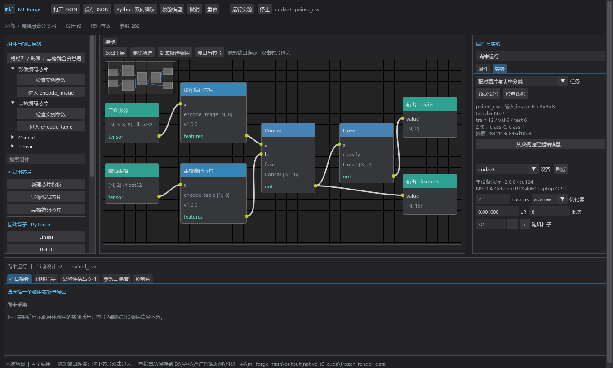
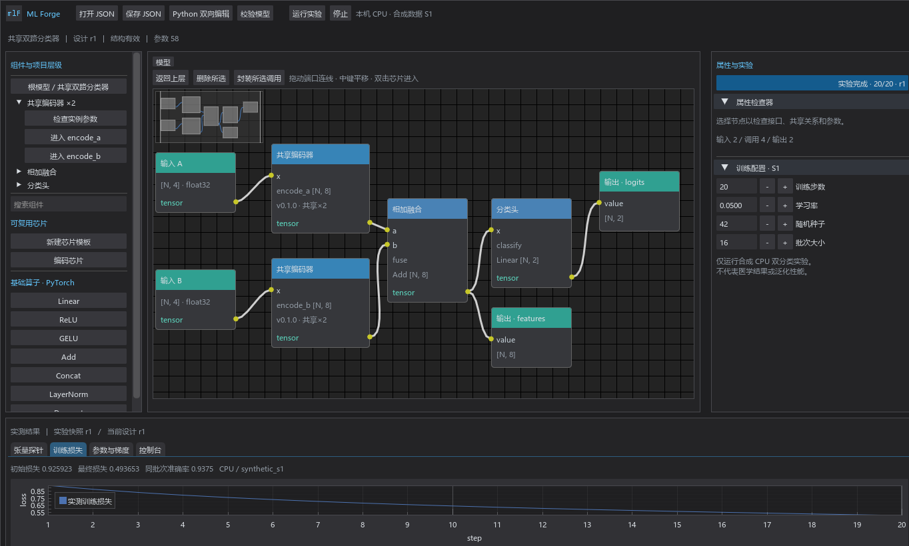
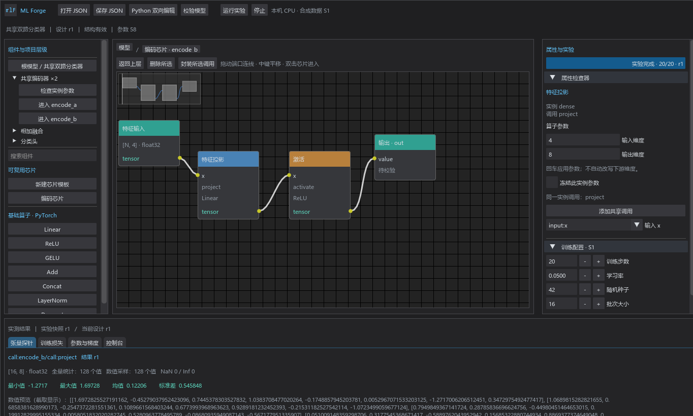

# 原生桌面版使用说明

2026-11-17最新源码开发版已有14个模型入口、36个内置组件、本地芯片/原生工厂扩展、hardware-v5无固定参数量容量策略，以及v3工作区页签/分屏恢复。使用`studio/启动S4源码预览.cmd`或`studio/启动S4-CUDA源码预览.cmd`启动现有环境，详细步骤见[多模型与工作区指南](S4_MODELS_WORKSPACE_GUIDE.md)。原直角连线/目录[验收记录](S4_COMPONENT_WORKBENCH_VERIFICATION.md)继续保留；以下是S3便携EXE历史指南，固定EXE尚未重新打包。

更新：2026-11-15，S3 自定义芯片与图片/表格配对分类。

这是沿用原 ML Forge DearPyGui 桌面形式的工作台，源码位于 `studio/native`，共享 `studio/backend/studio_core` 的图校验、执行与 Python 转换核心。S3 在已有真实 CSV 数值分类、二维 ImageFolder 分类之上，加入具名多输出芯片编辑、版本化芯片库、语义撤销/重做与图片/表格配对分类，保留 S1 合成 CPU 演示。启动不需要浏览器或本地 HTTP 服务。

S3 源码与 CPU/CUDA EXE 已在本机通过配对训练、续训、独立推理、芯片共享、Python 往返和原生界面回调验收，CUDA EXE 内显式选择 CPU 的运行也已通过。每环境 backend 运行175项（174通过、1项 Windows symlink 权限跳过），native 67项全部通过。详情见 [S3_VERIFICATION.md](S3_VERIFICATION.md) 与[可携带验收记录](../../docs/评审附件/2026-11-15-S3验收记录.json)。S2 历史记录保留在 [S2_VERIFICATION.md](S2_VERIFICATION.md)，S1 记录在 [VERIFICATION.md](VERIFICATION.md)。

## 启动与保存

CPU 版双击 `studio/启动桌面版.cmd` 或 `studio/dist/desktop/MLForgeStudio/MLForgeStudio.exe`；CUDA 版使用 `studio/启动CUDA桌面版.cmd` 或 `studio/dist/desktop-cuda/MLForgeStudio/MLForgeStudio.exe`。分发或移动时保留整个 `MLForgeStudio` 文件夹，尤其是与 exe 同级的 `_internal`；完整便携包无需另装 Python 或 Node.js。请按验证记录核对包的阶段版本。

首次启动显示默认共享编码器示例；后续优先恢复 `%LOCALAPPDATA%\MLForgeStudio\workspace.json` 中的模型与实验设置，兼容旧 `draft.json` 图草稿。数据摘要不会在重启后直接当作当前文件的检查结果，真实数据运行前须重新检查。

“保存 JSON”保存 `{workspace_version:2, model, experiment}` 工作区；“打开 JSON”恢复模型和实验设置，也接受旧版纯图 JSON。自动保存约每两秒在变化时写入 `workspace.json`，同时保留图格式的 `draft.json`，退出也尝试保存。重要版本请显式另存。旧版 `.mlf` 与 Studio JSON 不是同一格式。

## 搭建与编辑

- 左侧是项目层级和组件库，中间是节点画布，右侧“属性 / 实验”页签，底部是张量探针、train/val 曲线、最终评估与文件、参数/梯度和控制台。
- 点击组件按钮新增调用，拖动端口连线；属性中的输入来源下拉框也可修改或断开连接。选择输出节点可修改其来源。
- 修改参数后**回车应用**。数字用 JSON 数值，例如 `8`、`0.1`；数组用 JSON 数组，例如 `[3, 3]`。参数改变不会自动修正下游维度，随后点击“校验模型”。
- 算子包括 Linear、ReLU、GELU、Add、Concat、LayerNorm、Dropout，以及 Conv2d、MaxPool2d、AdaptiveAvgPool2d、Flatten。CNN 输入为 `[N,C,H,W]`；池化不返回索引 tuple，卷积使用数值 padding 与 `padding_mode="zeros"`。
- “冻结此实例参数”作用于实例；“添加共享调用”保留同一实例和权重。独立权重需要新增独立组件实例。
- 双击芯片进入内部，或从左侧进入具体调用；用“返回上层”或面包屑退出。内部修改共享定义，探针按具体调用路径定位。
- “删除所选”清理本图的下游引用。只有鼠标位于画布且没有输入控件活动时，Delete 才删除。节点拖动只更新布局，不使测量过期。

## 自定义芯片、接口与历史

1. 双击进入要编辑的芯片，再点击“接口与芯片”。“当前作用域接口”页操作对话框顶部显示的当前作用域；在根模型打开时，编辑的是根接口。上方“芯片定义”下拉用于选择公开参数与库操作的目标，不会切换画布作用域。
2. 可新增输入、修改输入 ID/形状，新增、重命名、连接或删除输出。接口 ID 使用合法英文标识符，形状填 JSON，例如 `[null, 4]`。每个作用域至少留一个输入和输出；被内部或外部使用的接口须先断开再删除。输入重命名会更新调用参数，输出重命名会更新具名引用。
3. 芯片可有多个具名输出，分别显示插座，例如 `features`、`aux`。连线选择具体输出；检查多输出调用时，在属性的“探针端口”中选择，或点击该输出端口按钮。多输出裸引用有歧义，会报错；保存图中的明确引用形如 `call:encode:features`，原单输出 `call:encode` 仍兼容。
4. 在“公开参数与绑定”页编辑参数行的 ID、名称、类型、默认值与绑定路径，然后“应用全部参数与绑定”。默认值用 JSON；绑定列表例如 `["dense.out_features"]`，路径是局部 `instance.parameter`。嵌套芯片通过下级公开参数逐层绑定。非法类型、路径和悬空绑定会被拒绝；合法尺寸修改仍可能产生需要处理的下游 shape 错误。
5. 顶部“撤销 / 重做”用于模型语义命令，包括接口、绑定、封装与导入。历史最多32个状态，undo+redo 总计不超过32 MiB；节点移动、选择和导航不记录。撤销/重做会增加 revision，必要时回到根模型；历史仅作用于模型文档，不撤回实验设置或已发生的训练，也不作为持久化工作区或训练恢复点。

**封装所选调用：**先校验模型，再在根图或芯片内部选择调用，指定暴露的输出 ID 与具体来源，可添加多行输出。边界外来源成为具名输入；保存会保留原片段并新增一个独立芯片实例，不替换原图或自动重接下游。片段内部的共享关系保留，但不继承跨封装边界的权重共享身份；可先检查新增实例再自行改接。

**本地芯片库：**在“版本与本地芯片库”页选择定义和版本，例如 `1.0.0`，保存为用户数据目录 `chips/<id>__<version>.mlfchip.json`。文件包含该芯片及依赖定义的架构、接口、公开默认参数与绑定，**不含训练权重**；实例的覆盖值继续保存在项目工作区。相同 ID/版本/内容可重复保存，不同内容需新版本。导入会复用相同定义，对冲突 ID 及其依赖引用一致重命名，保留当前项目；添加实例后才产生新的模块实例。旧 `.mlf` 不能当作 `.mlfchip.json` 导入。

## 真实 CSV 数值分类

1. 打开右侧“实验”，任务选“CSV 数值分类”，点击“数据设置”。
2. 选择 UTF-8 CSV，点击“读取 CSV 列”；选择类别标签列，并核对“数值特征列” JSON 列表。特征必须是有限数值，标签作为类别名称；标签、分组和 split 列不得选为输入特征。缺失或非法内容会报告来源，不会静默跳过。
3. 按需要指定分组列、split 列、标准化、val/test 比例和随机种子。标准化只在 train 拟合，随后用于 val/test。
4. 点击“检查并冻结数据摘要”，核对实际 train/val/test 数量、类别、输入形状和摘要。检查在后台执行；数据或划分设置改变后须重新检查，运行时还会重新核对实际内容。
5. 点击“从数据创建起始模型…”，在确认框中**确认替换模型**。CSV 起始模型是一个输入的 MLP，输入维度和输出类别数来自已检查数据；替换会移除当前模型和芯片定义，先保存需要保留的版本。也可自行搭建匹配模型。
6. 设置 epochs、AdamW 或 SGD、学习率、批次大小、种子和设备，点击“运行实验”。默认真实分类为10 epochs、AdamW、lr 0.001、batch 16、seed 42。

单独 CSV 和 ImageFolder 分类要求恰好一个映射的根输入，以及命名为 `logits`、形状为 `[N,K]` 的输出；K 必须等于数据类别数。默认 S1 双输入示例不会被自动接成真实数据模型。

有显式 split 列时只接受 `train`、`val`、`test`；否则进行种子固定的分层划分。每个分区均须包含全部类别，样本太少或无法形成有效分区会失败。分组划分优先保证组不跨分区，实际比例可能与设置比例不同，以检查摘要为准。

**患者或受试者边界：**同一患者有多行记录时，将稳定患者 ID 指定为 `group_column`；已有 split 也必须满足同一组不跨 train/val/test。仅按行随机拆分或只排除相同特征内容，不能替代患者级隔离。

## 二维 ImageFolder 图片分类

任务选“ImageFolder 图片分类”，配置图片根目录、输入高/宽、1或3通道与拆分方式，再按“检查数据 → 核对摘要 → 确认起始模型 → 运行”的流程操作。起始模型为带步长卷积、全局平均池化和分类头的小型 CNN。

```text
stratified：根目录/类别名/图片

directories：根目录/train/类别名/图片
                     val/类别名/图片
                     test/类别名/图片
```

支持常见单帧二维图片，执行固定 resize、通道转换和像素缩放到 `[0,1]`；不隐含临床归一化或随机增强。每个分区必须包含所有类别，坏图、内容重复跨 split 或超限会明确失败。图和张量预算也会限制可用输入尺寸，不会静默缩小 batch 或修改模型。

明确的系统/同步附属文件（如 `Thumbs.db`、`desktop.ini`、`.DS_Store`、`*.baiduyun.uploading.cfg`）会记录为忽略项，并在摘要/数据设置中提示；完整清单在 manifest。其他未知文件和损坏图片不会静默跳过。

ImageFolder 当前没有患者分组字段。若同一患者有多张图片，应先在工作台外按患者拆分，再使用 `directories`；目录类别和图片文件名不会自动构成患者分组。DICOM/NIfTI、三维、分割与配对 mask 不在此版本范围内。

## 图片与表格配对分类

选择“配对图片与表格分类”。一个 UTF-8 CSV 行绑定**同一个样本**的图片、数值特征、类别和患者/分组，不会分别 shuffle 两路数据，也不会按文件名猜测配对。

```csv
sample_id,patient_id,image_path,age,score,label,split
s001,p001,p001/image01.png,45,0.7,class_a,train
s002,p002,p002/image02.png,52,0.4,class_b,val
```

以上仅示意列格式，不能单独构成满足全部类别/分区要求的数据集。必填角色是唯一非空 `sample_id`、非空 `patient_id`、`image_path`、类别标签与至少一列有限数值特征；这些是默认列名，可在列选择器中映射对应列。患者分组必选，ID、图片路径、患者、标签和 split 列不能混入数值特征。

1. 选择 CSV，读取列，选择图片路径列、样本 ID、患者分组、标签和数值特征；设置图片尺寸与通道。
2. 指定 `image_root`，留空则使用 CSV 所在目录。图片路径优先使用相对该根目录的路径，越出根目录或通过符号链接越界会拒绝。配对模式只读取 CSV 引用的图片；缺少任一模态、坏图或源内容变化均失败，不跳行。
3. 有 split 列时使用 `train/val/test`，否则按患者组进行固定种子的联合拆分。所有分区包含全部类别，同患者、同图片路径或图片内容不得跨分区；数值特征重复本身允许，例如不同患者年龄相同。数值标准化只拟合 train。
4. 检查数据，核对两路输入形状和同一套样本/分组摘要。两路图端口默认映射为 `image → image`、`tabular → clinical`；可在两个输入端口字段中修改，必须是不同端口并恰好覆盖模型输入。
5. 确认创建配对起始模型：图片 CNN 分支与 clinical MLP 分支经 Concat 接分类头；也可自行建立匹配的双输入模型。明确选 CPU 或可用单卡后运行真实 train/val/test。

配对任务仍输出 `logits:[N,K]`，最终探针的 image/clinical 张量使用同一批 val 样本 ID。checkpoint 身份额外绑定模态到图端口的映射，改变映射后不能直接续用旧 checkpoint。原 S2 单输入任务与 checkpoint 路径继续兼容。

## 设备、指标与探针

- **CPU 版**使用 PyTorch `2.6.0+cpu`，通过 `studio/启动桌面版.cmd` 启动，仅支持 CPU。
- **CUDA 版**使用独立 PyTorch `2.6.0+cu124`，通过 `studio/启动CUDA桌面版.cmd` 或 `studio/dist/desktop-cuda/MLForgeStudio/MLForgeStudio.exe` 启动，可选择 `cpu` 或一个可用的 `cuda:N`。S3 配对与芯片训练已在本机 RTX 4060 Laptop 实际运行，完成恢复、独立推理和冻结界面检查；CUDA EXE 选择 CPU 的同一路径也通过，见 [S3 验收记录](S3_VERIFICATION.md)。这不是所有显卡和 Windows 机器的兼容性保证。
- “刷新”在后台查询运行时与显卡。选定真实任务后，在“设备”下拉框明确选择 `cpu` 或 `cuda:0`；请求不可用 CUDA 会失败，不自动退回 CPU。两个版本共享默认工作区，换到 CPU 版后如果恢复了 CUDA 配置，需要主动选择 CPU。当前不支持多 GPU 数量选择、DDP 或远程训练。
- 每个 epoch 遍历所有 train minibatch，再单独评估 val；只按 **val loss** 选择最佳 checkpoint。训练完成后加载最佳模型，对 held-out test 做一次最终评估。
- 曲线分别显示 train/val；最终 test loss、accuracy 和样本数在最终评估页显示，不能用 S1 的同批次指标代替。
- 最终张量探针来自最佳 checkpoint 的实际 val 批次，记录样本 ID、epoch、eval 模式和设备。梯度范数来自该选定 epoch 的最后一个训练 minibatch；参数更新范数比较初始化与**选定 checkpoint**，不一定对应最后完成的 epoch。数值预览有界，未采集不会显示占位测量。
- 模型语义、实验设置或检查后的数据摘要变化，会使原测量过期；worker 使用提交时的快照，不回读画布。

## checkpoint、继续训练与停止

每次真实运行在独立 `runs/<run_id>/` 中保存 `manifest.json`、`run_spec.json`、`last.pt`、`best.pt`、指标与参数文件；成功完成后另存 `predictions.csv`，含测试样本 ID、真实标签和预测。

继续训练时，在“数据设置”的 checkpoint 字段选择上一运行的 `last.pt`，重新检查相同数据，保留相同模型、预处理、优化器、学习率、batch、seed，以及配对任务的模态/端口映射，设置目标 epochs 后运行。例如 checkpoint 已完成2轮，epochs 设为10表示继续第3至10轮。恢复会校验图/数据/预处理/优化器身份，并从完整 epoch 边界恢复模型、优化器、RNG 与 shuffle 状态；不一致会失败。

点击“停止”提交取消请求，等待子进程退出确认。真实分类保留最后一个已完整提交 epoch 的 checkpoint；未完成的当前 epoch 不会作为恢复点，第一轮完成前停止可能没有 `last.pt`。重开程序不会自动恢复正在运行的进程，也没有完整历史实验列表；继续训练需显式选择 checkpoint。

## S1 合成演示仍可使用

选择“S1 合成 CPU（演示）”可运行原任务，默认20步、lr 0.05、seed 42、batch 16。根输入须为二维 `[batch, features]`，输出须有 `[batch,2]` 的 `logits` 并依赖可训练参数。

S1 的输入、训练 loss、前后 loss 与准确率来自同一个固定合成批次；history 为 train 模式下更新前 loss，前后评估与最终探针用 eval。它用于检查图执行、共享、梯度和更新链路，不是独立测试集结果；S1 不提供训练 checkpoint 恢复。

## Python 与数据位置

“Python 双向编辑”可打开/导出 `.py` 并“重新解析到画布”。导入只静态解析受支持构造器与显式 forward，不执行代码；CNN 和具名端口使用版本化受限 profile；具名芯片为 `ports-pytorch-v3`，字典输出由字面量端口选择，模块不会因选择多个输出而重复调用。未知 Python、计算得到的动态端口或动态控制流会被拒绝。**Python 导入只替换模型，保留实验设置**，修改后重新检查模型与当前数据的兼容性。

导入失败保留原文档和代码草稿；从画布重新生成代码遇到已有修改时需确认。Python 窗口草稿只保证当前会话内保留，退出前请导出需要的 `.py`。导出文件是模型源码，另需 PyTorch 与 tensor 输入；它不包含完整数据、运行配置或 checkpoint。

| 默认位置 | 内容 |
|---|---|
| `%LOCALAPPDATA%\MLForgeStudio\workspace.json` | 自动保存的模型与实验设置 |
| `%LOCALAPPDATA%\MLForgeStudio\draft.json` | 兼容旧格式的图草稿 |
| `%LOCALAPPDATA%\MLForgeStudio\runs\<run_id>.json` | 提交快照、配置、事件与结果摘要 |
| `%LOCALAPPDATA%\MLForgeStudio\runs\<run_id>\` | manifest、checkpoint、指标和测试预测 |
| `%LOCALAPPDATA%\MLForgeStudio\chips\` | 版本化 `.mlfchip.json` 架构与依赖包 |
| `%LOCALAPPDATA%\MLForgeStudio\logs\desktop.log` | 桌面日志 |

可用 `--data-dir` 指定可写状态目录。中文字体只读取 `C:/Windows/Fonts/msyh.ttc`，缺失时中文可能无法完整显示。开发入口、构建命令见 [Studio README](../README.md)。原 `ml_forge/` 业务源码与旧网页参考继续保留；S3 仍不包含多 loss/训练协议图、交互式前向/反向单步、完整训练工程导出、DICOM/NIfTI、3D/分割、LLM/RAG、多 GPU 或远程训练；这些仍属后续路线。

## 归档与上传状态

S1 历史归档保留。S2 的 `MLForgeStudio-Windows-x64-S2-CPU.zip`、`MLForgeStudio-Windows-x64-S2-CUDA.zip`、`MLForgeStudio-source-S2.zip` 保留于 `studio/dist/desktop/`，历史身份见 [S2_VERIFICATION.md](S2_VERIFICATION.md)。S3 已生成同目录的 `MLForgeStudio-Windows-x64-S3-CPU.zip`、`MLForgeStudio-Windows-x64-S3-CUDA.zip`、`MLForgeStudio-source-S3.zip`；ZIP CRC 通过，源码逐项与当前文件匹配。便携包 CRC/SHA256 与冻结证据见 [S3_VERIFICATION.md](S3_VERIFICATION.md)，源码包身份在本地 `output/native-s3/archive-source.json`。

GitHub 上传仍按用户要求暂停。当前没有远端、提交或协作者；本说明不宣称私库、Release 或分享链接已建立。接续说明见 [HANDOFF.md](../HANDOFF.md)。

S3 原生功能与 S2 参考的[实际界面对照](../../docs/images/native-s3-comparison.png)：



以下为保留的 S1 原生界面参考：




