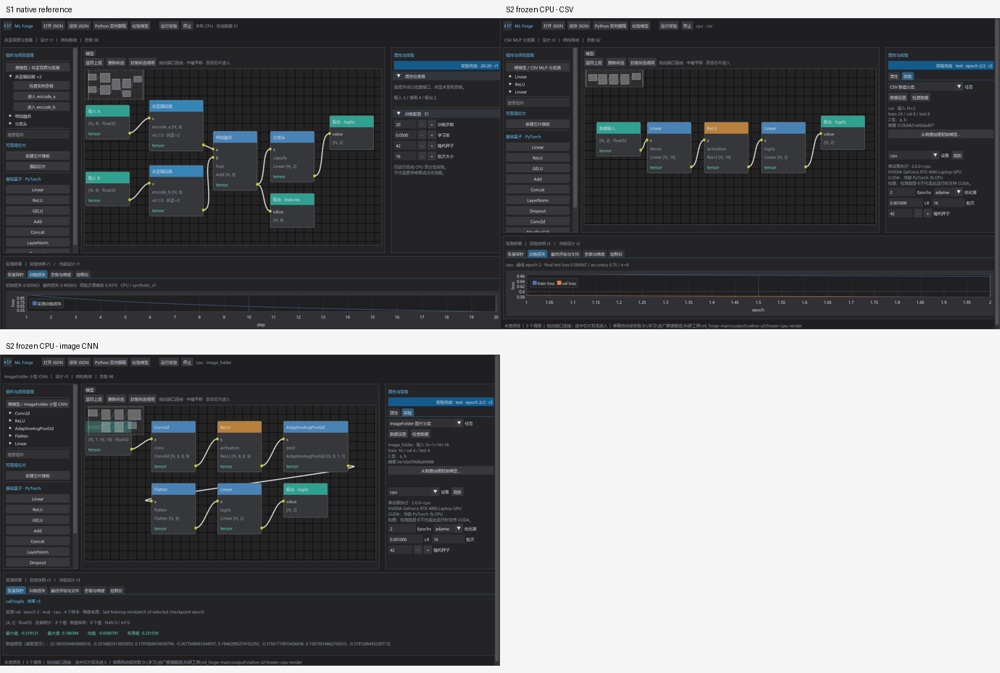

# S2 原生真实数据训练验收

核查日期：2026-11-14。本文件区分源码测试、冻结程序实测和设备证据。全部训练证据来自本地生成的小型 CSV/PNG 测试样例；不代表临床、基准数据集性能或跨机器兼容性。

## 已核实的 CPU 交付

- 原生 DearPyGui Windows 目录式 EXE：`studio/dist/desktop/MLForgeStudio/MLForgeStudio.exe`，与 `_internal` 一起分发。
- CPU 便携包：`studio/dist/desktop/MLForgeStudio-Windows-x64-S2-CPU.zip`。归档 CRC 检查通过；文件数、字节数、SHA256 见 `output/native-s2/archive-cpu.json`。
- 122 项 backend 测试通过；38 项 native 测试通过。原版 `ml_forge/` 业务文件在 S2 没有修改。
- 冻结程序真实 CSV MLP / 2D CNN 训练、train/val/test、独立 best checkpoint 推理、CPU epoch 边界精确恢复、CNN Python 导出/导入和独立模型前向均通过。
- 冻结程序自身 DPG 回调与 framebuffer 验证已通过数据读取、异步检查、起始模型替换确认、train/val 曲线、实际 val 探针、工作区保存恢复及设置变更后的过期结果提示。
- 冻结程序的 S1 合成训练、共享芯片内部探针、Python 非法草稿保留和取消退出也已回归通过。各诊断均确认其拥有的 worker 已退出。

## 已核实的 CUDA 交付

按用户授权另建 `studio/.venv-cuda`，使用 `torch 2.6.0+cu124`、CUDA 12.4、cuDNN 90100。原 CPU 环境复查仍为 `2.6.0+cpu` / CUDA=None。本地生成的 CSV 与单帧二维 PNG 小样例已完成源码和冻结 GPU 实际训练。

- 实际设备：RTX 4060 Laptop GPU，NVIDIA 驱动 560.94；nvidia-smi 报告 8188 MiB，Torch 设备属性向下取整报告 8187 MiB。
- CUDA EXE：`studio/dist/desktop-cuda/MLForgeStudio/MLForgeStudio.exe`，启动器 `studio/启动CUDA桌面版.cmd`；同样必须保留 `_internal`。
- 源码与冻结程序均在 `cuda:0` 实际完成 CSV MLP、包含四个新增算子的 CNN、train/val/test、best checkpoint 独立推理、epoch 继续训练与 CNN Python 往返。GPU 导出/重建前向在此固定样例最大绝对差为0；验证政策使用 rtol=1e-5/atol=1e-6，不推导一般逐位确定性。
- 源码与冻结 DPG 界面均通过显式选 `cuda:0` 后的两类实际训练、探针和工作区检查，设备列表含 `cpu` 与 `cuda:0`；诊断结束确认 worker 已停止。
- CUDA EXE 明确选择 `cpu` 后也通过完整分类运行诊断，证明同一 CUDA 程序内的两种设备选择均可实际执行。
- 在独立 CUDA 环境再次执行 122 项 backend、38 项 native 测试通过；其中许多回归明确在 CPU 上运行，不能把这些测试数量都称为 GPU 训练次数。
- CUDA 便携归档为 `studio/dist/desktop/MLForgeStudio-Windows-x64-S2-CUDA.zip`，CPU 与 CUDA 分开分发。归档身份和最终 CRC 见 `output/native-s2/archive-cuda.json`。

安装包来自官方 PyTorch cu124 索引，完整 wheel SHA256 与官方索引一致：`3313061c1fec4c7310cf47944e84513dcd27b6173b72a349bb7ca68d0ee6e9c0`。核查来源：`https://pytorch.org/get-started/previous-versions/` 与 `https://download.pytorch.org/whl/cu124/torch/`（2026-11-14）。官方版本页面快照保存在 `output/native-s2/official-pytorch-previous-versions.html`；没有下载模型、临床数据或修改驱动/网络设置。

目前只选择一个执行设备。多 GPU 数量选择、DDP、多机与远程调度未实现；本机通过不等于所有 GPU、驱动或 Windows 机器通过。

## 证据与复查命令

| 证据 | 文件 |
|---|---|
| 源码实际文件训练/精确恢复 | `output/native-s2/runtime-source.json` |
| CPU 冻结实际训练/独立推理/恢复 | `output/native-s2/runtime-frozen-cpu.json` |
| CPU 冻结 DPG 回调与截图 | `output/native-s2/render-frozen-cpu.json` |
| S1 冻结运行回归 | `output/native-s2/s1-runtime-frozen.json` |
| S1 冻结 DPG/芯片/Python/停止回归 | `output/native-s2/s1-render-frozen.json` |
| CPU 构建与 native 测试日志 | `output/native-s2/build-cpu.log` |
| CPU 便携包 CRC/SHA256 | `output/native-s2/archive-cpu.json` |
| CUDA 实际张量与设备版本 | `output/native-s2-cuda/device-smoke.json` |
| CUDA 源码训练与续训 | `output/native-s2-cuda/runtime-source.json` |
| CUDA 冻结训练与续训 | `output/native-s2-cuda/runtime-frozen.json` |
| CUDA EXE 选择 CPU 的真实训练 | `output/native-s2-cuda/runtime-frozen-cpu-choice.json` |
| CUDA 源码 DPG 实训 | `output/native-s2-cuda/source-render/render.json` |
| CUDA 冻结 DPG 实训 | `output/native-s2-cuda/frozen-render/render.json` |
| CUDA 构建与 native 回归 | `output/native-s2-cuda/build-cuda.log` |
| 两个环境包版本清单 | `output/native-s2/packages.json`、`output/native-s2-cuda/packages.json` |
| CUDA 便携包 CRC/SHA256 | `output/native-s2/archive-cuda.json` |

源码仓库保留的精简验收摘要见 `docs/评审附件/2026-11-14-S2验收记录.json`，包含程序/便携包身份和源码文件摘要；完整 `output/` 日志和测试产物不进入源码归档或 Git。

从仓库根目录执行：

```powershell
$env:PYTHONPATH=(Resolve-Path '.\studio').Path+';'+(Resolve-Path '.\studio\backend').Path
& '.\studio\.venv\Scripts\python.exe' -m unittest discover -s studio/backend/tests -v
& '.\studio\.venv\Scripts\python.exe' -m unittest discover -s studio/native/tests -v
& '.\studio\build-desktop.ps1' -Runtime CPU
# 已有独立 CUDA 环境时，输出另一个目录，不覆盖 CPU EXE
& '.\studio\build-desktop.ps1' -Runtime CUDA
```

EXE 诊断入口为 `--self-test REPORT`、`--render-check REPORT`、`--classification-check REPORT`、`--classification-render-check REPORT`；用 `--data-dir DIRECTORY` 隔离测试状态。分类诊断可显式指定 `--check-device cpu` 或一个可用的 `cuda:N`。在脚本中启动窗口式 EXE 时应等待进程退出，并核查退出码、报告状态和 `workers_stopped`。

## 数据、检查点和测量语义

- 标准化只拟合 train。支持显式 split、CSV group 隔离和可复查的内容摘要；实际预处理后的 float32 输入也检查跨 split 重复，避免不同 float64 值舍入后造成泄漏。
- 数据重新读取会核对内容；二次全量核对和懒加载同样响应取消与运行期限。只对白名单系统/同步 sidecar 进行显式审计忽略，未知文件或损坏图片仍报错。
- best 仅按 val loss 选择；test 在成功训练后加载 best 最终评估一次。反转验证标签的回归用例确认 best 可以早于 last。
- checkpoint 保存模型、优化器、RNG、shuffle、完整 epoch 与 best 状态；不把取消请求当作已保存任意 minibatch。图、数据、预处理或训练关键设置改变会拒绝不兼容恢复。
- CPU 连续训练与分段恢复逐位一致已验证；跨设备与 CUDA 不承诺逐位一致。
- 张量探针来自选定 best 的实际 val/eval 批次。梯度来自选定 epoch 的最后训练 minibatch；参数更新范数比较初始化与该 checkpoint，不能解读成该 val 批次的梯度或单次更新量。
- 控制消息采用有限 JSON 和 2,000,000 字节边界；过大仪表摘要转存文件。运行配置记录 Python、PyTorch、Pillow、平台及实际 CUDA/cuDNN 版本。

## 原生视觉检查

使用程序自己的 framebuffer，未调用 Use Computer、Windows 输入自动化或浏览器。将 S1 原生参考与 S2 冻结 CSV/CNN 同屏对照，保留组件库、中央网格、属性/实验与底部仪表的关系。CNN 起始图为两行；节点矩形检查无重叠。train/val 两个图例改为水平排列，解决短图表的文字裁切。



## 明确边界

S2 支持数值 CSV 和普通单帧二维 ImageFolder 分类，单输入、命名 logits、SGD/AdamW；保留共享实例、嵌套芯片和受支持 Python 静态往返。Python 导出当前是独立模型源码，未导出完整数据/训练工程或权重。

尚未完成 DICOM/NIfTI、3D、分割/检测、多模态、报告生成、LLM 微调、RAG、传统 sklearn 算法插件、参数扫描、历史实验浏览器及完整实验包双向导入。ImageFolder 的内容查重不等于患者级隔离，患者多图需要预先按患者拆目录。源码/EXE 本机通过不等于其他 Windows 机器或全部 CUDA 设备已经验证。

GitHub 上传按用户要求暂停，没有创建远端仓库、添加协作者、部署或发布。本地源码压缩包与便携包不代表已经上传。
