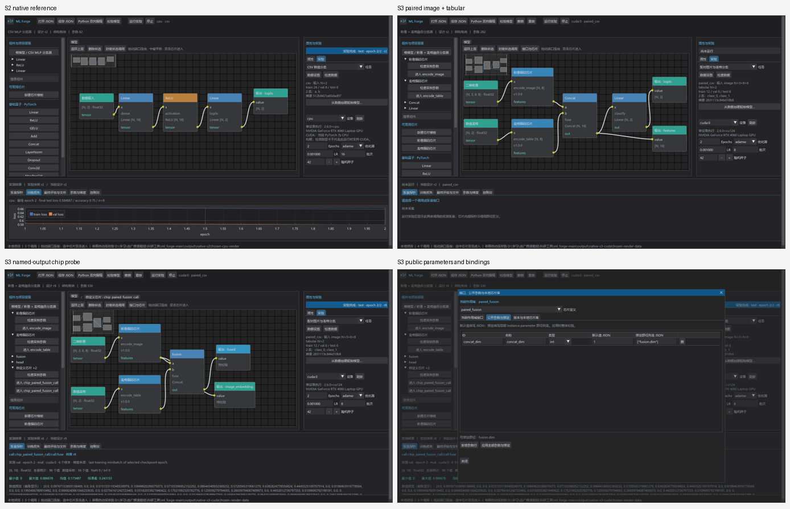

# S3 自定义芯片与配对输入验收

客户端核查日期：2026-11-15。本阶段落实已批准路线的第一部分：可编辑、可复用的具名多输出芯片，以及图片/表格配对分类。训练证据均为生成的小型 CSV/PNG 测试样例，不代表临床或公开基准性能。

## 源码关口

- CPU 与 CUDA 两个环境的 backend 均运行175项测试，结果 OK，包含1项 Windows symlink 创建权限跳过；直接路径越界和内容隔离用例实际通过。跳过不被计作已验证。
- CPU 与 CUDA 两个构建环境的 native 均运行67项测试，全部通过；其中包含原 S1/S2 真实训练回归、新接口/芯片库/undo、paired 数据与正式 DPG 回调。
- 使用原生 DearPyGui 的回调和 framebuffer，不使用 Use Computer、桌面输入自动化或浏览器。原版 `ml_forge/` 业务文件保持不变。

## 本阶段功能及语义

| 能力 | 本阶段实现与验证 |
|---|---|
| 具名端口 | `call:id:port`，多输出必须选择端口；单输出保留旧别名；未知/歧义来源拒绝 |
| 芯片执行 | 多输入输出、嵌套、同实例多次调用；手写参考比较输出、梯度与更新，避免重复调用/克隆 |
| 接口编辑 | 当前 scope 增删/重命名接口、修改形状，调用方同步迁移；被消费端口需先断开 |
| 公开参数 | auto/int/float/bool/shape 与 immediate `instance.parameter` 绑定；嵌套类型和上层绑定删除保护 |
| 语义撤销 | 一次命令一条历史；最多32状态/32MiB；多选删除失败整体回滚；移动和实验配置不在该历史内 |
| 版本芯片库 | `.mlfchip.json` 含架构及依赖闭包；版本不可覆盖，冲突 ID 一致重命名，合并限额检查；不包含权重 |
| 配对数据 | 每行绑定 sample_id、image_path、数值特征、label、group、split；同一 DataLoader 保持对齐 |
| 数据隔离 | group 与图像路径/有效内容跨 split 隔离；标准化只拟合 train；不同患者相同数值特征允许 |
| 真实训练 | 两路映射 image/tabular → 默认 image/clinical；CPU 或一个 cuda:N；val 选 best，独立 test、逐样本预测 |
| 恢复和重现 | CPU 完整 epoch 恢复逐位一致；CUDA 验证连续性和独立推理容差，不承诺一般逐位确定性 |
| Python | `ports-pytorch-v3` 静态 dict 返回/选择；公开类型、隐式默认继承、显式覆盖和绑定均保留；独立 Model 不依赖本平台 |

封装保留原片段，并创建独立芯片实例；只保持芯片内部共享，不默默捕获边界外的权重别名。之后“共享调用”才复用该新实例。接口、公开参数和芯片库错误均不得留下部分提交。

## 图—代码一致性

本轮额外发现并修复了公开类型丢失、隐式参数被补为显式覆盖、绑定目标的无效原始值、等价输出别名和实际执行拓扑顺序造成的假身份变化。S3 使用语义规范化；S2 黄金摘要保持兼容。默认值继承与明确固定值仍有不同身份，不能混为一类。

正式 native 验收在未清空数据摘要前，要求“同代码导回后测量仍有效”，同时检查类型、默认值、绑定、端口与布局。工作区重开之后则明确需要重新检查外部文件，不使用该状态掩盖往返问题。

根/嵌套输入输出布局通过 visual metadata 按 ID 恢复；形状、构造器、端口选择、连线和冻结语义由当前源码决定。无法表达的跨层递归强制解冻会明确拒绝，避免导入成功却训练不同参数。任意 Python、动态 selector 和未支持的库调用没有无损导入保证。

## 构建与原始证据

CPU EXE：`studio/dist/desktop/MLForgeStudio/MLForgeStudio.exe`。CUDA EXE：`studio/dist/desktop-cuda/MLForgeStudio/MLForgeStudio.exe`。二者均须与 `_internal` 一起移动；用户状态保存到可写的数据目录。旧 S2 ZIP 保留。

| 证据 | 路径 |
|---|---|
| CPU backend | `output/native-s3/backend-cpu.log` |
| CUDA backend | `output/native-s3-cuda/backend.log` |
| CPU 构建/native | `output/native-s3/build-cpu.log` |
| CUDA 构建/native | `output/native-s3-cuda/build-cuda.log` |
| CPU 源码运行 | `output/native-s3/runtime-source-cpu.json` |
| CUDA 源码运行 | `output/native-s3-cuda/runtime-source.json` |
| CPU 源码 DPG | `output/native-s3/source-render/render.json` |
| CUDA 源码 DPG | `output/native-s3-cuda/source-render/render.json` |
| CPU 冻结 EXE 运行 | `output/native-s3/runtime-frozen-cpu.json` |
| CUDA 冻结 EXE 运行 | `output/native-s3-cuda/runtime-frozen.json` |
| CPU 冻结 EXE DPG | `output/native-s3/frozen-render/render.json` |
| CUDA 冻结 EXE DPG | `output/native-s3-cuda/frozen-render/render.json` |
| CUDA EXE 内显式选择 CPU | `output/native-s3-cuda/runtime-frozen-cpu-choice.json` |
| 新 CPU EXE 的 S1 训练/取消回归 | `output/native-s3/s1-runtime-frozen.json` |
| 源码包内可携带验收记录 | `docs/评审附件/2026-11-15-S3验收记录.json` |

新增诊断：`--s3-check REPORT`、`--s3-render-check REPORT`，均接受 `--check-device cpu` 或明确的 `cuda:N`，并用 `--data-dir DIRECTORY` 隔离状态。退出码、报告和 `workers_stopped` 必须共同核对。测试 fixture 和完整 output 日志不进入源码包。

上述10份源码/冻结诊断报告均为 `status=passed`，退出码为0，并确认 `workers_stopped=true`。冻结 CPU 与 CUDA EXE 均实际完成嵌套多输出芯片的配对分类训练、同实例共享、best checkpoint 独立推理、完整 epoch 恢复、工作区/芯片库重载，以及带/不带 visual metadata 的 Python 往返和独立 Model 推理。GPU 验收实际使用 RTX 4060 Laptop `cuda:0`，不是仅检查设备列表。CUDA EXE 内另行显式选择 `cpu` 的同一路径也通过。

CPU 恢复比较包含模型、优化器、RNG、shuffle、历史和指标逐位一致；CUDA 只声称续训成功和输出容差验证。两版正式 DPG 检查均确认未编辑 Python 导回后测量仍有效，工作区重开后则需要重新检查外部数据。后者有意令旧摘要失效，不代表往返身份错误。

CPU 运行时为 `torch 2.6.0+cpu`；CUDA 运行时为 `torch 2.6.0+cu124` / CUDA 12.4，验收显卡为 NVIDIA GeForce RTX 4060 Laptop GPU（约8GB），驱动560.94。所有性能或准确率数值仅来自生成 fixture，不作为科研效果结论。

## 便携包、源码包与界面复核

两个 S3 便携 ZIP 已逐文件检查 ZIP CRC，并重新核对整体 SHA256、文件数、大小和归档中 EXE 与当前 EXE 的一致性：

| 文件（均在 `studio/dist/desktop/`） | 文件数 | 字节数 | SHA256 |
|---|---:|---:|---|
| `MLForgeStudio-Windows-x64-S3-CPU.zip` | 2121 | 149586511 | `17fb00be3b3e6b887c1bf1e3bdda228092046ed873f3a49d10a8a777843cc63b` |
| `MLForgeStudio-Windows-x64-S3-CUDA.zip` | 2139 | 2474635489 | `2c600092b2f3a9fa26b1f490f4668feb631d8278f60c641ebf64df50baad5f66` |

源码 ZIP 为同目录的 `MLForgeStudio-source-S3.zip`，包含本说明与可携带验收记录，不包含环境、build/dist、output、临时工作文件或生成测试数据。源码 ZIP 的最终 CRC、逐项源码匹配结果和 SHA256 保存在本地 `output/native-s3/archive-source.json`；它自己的哈希不会写回 ZIP 内，避免自引用。S1/S2 旧 ZIP 保留。

可携带记录保存上述10份报告的状态/哈希、测试数量、当前 EXE 和便携 ZIP 身份、64份纳入源码包的 Studio Python 文件哈希以及设备边界。原始诊断报告、日志和 fixture 仍留在本地 output，未打入源码包。

界面复核使用原生 framebuffer，并将 S2 参考、S3 配对起始图、芯片端口探针和公开参数面板放入同一对照图查看。当前起始图未见裁切/节点遮挡，芯片输出端口和公开参数字段可见。截图本身不替代上述回调与数值断言。

独立截图：[配对起始图](../../docs/images/native-s3-paired-starter.png)、[芯片探针](../../docs/images/native-s3-chip-probe.png)、[公开参数](../../docs/images/native-s3-chip-public.png)。

## 保留的后续边界

数据适配器当前是二维图片/数值表格配对分类；不等于任意多模态。模型接口和端口机制可扩展，训练仍使用分类协议。损失/优化器关系画布、交互式 backward 单步、完整实验工程导出、3D/分割、LLM/RAG、多 GPU/远程均尚未完成。

本机验收不是所有 Windows/驱动/显卡的兼容性证明。GitHub 上传继续暂停；没有创建仓库、添加协作者或发布。
