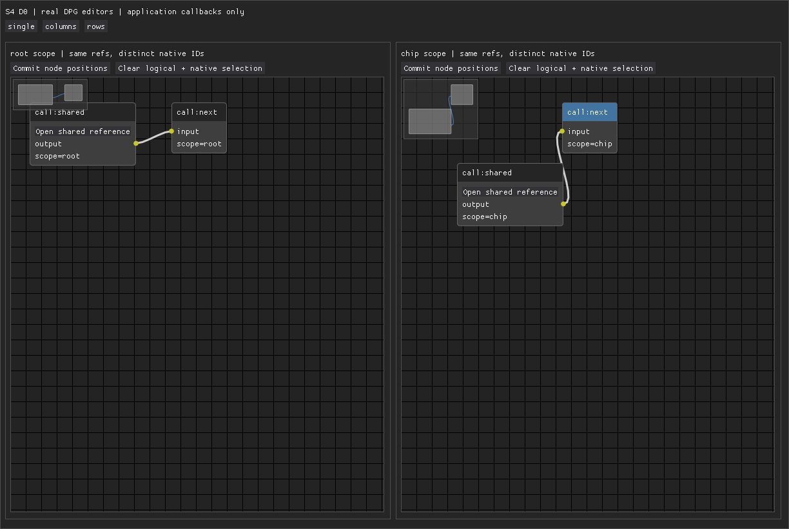

# S4 D0 前置验证与交接

日期：2026-11-16。当前软件仍为S3；本轮交付独立预算审计、原生双editor诊断和回归证据，没有将多页签或ResNet加入正式程序，也没有重建EXE/ZIP。

## 结论与关口

**A0、B0两项调查任务已经完成，D0的Go关口尚未全部通过。** 双editor的限定应用回调/控件状态验证通过；候选ResNet18预算仅改batch上界仍超限，需要先修订新profile的计费契约。

| 事项 | 结果 | 能说明什么 |
|---|---|---|
| 两个真实DPG editor | 限定验证通过 | 不同原生ID，同名模型引用可隔离；连线/删线owner检查正确 |
| 隐藏显示、横/竖分屏、resize | 原生editor/node/port/link ID保持 | 常驻控件可用作后续CanvasHost基础；不是精确pan/zoom恢复证明 |
| 真实Document布局写入 | 芯片节点改变，根图同名节点未变；语义和revision未变 | 应用注册回调可以保持明确scope归属；不等于B1作用域适配器已交付 |
| 清理失败路径 | 首审P2已修复，范围复审接受 | destroy_context失败不再记成功；原业务/清理异常保留 |
| ResNet18候选参数/单张量 | 纯数学算例可容纳 | 不是平台网络前向或训练实测 |
| 同一候选树全部静态累计计费 | batch1=148,151,712；batch2=296,303,424，均超134,217,728 | 仅改null batch替代数不能通过；预算策略仍未实现/验收 |

独立审查按scope深度重新展开账本，与A0数值一致。这里的候选是根→entry→stage→block→projection、17个独立定义、69个primitive、每实例单call、根只输出logits。未来定义复用、额外输出/Identity或公开参数变化都须对真实生产闭包重新验证，不能把条件数字当作任意ResNet实例的实测。

## 已交付的可运行检查

- `studio/backend/tests/vision_budget_audit.py`：纯数学、标准库审计夹具；不导入torch或生产shape helper，不生成可执行图。
- `studio/backend/tests/test_vision_budget.py`：17项现状和独立算例测试，包含旧小型ReLU图batch65实际前向、旧限制边界和嵌套计费核对。
- `studio/native/canvas_capabilities.py`：独立DPG诊断CLI，不由生产ui.py导入；真实context/viewport/editor、应用回调、framebuffer和清理记录。
- `studio/native/tests/test_canvas_capabilities.py`：6项实际控件/回调测试，包括清理失败的三个子场景；没有mock整个DPG。

复现（项目根目录，使用已存在环境）：

```powershell
$env:PYTHONPATH=(Resolve-Path '.\studio').Path+';'+(Resolve-Path '.\studio\backend').Path
& '.\studio\.venv\Scripts\python.exe' -m unittest discover -s studio/backend/tests -p test_vision_budget.py -v
& '.\studio\.venv\Scripts\python.exe' -m unittest discover -s studio/native/tests -p test_canvas_capabilities.py -v
& '.\studio\.venv\Scripts\python.exe' -m native.canvas_capabilities --output output/native-s4-d0/canvas
& '.\studio\.venv\Scripts\python.exe' studio/backend/tests/vision_budget_audit.py
```

诊断窗口是开发验证工具，不是新的正式工作台；无需Use Computer或OS输入自动化。ResNet生产模型、预训练权重、BN执行核心、新profile和Python v4都未在本轮实现。

## 测试及原始证据

| 检查 | 实际结果 | 本地证据 |
|---|---|---|
| A0新增定向 | 17项通过，退出0 | `output/native-s4-d0/core/a0-tests-green.log`与exitcode |
| A2未来API红灯 | 缺少bounded_elements，预期退出1；位于SDD，不进入默认suite | `output/native-s4-d0/core/a0-future-policy-red.log` |
| B0新增定向（修复后） | 6项通过，退出0 | `output/native-s4-d0/canvas/tdd-cleanup-green.log` |
| B0独立CLI | passed，context_destroyed=true，退出0 | `output/native-s4-d0/canvas/diagnostic-run.log`及JSON |
| CPU完整backend | 运行192项，unittest结尾OK（1项symlink权限跳过） | `output/native-s4-d0/backend-cpu-full.log/json` |
| CPU完整native | 73项全部通过，退出0 | `output/native-s4-d0/native-cpu-full.log/json/exitcode` |

backend测试子进程完成后，包裹脚本按UTF-8读取混合Windows日志发生解码错误，未持久化子进程退出码；因此不声称已捕获backend退出0。已直接核对原日志的192项及OK(skipped=1)，没有为重新生成摘要重复测试。包裹脚本失败与测试断言失败分开记在JSON中。

既有回归包含微型合成模型和生成CSV/PNG的反向/优化/短训练；这些是旧流程回归，不是ResNet或新S4组件训练。未启动独立科研训练、长训练、临床数据任务或下载/安装。A0执行者对简报“不要训练”的字面偏差已保留在实施报告，不删除原始记录。

当前97份既有Python源文件按执行前基线保持不变；新增的四份D0诊断/测试文件不进入该97份的“原样”声明。原ml_forge业务、生产schema/runtime/ui/Document、原测试、S3 EXE和ZIP未改写。源码变更和报告哈希见[可携带核查记录](../../docs/评审附件/2026-11-16-S4-D0验收记录.json)。

## 原生画布证据与能力边界

下面是独立诊断真实framebuffer，保留不同scope的相同节点引用；不是正式S4界面：



公开API仅有节点选择get/clear，未找到选择setter或node-editor精确pan/zoom读写。逻辑selected_refs及主题高亮与原生ImNodes选择位严格区分。正原生选择、真实鼠标拖动/连线/双击、minimap鼠标导航、非零pan后的保持均未验收。应用直接调用已注册callback只证明该应用路由，不证明实际手势投递。

完整资料：[核心预算验证](../../docs/评审附件/S4-D0核心验证.md)、[画布验证](../../docs/评审附件/S4-D0画布验证.md)。原始逐scope/leaf账本、源文件事实快照、API签名、逐事件日志和single/columns/rows图片在 `output/native-s4-d0/`。

## 接下来的明确任务

1. A1可独立实施统一算子和BN四组合状态；B1可独立实施WorkbenchState及view_scope。它们不以候选ResNet预算通过为前提。
2. A2先修订仅新profile的计费：区分有界编译/全部定义验证工作与根执行累计元素，或缓存纯shape/参数计算；不合并真实调用，不跳过定义合法性，不提高旧档全局阈值。该设计需独立账本/反例验证，不保证候选方向已经可行。
3. A4/正式ResNet及完整多页签集成仍按总计划后续验收。S4完成度不由本次调查通过数推算。

GitHub继续暂停，没有创建远端、提交、协作者或发布。
